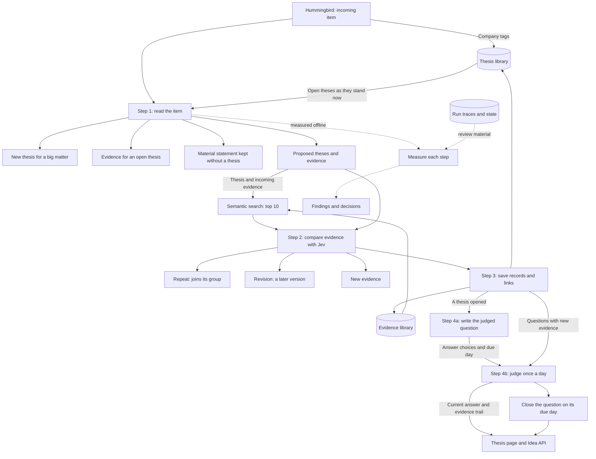

# Hivemind architecture: a market world model built the way a hedge-fund analyst works

**Status, 2026-11-16: working design of the rebuilt pipeline ("the new system", this folder).** Step 1 runs the adopted request c8
(D387). Step 2 and Step 3's grouping are frozen (D427). Step 4's ladder step is built and frozen as it ran (D426); production's frozen
judge follows it. The new system has not yet passed the gates that would let it replace the running pipeline (section 8). Until it
does, the running pipeline (`poc/config/poc-v118.json`) stays the default and both are kept (D544). Six choices wait on Alex
([decision page](../docs/research/2026-11-14-use-acceptance/DECISION-PAGE-2026-11-16.md)). Nothing here is deployed.

**How to read this document.** Section 1 says what the system is for, the problems it answers and what it does differently. Section 2
is the picture. Sections 3 to 7 define the information and each step. Section 8 says how each step is measured and where it stands.
Sections 9 to 11 walk one item through, list what is open and draw the boundary. Sections 12 and 13 hold the two frozen requests word
for word. Sections 14 to 16 map the code, record the future design for links across companies and point to the earlier record.

## 1. Vision, problems and what is done differently

### 1.1 The vision: a market world model

Alex set the purpose when this architecture started: "the purpose of this system is to build a hedge fund brain, it is building the
decison process for hedgefund analyst to source data and extract information (thesis) and link evidences for keeping it's dossier of
events that impact the assets and events in the world" (2026-11-06).

He now calls it a market world model (2026-11-16). In this document the phrase means one concrete thing: **a standing, dated record of
the open investment questions about each company and theme, which only new information moves and which closes each
question on its due day.** For each question
the record holds:

- **The question, fixed when it opened**, with its possible answers and its due day written before any evidence is judged. Alex:
  "一条观点一定是有一个明确的 ladder 和到期日，这样才构成一个观点呀" (D38).
- **Every statement that bears on it**: who said it, when, where it was reported, and every later report or revision of it.
- **The current answer and its history.** The answer moves only when new information arrives. Alex: "有相关的信息抽取出现，自然会影响整个系统抽取的thesis 向前" (D13).
- **The final answer on the due day.** Alex: "最后到期日的状态就定格就好" (D54).

The whole system builds, updates and retires that record. Alex: "其实整个system做的事情就是建构，更新，删除这个data structure" (D26).

**One picture.** On NVIDIA, a report says it may back OpenAI's lease of a large data center in Ohio. The record opens one question:
"Will NVIDIA sign a guarantee or backstop for OpenAI's Ohio data-center lease by 2027-12-31?" Its answers are fixed at opening: it
happened, it is ruled out, or still open; due 2027-12-31. The amount of the guarantee is listed as a part not judged. Every later
report of the same story joins one group instead of counting again. A company denial is filed as a later version of the report. The
answer moves only on a statement that changes it. On the due day the answer is closed and kept.

**Why a reader uses it.** Alex: "it's like a dossier, right? Or it's like a reference where people can anchor their beliefs, or they
can check whatever they're thinking, whether it's already priced in, or, you know, how single factors evolve. I don't think the value
is in, like, having an idea and basically just constructing alpha" (2026-10-22). The gap it closes: "大部分的人, 每一天都会有很多信息,
但这些信息怎么变成交易? … 你要拆解这个信息, 理解它背后的驱动力啊, 哪些因子会影响他 … 这个才是真正中间转移的痛点" (2026-10-22). On a
page: "一个用户的thesis 可以直接被拆解成可以理解的证据，并且看得到证据过去变化的历史" (2026-10-24).

**What it is not.**
- Not a tracker for a view the user already holds. Alex rejected that framing: "我只是把这个东西当成一个跟踪工具, 我就是完全是不对的呀"
  (2026-10-22). The system forms the questions itself, before any user asks.
- Not a price forecast or an alpha engine (his words above).
- Not yet a judge of what is priced in. The record keeps the expectations it reads (a consensus estimate, a company's guidance) as
  evidence, and a figure's ranges may be set against a consensus (section 7). But no step compares a judged answer with what the
  market already prices, so the record cannot by itself say whether an answer is in the price (section 10).

### 1.2 The problems it answers

Three things make an analyst's job hard, and the record is built against each:

1. **Most of what arrives is noise; the increment is rare.** Alex: "不是什么事情都是惊弓之鸟需要抽取，杂音还是很大的，我们整体应该倾向谨慎…同时我们要敏感一些新的信息带来的增量不要错过" (D243).
   The system keeps few statements and only big questions. Alex: "我觉得核心就是这个颗粒度的把控要符合一个高端的hedge fund analyst 的思维。不要搜集一堆鸡毛蒜皮的事情，要看重要的大事，合并整合关键的信息" (D248).
2. **One statement arrives many times.** The same forecast comes through many outlets and reposts. Counted as many, it fakes
   conviction. The record keeps it as one statement with all its sources (section 6).
3. **An answer written from scratch has no memory and no score.** It cannot say what it concluded two weeks ago, what changed it, or
   whether it was right. The record fixes the question and its answers first, dates every judgement with its evidence, and closes the
   answer on the due day.

**Why one model call over everything does not do this.** Alex, on asking a general model to research theses: "it's actually very, very
hard because it hallucinates, it, you know, it doesn't really work" (2026-10-22). Two measurements point at what breaks:
- **Too much material in one request fails.** In a three-month run the data-center revenue question held 1,768 linked pieces. Its
  judging request was 292 KB with 698 evidence ids. The judge mislabelled ids, its answers were refused, and whole days halted (D358;
  Alex: "bloating evidence 的问题 … 很严重，需要解决").
- **The reasoning is not the bottleneck; delivering the right facts to the right question is.** The custom-chip question, sent as it
  was, answered "below $40 billion" 9 times of 9. With the Broadcom and Trainium facts the ledger already held added, it left the
  lowest range 9 times of 9 and reasoned as the expert readers did (`docs/prd/10-filing-phase.md`, Evidence).

So the architecture puts its effort into reading, filing and grouping, and keeps the judge small and fixed. No test has compared the
system with a single general-model call on the same questions; the case rests on the measurements above.

### 1.3 Why the running pipeline was rebuilt

On 2026-11-06 Alex sealed the running pipeline's line of work and restarted the design. "好的我觉得你先clean up封存这个版本吧。我要重新梳理系统设计" (D379).
"之前所有的rules decisions 你可以参考，但是我们要重新开始做一个干净的". "之前很多的carry over 是不正确的 … 我觉的我们first principle 重来".
He named the shape that does not scale: "thesis counts are okay after it grows, like <100, but evidence attached grows, so if feeding
into the extraction it's too much context". And he drew the new one: "{thesis, evidences} extraction in pairs, with what existing thesis
that is outstanding as input context … then in the nex stage I can just dedup this evidence without having the need to read the full
evidence"; "there should be like a search engine overlay on top of evidence db for a {thesis, evidence} to return the top-10
semantically relevant evidence" (all 2026-11-06; his [diagram](reference-diagram.png)).

The running pipeline's measured problems:

| Problem | What was measured | Source |
|---|---|---|
| Evidence piles up under a few questions | 1,768 pieces under one question; a 292 KB judging request; refused answers halted days. | D358 |
| A fact with no question is thrown away | 441 statements dropped as "no home" over three draws; 60 of 213 missed helpful matters were written, then dropped. In one fresh week, 278 thrown away. | `docs/prd/11-production-experiments-from-split.md` E1; `docs/research/2026-11-14-use-acceptance/week/WEEK-RESULT.md` |
| A fallback parks what filing cannot place | Under the total-revenue question, 32–39% of its reports are ones the standard does not keep and only 7–10% are what the gold uses; 24–44% of its judgement citations are about other companies or the whole market. | `docs/prd/10-filing-phase.md` |
| Narrow questions starve | The custom-chip question received none of Broadcom's figures in three draws; operating margin and NVIDIA's capital spending were never judged. | `docs/prd/10-filing-phase.md` |
| Questions crowd into financial lines | Alex: "永远都是一堆财务指标，真正的观点呢？" | D164 |
| The same bet opens twice | One bet split on a fine detail; ten re-sends of one stored request opened a duplicate twice. | D354 |
| Earlier versions are searched by shared words inside one question | 82.1% of known earlier versions found; a newly opened question gets no history. | [Step 2 log](step2-validation-2026-11-07/LOG.md) |
| Answer choices written by extraction can be inverted or empty | A favourable rung holding the unfavourable range; a band missing its reference; a rung with no value. | `docs/prd/11-production-experiments-from-split.md` E3 |

### 1.4 What the new system does differently

| Choice | Running pipeline | New system | Shown so far |
|---|---|---|---|
| What reading an item sees | Open questions with filing guidance, from the start of the day. | Every open thesis as the previous item left it, and never the evidence history (section 4). | The request no longer grows with the evidence. |
| What opens a question | Extraction proposes candidates with answer choices; a matcher and a collision judge decide. | Step 1 decides in the same reading, and only for a big matter; a company's own figures are conditions, not questions (D382, D384). | 1 of 10 opened wrongly on 50 fresh articles (D386). Opening is also where it loses most against the ruler (section 8). |
| A useful fact no question takes | Thrown away. | Kept without links, and offered to each new question when it opens (D383). | 0 thrown away against 278 in one fresh week; but 389 of 569 kept statements were read by no judgement that week (section 10). |
| Finding the earlier version of a statement | Shared words, inside one question. | Semantic search across the company, then Jev compares (section 5). | 141 of 143 earlier versions found; 1 clear wrong merge in 57 (D386). |
| The same statement reported again | A separate record. | One group; each report keeps its own text and source (section 6). | Later details are kept (22 = 22, a storage check). Copies are still 31–34% of what the judge reads, against 26–31% in the running pipeline. |
| Answer choices | Written by extraction with the candidate. | A separate step at opening: an event has three outcomes; a figure has five ranges against a reference with the favourable end registered; the due day follows rules (section 7). | Its quality gate is not met (section 8). |
| Judging and closing | The frozen judge, daily; closing on the due day. | The same judge and the same closing, unchanged (D354, D567). | By design, differences come only from what reaches the judge. |

On the frozen extraction gold, Step 1 keeps more of what matters: helpful 214, 211 and 212 of 234 in three draws, against 167, 171 and
162 for the running extraction (core 85–86 of 86 against 75–76). The running pipeline's draws were stored runs from another day, so
this is a lead, not a same-day comparison.

**What is not shown yet.** That the new system gives better answers end to end. Every comparison so far is a diagnostic: the seeded
test was inconclusive (18, 18, 17 against 17, 15, 16 of 23); on one fresh week the difference was "not clear" by the rule written
beforehand (D489). The weakest point is named (D559): the system often cannot turn an important matter into a question it can answer
and follow. It also costs more: about $3 a draw for the whole new system (Step 1 about $2.5 of it) against about $0.45 for the running
pipeline, and about 2 hours 20 minutes a draw because items are read one after another (an estimate,
`e2e-comparison-2026-11-13/SLICE-RESULT.md`). Correct comes
before cheap; cost is recorded as a baseline.

### 1.5 What decides that it replaces the running pipeline (D665, superseding D548's gate order)

Alex asked the council to determine whether the six lines still make sense and what decides readiness (D664: "does it make sense now run your
council to determine"). The council's consensus is D665.

**The release decision is one product comparison against the running pipeline.**
- **The systems.** poc-v118 is replayed against the new system as configured and hashed (astra-frozen; v5.5 excluded). Both start from empty
  over 2026-07-01 to 07-19, three draws each, and are scored on the unread weeks from 07-20 up to 09-20, as far as the full exposure census
  supports.
- **The main quantity: big matters served.**
  - Both reader families list the scored weeks' big matters from the articles, blind to any output, and freeze the list.
  - A system serves a matter when, in at least two of three draws, it holds a question both families mark worth tracking and whose latest
    answer both mark supported. The cards are read by the council (D663), with Alex spot-checking splits.
  - With a = matters served only by the new system, b = only by the old, and N = all listed matters, written before the first send and computed
    under both split countings:
    - **Practical lead:** a − b ≥ max(3, 15% of N) and a ≥ 2b. Every guardrail subgroup must meet its frozen minimum and pass under both
      countings.
    - **Practical loss:** the mirror of the lead, or a guardrail breach confirmed under both countings.
    - **No practical winner:** everything else, including a verdict a split could change, or a guardrail that was not exercised.
    - **Too small:** fewer than 20 distinct matters, or fewer than 30 distinct questions per system per draw.
    - **Invalid:** a planted wrong answer accepted, fewer than 3 of 4 supported controls accepted, or fewer than 2 of 3 repeats marked the same.
- **The guardrails:** the unsupported share for figures, the unsupported share for yes/no questions, and the not-worth-tracking share, none
  more than 10 points above the old system's. D428's original limits are printed beside them.
- **Printed beside the verdict, not deciding:** a sign test and an interval (illustrative unless the frozen grouping supports them); the
  frozen-reference reading of 07-01 to 07-14 (D431, superseded on this point only); and the proposed absolute floors.
- **Kept from the earlier gates:**
  - **The six lines of D400** are measured and reported on every ladder run. They no longer block release.
  - **The parts code decides stay hard checks:** figure ranges meet end to end; the favourable end is the same across sends; the due day is
    consistent in at least nine of ten.
  - **Step 2's three checks stay,** as D427 and D431 set them.
  - **Stage B's control line waits** with D658.
- **Back to Alex,** before any release engineering resumes:
  - a practical lead, with the split cards for his spot check;
  - a practical loss, at once (D544);
  - no practical winner, too small, or invalid, with the counts;
  - no verdict by 2026-12-01.

| Earlier gate | Now |
|---|---|
| 1. The ladder step (Stage A), Alex's six lines (D400) | Reported on every run. Its code-decidable parts are hard checks. Not passed in nine readings |
| 2. The judge on the system's own questions (Stage B, D428) | Its unsupported shares become the comparison's guardrails. Its control line waits (D658). Not passed: 4 of 8 controls |
| 3. End to end against the running pipeline (D427, D431) | **The comparison above.** The frozen-reference reading is printed beside it |
| 4. Use on unseen news (D484) | Folded into the comparison, which runs on unseen weeks. Its proposed lines are printed beside it |
| 5. Integration and release | Waits for a practical lead and Alex's word. Partly built (D570–D573; the D593 test-store contract); held by D662 |

## 2. Architecture at a glance



An item travels down the left half: it is read once, its statements are compared with what the library already holds, and the result is
saved. The bottom of the picture is the judgement, which runs on the saved library and never on the item alone. Measurement sits to the
side: it reads traces and never gates the live path. The thesis library and the evidence library are logical stores; today both live in
one ledger file. The [original diagram](reference-diagram.png) is Alex's starting picture; this section is its clarified form.

| Part | What it receives | What it produces | Where it stands |
|---|---|---|---|
| Hummingbird stream | Incoming material from its event pipeline. | An item with its source information. | Stand-in: the local source database (section 14). The live Hummingbird contract is not established. |
| Thesis lookup | The item's company tags. | Every open thesis for those tags, as the library stands after the previous item was saved. | One company at a time; links across companies are future design (section 15). |
| Step 1 | The item and the open theses. | Evidence for open theses; a new thesis, with its evidence, for a big matter; material statements no thesis takes, kept without links. | Adopted: request c8 on DeepSeek Flash at high effort (D387; section 12). |
| Semantic search | Each thesis and incoming evidence. | Up to 10 earlier records of the same company per query. | Frozen (D427; section 5). |
| Step 2: Jev | The incoming record and the returned candidates. | Repeat, revision or new; and, when a thesis opens, whether each earlier unlinked record informs it. | Frozen (D427; sections 5 and 13). |
| Step 3 | Step 1's proposals and Step 2's outcomes. | Saved theses, evidence groups, revision links and later links. | The grouping library is frozen (D427); the writer into the judge's ledger is measurement code (section 6). |
| Step 4a: the ladder step | A newly opened thesis and the article that opened it. | One judged question, its answer choices, its due day and the parts not judged; or a decline with its reason. | Built and frozen as it ran (D426); its quality gate is not met (section 7). |
| Step 4b: the judge | Each judged question whose evidence changed, once a day. | The current answer with the evidence it cites. | Production's frozen judge, unchanged (D354); its test on the new system's questions has not passed (section 7). |
| Closing | The questions due that day. | The final answer at the due day. | Production's closing step (D567). |
| Thesis page and Idea API | The stored library. | The page a reader uses: question, answer choices, current answer, evidence trail, parts not judged. | Serves a store of the new system (D573); live operation is not authorized (D593). |
| Measurement | Traces, state, the frozen ruler and independent readers. | Findings, and the decisions taken on them. | Offline (section 8). |

## 3. The information the system works with

| Information | What it is for |
|---|---|
| Incoming item | The article or other material Hummingbird supplies, with its source, speaker and publication information when known. |
| Thesis | A big matter an analyst would follow for a company or a theme, written as a question with the outcome to track and its period when known. |
| Evidence | A statement, number, event or view from an item that an analyst would note, with its source passages, speaker, original party, statement date and tier. It may link to one or more theses, or to none yet. |
| Evidence group | One statement and every later report of it. Each report keeps its own text and source inside the group; the first record is never rewritten. |
| Revision link | A later version of a statement (a revised forecast, an official denial of a report), linked to the earlier one; the earlier statement stays. |
| Judged question | The one part of a thesis that is judged: an event (it happened, it is ruled out, or still open) or a figure (five ranges set against a reference, with the favourable end registered), with its due day. Other parts of the thesis are listed as not judged. |
| Judgement | The current answer to a judged question, with the evidence it cites, written by the daily judge. |
| Closing | The final answer recorded on the due day. |
| Run trace | The item, everything the model was shown, its raw answer and the library before and after, kept for review. |

A thesis can have many pieces of evidence. One statement can inform several theses and is stored once. An article can feed open theses,
open a new one, add statements kept without links, or add nothing.

## 4. Step 1: read the item

### Input

Step 1 receives the whole item and every open thesis for the item's company: its identity, question, the outcome it tracks and its
period when known. Items are read one at a time, and each sees the library as the previous item left it. Step 1 does not see the
history of evidence; finding earlier versions of a statement is Step 2's job. The current flow covers one company at a time; finding
the other companies an item affects is future design (section 15).

### What the model decides

For each statement an analyst would note, one of four results:

1. **Evidence for an open thesis.** The statement is linked to every open thesis it informs, with the reason.
2. **A new thesis.** Only for a big matter, by one of the standard's four reasons: an obligation the company takes on, its main
   product's next node, a policy stage, or a checkable shared quantity (D384; Alex: "按金标：只开大事"). Another company's single
   project, partnership or product line is evidence, not a thesis. A new thesis carries the entity (supplied by code), the question,
   the outcome to track and the period when known (Alex, 2026-11-06); a meaningful matter may open without a known decision date when
   later developments can settle it.
3. **A material statement no thesis takes yet.** It is kept in the company's record without links and linked when a thesis that
   covers it opens (D383; Alex: "先存着，有观点再挂").
4. **Nothing.** What the closing check rejects is dropped with its reason, never parked.

Three of Alex's rules shape the reading:
- **A financial figure is a condition, not a thesis** (D382; Alex: "我觉得财务类型不应该是thesis，而更多的是条件。观点应该是独特的view，而不是喊出来的数字，除非有理由 - 这个理由恰恰才是观点").
  A statement of the company's own useful figures lists them, and code checks each value against a verified passage. Those figures are
  evidence for the judgements of related questions (D505).
- **Target prices and valuation conclusions are not kept**; the estimates they rest on are (D385).
- **Lean cautious, catch the increment** (D243): most of an item is common knowledge and is not kept; new information that can change
  an answer is never missed.

Step 1 decides in the same reading whether a matter is already tracked; there is no separate thesis-routing stage. That is a choice
of this design, and where it fails it fails at opening (section 8).

### Output

One answer per item with two lists: new theses and evidence. Each evidence item carries its source passages (each checked by code
against the item), a standalone summary, the reporting speaker, the original party, the statement date and the date as written, the
period it describes, its tier (fact, party statement, third-party view, rumour), the company's figures where it states them, and its
links with a reason for each. References inside the answer are local; code assigns every stored identity. A format failure or a cut
answer is sent again once; a second failure marks the item failed and the run goes on (D380). A dropped connection is tried again
by the transport up to three times, as production does (D488); another failure that survives those tries stops the run. The full request is in section 12.

### Example

The open list holds **"How much will Company A's capital spending grow this year?"** An item says Company A raised its forecast to 25%,
announces a supply agreement that commits it to buy a stated volume for three years, and repeats its quarterly revenue.

- **Evidence for the open thesis:** the new 25% forecast.
- **New thesis:** the supply agreement, if it is the kind of obligation that can change revenue, profit, cash or credit risk, with the
  agreement as its evidence.
- **Kept without links:** the quarterly revenue, a condition of the company that a later revenue question can use.

The examples illustrate the flow; they are not a list of what matters. The model judges relevance in context.

## 5. Step 2: find and compare related evidence

### Why this is separate

An open thesis may accumulate many evidence records. Step 1 needs to understand the article and the open research; it does not need to read every prior statement to do that. Step 2 uses each proposed `{thesis, evidence}` association to find the history worth comparing.

### Find candidate evidence

Semantic search runs over the evidence library. It uses the thesis and incoming evidence to find top-N related evidence across the current entity, including evidence linked to other theses. The thesis is search context, not a restriction to evidence already linked to that thesis. This also applies when the proposed thesis is new. For example, “raised its revenue outlook” and “expects higher sales” can be related despite different wording. Alex chose this entity-wide scope on 2026-11-06.

Search returns **candidates**, not a final decision. As built and frozen (`step2/compare.py`; D381, D427): one query per association (the thesis question, then the incoming summary and passages), plus one query of the record's own text when it has no association or lists the company's figures; each query ranks the original record of every stored group by cosine similarity of `text-embedding-3-small` embeddings and keeps the top 10; the union is compared. Figures never enter a search or comparison text. Measured: the earlier version of a repeat was among the candidates for 112 of 113 known pairs in the first forward run and 141 of 143 at the acceptance on fresh articles (D386). Speed and cost under production load are not measured.

A match outside the returned set will not be considered by the comparison. Search quality therefore matters independently from the model's ability to compare the records it receives.

### Compare with Jev

**As built and frozen (2026-11-08, accepted D381, frozen D427; [round log](step1-unfiled-2026-11-08/LOG.md) §§24, 31–35):**
- Comparison reads the full passages; the 600-character cut is removed.
- An unlinked record also searches by its own text.
- `figures` never enter a search or comparison text.
- Jev is asked the clean path's own piece question, aligned with line 2's test: a repeat reports the stored piece's main statement, and
  an official's denial of a report is a revision.
- When a thesis opens, every stored unlinked group from earlier articles is judged against it in batches of ten (a yes/no question; the
  company's overall results inform only a revenue or earnings thesis). Each judged pair is recorded once.
- On c6's records: search 97.9%, wrong merges 1.9% (2 of 104), both lines met; line 3 not re-measured. At the acceptance on 50 fresh
  articles (D386, one draw): search 141 of 143, clear wrong merges 1 of 57 plus 2 overlaps.
- Known weakness, recorded and not tuned (D423): "later version" relations. In one saved end-to-end draw, two source readers found 9
  of 30 such relations join two different statements, most of them NVIDIA's answer to a report linked to a neighbouring statement of
  the same story; a wording change failed its line (Step 2 log §14).

Jev compares the new evidence with the returned evidence. The intended outcomes are:

| Outcome | Meaning | Example |
|---|---|---|
| Repeat | The new material presents the same statement again. | Another article reports the same company forecast. |
| Revision | A later account changes the same statement. | The company revises its forecast from 12% to 25%. |
| New evidence | It is not identified as a repeat or revision of the evidence compared. | A different analyst offers a separate forecast. |

The words, amount, speaker, source and time can matter to the comparison. A later statement about the same subject is not necessarily a revision. A matching amount alone does not prove that two statements are the same.

The result “new evidence” is the outcome of the comparison performed; it is not proof that no matching evidence exists elsewhere in the library. When the incoming evidence is judged a repeat of several candidates, it joins only the group Jev judges it most like: the highest same-statement probability, with ties going to the earliest group (Alex, 2026-11-08). A comparison that fails is not saved and is reported.

**Repeat handoff:** when Jev identifies a repeat, the comparison must retain the identity of the existing evidence record it was compared against. Step 3 uses that identity to place the incoming record in the existing record's group, adding its source and any missing thesis link. The typed Jev response need not generate the record ID: the caller can associate the choice with the candidate it supplied. The rule for several matching candidates is stated above.

**Step 2 acceptance (Alex, 2026-11-08).** Three lines apply:
1. For incoming evidence whose earlier version is in the library, search returns it at least 90% of the time.
2. At most 2% of merges are clearly wrong.
3. Grouped dossiers keep no fewer details added by later reports than no merging does.

The first measurement against these lines is in the [Step 2 log](step2-validation-2026-11-07/LOG.md) §12; the isolated modules are `step2/compare.py` and `step3/library.py`.

**Frozen (D427, Alex, 2026-11-11: "好jev 收尾冻结").** Step 2 and Step 3's grouping library stay as accepted and measured (Step 2 log §§12–18); `tests/test_frozen_clean_step2.py` fails the suite when one of their files moves. They go to production only with the whole clean path, after Step 4 meets its lines, through an end-to-end comparison against production on the frozen ruler (three draws each), with these three lines checked on that run. A change is a new version that only Alex opens; while he is not active, the council may open it (D439), never the frozen ruler. Five open defects are carried with the freeze (Step 2 log §17).

The diagram's intended sequence is: use `{thesis, incoming evidence}` to search the evidence library; pass the returned candidates and incoming evidence to Jev; pass the comparison result and the proposed association to Step 3. For a new thesis, search the same entity-wide evidence library. The frozen Jev request appears in [section 13](#13-step-2-prompt-jev-request-frozen).

## 6. Step 3: save evidence and links

Step 3 takes the proposals from Step 1 and the comparison outcomes from Step 2 and writes the resulting research information.

| Result | What is saved |
|---|---|
| New thesis with supporting evidence | The new thesis and its evidence link; save new evidence or reuse a matching record according to Step 2. |
| New evidence for an existing thesis | The evidence and its link to the thesis. |
| Repeat | Place the incoming record in the existing evidence record's group: add its source and any missing link to the relevant thesis, and keep the incoming record's own text and fields inside the group. Do not rewrite the existing record, and do not create a separate evidence record for the same statement. |
| Material statement no thesis takes | The evidence, kept in the company's record without links (D383). When a thesis opens, Jev is asked of each earlier unlinked group whether it informs the thesis; a yes adds the link (section 13). |
| Revision | The new evidence and its source, linked to the earlier statement as a revision. In the judge's ledger the new record also takes the earlier record's thesis links (D202's rule, kept on the clean path by D424; written by the D392 adapter until Step 3 is joined to production storage). |

A revision does not erase the earlier statement. On 2026-11-06, Alex chose to keep one evidence record for a repeat and add the new source and any missing thesis link. On 2026-11-08 the Step 2 validation showed that keeping only the earlier text discards details a later report adds, such as a guidance condition; Alex then chose to keep each repeat's own text and source inside the stored record's group, without rewriting the original ("A 继续；跑council loop 开始做"; [Step 2 log](step2-validation-2026-11-07/LOG.md) §7). In the judge's ledger each member of a group is its own evidence record, related to the original as the same claim (D204), and the judge reads each copy with that note; a second or later copy of a statement already in the same request is 31% to 34% of what the judge is shown in the saved clean draws (26% to 31% in production's), and how a judgement weighs copies is not tested further (Step 2 log §17). Multiple articles reporting the same statement do not automatically establish independent original sources. The current production writer stores separate repeat records, so this is a change for the clean path and needs implementation and verification; the existing historical records remain available. Step 3 ends when the theses, evidence and relationships are saved. The grouping library (`step3/library.py`, frozen) holds them; a measurement writer (`step4-2026-11-10/stage_b/ladder_adapter.py`) writes them into the judge's ledger together with the judged questions, processing steps, completed days and closings (D429, D564, D567). Joining Step 3 to production storage is part of gate 5 (section 1.5).

## 7. Step 4: judge the thesis

Judgement is separate from reading and saving an item. Saving the revised capital-spending forecast records **what the company said**;
judgement says **what that means for the question**, from all the saved evidence. Alex opened this step's design on 2026-11-10:
"设计新系统自己的“判断”环节" (D396). The full design is [Step 4 design](step4-2026-11-10/DESIGN.md) (version 35); this section states
what it does.

### Two parts

1. **The ladder step (Step 4a).** One call per newly opened thesis, after Step 3 has saved the item that opened it and before that
   day's judging. It reads the thesis, the article that opened it, the company and its fiscal-year note, and the list of themes; it
   reads nothing later than the opening article. It writes the judged question, its answer choices and its due day, and lists every
   other part of the thesis as not judged. Model: gpt-6-luna at medium effort as frozen (D426); astra (gpt-6-astra) is the candidate under test (D648, D649, D653).
2. **The judge (Step 4b).** Production's frozen judge (judging-v7, D354), unchanged. Once a day it judges every judged question whose
   evidence changed, citing the evidence it used. On a question's due day production's closing step records the final answer (D567).

### What the ladder step decides

- **One judged question per thesis**, the part the thesis's outcome names. Every other part is listed as not judged and shown beside
  the answer (D397). A second side of the same bet is context, not a second question (D436).
- **An event** has at most three outcomes: it happened, it is ruled out, or still open by the due day. Code writes "still open"
  (D409). Ruling out is stated as who decides and what they decide (D416); a proceeding that formally ends without the conclusion
  asked for is ruled out (D420).
- **A figure** has exactly five ranges set against a reference, with the favourable end registered and its reason; code orders and
  labels the ranges (D398, carrying D186). An amount already reported may be the reference, labelled as that and never as the market's
  expectation (D411). Where the texts do not settle it, an amount the company owes or guarantees has the lower end favourable (D413).
- **The owner**: the company, or a theme. A government's permission or ban on a class of product belongs to the theme (D418).
- **The due day**: for an event, a stated date or the last day of the thesis's period (D403); for a year's figure, code sets it to the
  fiscal year-end plus 60 days for a company and the calendar year-end plus 90 days for a theme (D414).
- **A decline** is allowed with its reason: no main part, a rolling twelve months with no publication day (D417), or no theme that
  covers the matter. An answer refused twice by code writes no question (D405). A thesis without a judged question is kept, and the
  links to it are counted, not judged.

### Where it stands

- **Built and frozen as it ran in the fourth Stage A** (D426). A second look by the model at its own answer was tested and not adopted
  (D425).
- **Gate 1 (Stage A) is not met.** With astra on the frozen request (D649), lines 1, 3 and 6 were met and line 4 missed by 7 (the D436 class); with D414 applied to 12 due-day points, line 5 is met and line 2 hinges on one disputed point (D653). In the fourth run on Alex's 44 theses, lines 2 and 6 were met, line 5 on two of three readings, and
  lines 1, 3 and 4 missed by 1, 2 and 3 answers of 131. Every later reading on fresh topics also missed it (nine readings in all).
- **Gate 2 (Stage B) is not met.** Three draws, 236 judgements: unsupported figure answers 3.4%, 3.2% and 10.5% against a limit of
  12.7–14.4%, and yes/no answers 0.9%, 0.8% and 4.9% against 5% (both met); the control line could not be exercised (4 comparable
  controls of 8 needed), and the strictest reading of the last-answer line missed (3 of 24)
  ([result](step4-2026-11-10/stage_b/STAGE_B_RESULT.md)). Re-sending the judge cannot close the control shortfall (D576, D592).
- **On the product's page** the judged question, its answer choices and the parts not judged are shown without any invented direction
  (D570–D573).

## 8. How the system is measured, and where it stands

### The measuring stick

- **One frozen ruler** for historical comparison (AGENTS §7.1; D261, D262): the signed extraction standard with its gold
  (golden-v5), the 22 seed questions, and reader B's judgement gold at the window end 2026-07-14. None of its files changes. Since
  D372 future evidence scoring counts the gold's core and supporting entries as helpful and its not-kept entries as unhelpful.
- **Each step's own acceptance protocol.** Steps 1 and 2 were accepted on 50 fresh articles no run had used, read against the source
  by two readers and a third on disputes (D386). The ladder step is read on stored theses against Alex's six lines by two model
  families (D400). The judge's answers are each read alone by both families against a baseline, with planted wrong answers (D428).
- **The traces themselves.** A score is a lead. Every measurement is followed by reading the raw answers beside their sources.
- **Use on unseen news** (gate 4, D484): readers first list the big matters in a week of news, then check what each system covered,
  whether its last answers are supported, and which key facts never reached an answer.

### Where each step stands

| Step | Its lines | Result | Source |
|---|---|---|---|
| Step 1 (c8) | Helpful kept; wrongly opened theses "50 篇里最多 2 个" (D386). | 50 fresh articles, one draw: helpful 132 of 139 (core 83 of 83); wrongly opened 1 of 10. Dev, three draws on golden-v5: helpful 214, 211, 212 of 234. Weak point: link clutter (19 of 34 disputed links weak, 2 wrong). | Section 12; [round log](step1-unfiled-2026-11-08/LOG.md) §§40–44 |
| Step 2 | The three lines of section 5. | Search 141 of 143; clear wrong merges 1 of 57; details kept 22 = 22 (one draw). | Section 5; D386 |
| Step 4a (gate 1) | Alex's six lines (D400). | Not met in nine readings. | Section 7 |
| Step 4b (gate 2) | D428. | Not met: controls unexercised; strictest last-answer reading missed. | Section 7 |
| End to end (gate 3) | D427, D431. | Owed. Diagnostics so far: seeded 18, 18, 17 against 17, 15, 16 of 23, inconclusive (D392–D394); same-day July census 2, 1, 0 against 1, 1, 1 settled agreements, every loss at opening (D451). | [Comparison](e2e-comparison-2026-11-13/) |
| Use on unseen news (gate 4) | Proposed, not Alex's. | One fresh week, one draw: big matters covered 2 of 5 against 4 of 5; last answers supported 6 of 7 against 10 of 15; "not clear" (D489). | [Week result](../docs/research/2026-11-14-use-acceptance/week/WEEK-RESULT.md) |

### What the measurements say

- **In the end-to-end diagnostics, answers were lost before judging.** On the seven graded ruler questions no eligible judgement
  disagreed with reader B in either system; every loss came at opening: the question was not opened, or not in a shape the ruler
  grades (D395, D451). Where it was given the facts, the judge reasoned as the expert readers did (section 1.2). The judge's own test
  on the new system's questions has still not passed (gate 2).
- **The core problem is forming answerable questions** (D559): a worthwhile matter is left without an answerable question, or a
  delivered question asks a materially different or unresolvable thing. No single cause is proven.
- **Model readers disagree.** Since 2026-11-10 every quality judgement has come from model readers, and their two families disagree.
  Alex's own marks on a pilot deck come first ([decision page](../docs/research/2026-11-14-use-acceptance/DECISION-PAGE-2026-11-16.md),
  choice 1).

The records of each round are in the step logs linked above and in
[`docs/research/2026-11-14-use-acceptance/LEAN-LOG.md`](../docs/research/2026-11-14-use-acceptance/LEAN-LOG.md). The first Step 1
investigations of 2026-11-06 and 11-07 are kept word for word in [PRD-HISTORY.md](PRD-HISTORY.md).

## 9. Walk one item through the system

The library holds the thesis **"How much will Company A's capital spending grow this year?"**, laddered with five ranges against last
year's 12% growth, the high end favourable, due 60 days after the fiscal year-end. Its evidence holds Company A's earlier 12% forecast.
A new article reports that Company A has raised the forecast to 25% and gives its quarterly revenue.

1. **Receive and read.** Hummingbird supplies the article. Step 1 sees the open thesis list as the previous item left it.
2. **Extract.** Step 1 links the 25% statement to the capital-spending thesis. It keeps the quarterly revenue without links: it is a
   condition of the company, not a thesis.
3. **Find history.** Search uses the thesis and the 25% statement and returns the 12% forecast among its top 10.
4. **Compare.** Jev judges the 25% statement a later version of the 12% forecast.
5. **Save.** Step 3 saves the 25% statement with its source and its link, and records it as a revision of the 12% statement, which
   stays.
6. **Judge.** The question's evidence changed, so that day's judge answers it again from all its saved evidence and cites the
   statements it used. On the due day the answer is closed.

If the article had opened a new thesis instead, the ladder step would write its judged question before that day's judging, and Jev
would first ask whether each earlier statement kept without links informs it.

If search misses the 12% statement, or Jev picks the wrong relation, the saved record is wrong. Those are separate failure points and
are measured separately (section 8).

## 10. Open questions

1. **Forming answerable questions** (gate 1; D559). How the system turns more worthwhile matters into questions it can answer, without
   answering questions it should decline. The ladder step is frozen; a change is a new version (D426).
2. **The judge's control line** (gate 2; D576, D592). Four comparable controls exist against eight needed, and re-sending cannot add
   more.
3. **What "beats" means** for the end-to-end comparison (gate 3): not yet defined in numbers.
4. **The six choices on Alex's page** ([decision page](../docs/research/2026-11-14-use-acceptance/DECISION-PAGE-2026-11-16.md)): mark
   the pilot deck; the role of his six lines; the starting library for the next product test; a band named with nothing behind it; the
   directions the running product invents; running the new system live.
5. **Kept statements no judgement reads.** In one fresh week 389 of 569 kept statements sat in no question. Alex's rule is that the
   company's kept figures reach the judgements of related questions (D505); the delivery gap is an open defect.
6. **Priced in.** The record keeps the expectations it reads, but no step compares a judged answer with what the market already
   prices, so it cannot yet say whether an answer is in the price.
7. **Step 2's carried defects** (D423, Step 2 log §17): "later version" relations that join two different statements; the context links
   a revision carries; wrong groups never tested on an unprompted reader.
8. **Integration.** What Hummingbird delivers; joining Step 3 to production storage; the live store (its contract is agreed for test
   stores only, D593); the Idea planner on a store of the new system.
9. **Whether an announced postponement rules out a deadline question.** No decision settles it; the 37 affected company answers and
   one authority answer are listed beside the gate counts, and the question is on Alex's page (D591).
10. **Cost and speed**, measured only as a baseline (section 1.4).
11. **Links across companies** (section 15).

## 11. Design boundary

This document owns the new system's architecture. The [original diagram](reference-diagram.png) is the starting picture; section 2 is
its clarified form. The decisions in force are in `docs/DECISIONS.md` and the log; where this document and a decision differ, the
decision governs and this document is corrected. Sections 12 and 13 hold the frozen requests; the code is their owner and the tests
named there fail when they move. The frozen ruler is outside this document and never changes (AGENTS §7.1). Nothing here authorizes
a deployment, a switch of the default, or a paid run.

## 12. Step 1 prompt: c8, adopted (D387)

**Configuration (Alex, 2026-11-09: "采用 c8").**
- **Model:** c8 on DeepSeek Flash, high effort, 64,000-token output cap.
- **Request:** the system prompt, the closing check that ends the user message, and the schema are written below.
- **Transport:** DeepSeek runs in JSON mode, and the transport states the schema at the end of the system text.
- **Failures:** a format failure or a cut answer is resent once. If the resend fails too, the item is marked failed and the run
  continues (D380).

The files are frozen as `step1-unfiled-2026-11-08/arms/c8-*`; a run with no candidate files reads all three from this section. Any
change is a new version, measured against c8.

**What c8 carries (Alex's decisions D380–D386):**
- **A financial figure is a condition, not a thesis.** A statement of the company's own useful figures lists them in `figures`, and
  code checks each value against a verified passage (D382).
- **A thesis opens only for a big matter**, for one of the standard's four reasons: a product node, a binding obligation, a shared
  quantity, or a policy stage (D384).
- **A material statement that no thesis takes is kept without links**, and is linked later when a covering thesis opens (D383). What
  the closing check rejects is dropped.
- **Target prices and valuation conclusions are not kept** (D385).

**Acceptance** ([protocol](step1-unfiled-2026-11-08/ACCEPTANCE-PROTOCOL.md); [round log](step1-unfiled-2026-11-08/LOG.md) §§40–44):

| Run | Result |
|---|---|
| 50 fresh, unused articles (2026-09-05 to 09-07, a holiday weekend with no NVIDIA posts), one draw, two readers and a third on disputes | helpful 132/139; wrongly opened theses 1/10; search 141/143 available repeat pairs (141/145 for the whole system; one 11-article story supplies 55 pairs; revisions barely exercised); clear wrong merges 1/57 (2 overlaps); detail retention 22 = 22 (a storage comparison, not a usability test) |
| Dev, three draws (frozen golden-v5, a lead) | helpful 214, 211 and 212 of 234 |

The weak point is link clutter: a blind recheck of the 34 disputed fresh links found 19 weak and 2 wrong; 10 accepted links mixed in as controls were all useful, and the other 49 links were not rechecked. Step 4 is not built, so these results do not show that the clean system can judge an investment view.

### What the model receives

- The whole source item, with available source, speaker and publication information.
- All relevant company tags and all open thesis descriptions and identities in scope for those tags, with outcomes and periods when available.
- The instructions below. Historical evidence is not included in this Step 1 input.

### System prompt

```text
ROLE

You are a senior hedge-fund analyst reading one source item for the company in scope (current_entity); "the company" below is that
company. The research already tracked for it is listed in open_theses. Your first job is evidence: decide by the rules below which
statements in the item are material, then link each one to every thesis it informs: an open thesis that covers it, a new thesis you
propose, or both. Your second job is new theses: the important research questions this item raises that no open thesis
covers. Every new thesis comes with evidence from this item. A material statement that no open thesis covers and that is not
itself a big matter (section 3) is returned with empty links: code keeps it in the company's record without links and links it
when a thesis that covers it opens. Never open a thesis only to give a statement a home.

INPUT

- current_entity and company_tags: the company in scope and the companies the item is tagged with. Code assigns the entity; do not
  invent one. Evidence can describe another party when it informs research on the company.
- open_theses: the identity, question, tracked outcome and period of each thesis already tracked. They tell you where evidence belongs
  and whether an idea is already covered; they are not evidence. You do not see the evidence already stored; a later step compares
  new evidence with history.
- source_item: the complete text and its source metadata.

1. EVIDENCE: WHAT TO KEEP

- A material statement is one of four kinds. (1) The company's own figure, guidance or decision: "same-store sales rose 4.2% in the
  quarter"; "management guided full-year revenue to $12–13 billion"; "the board approved a $10 billion buyback". (2) A customer's,
  supplier's, competitor's or partner's action or reported figure with a size, date or name that bears on the company's demand,
  supply, input costs, competition, prices or products: "the largest customer said it will cut orders by a fifth next year"; "a bank
  chose a rival's system"; "a software firm is integrating the company's model into its government systems"; "the main supplier said
  its capacity will double by 2027"; "a rival cut list prices 15% in Europe"; "the largest customer reported its order backlog doubled
  to $40 billion". An action is a step the item reports as news: taken, decided or planned (an order, a contract, a selection, an
  integration under way, an expansion, a cut, a price change, a deployment plan). A party that already uses, hosts, runs or has built
  on the company's products, and the benefits it describes from that use (faster, cheaper, more accurate), describe an arrangement in
  place, which is background; its own revenue, capacity, orders or contracted amounts are figures under (2) ("a hospital chain uses
  the company's scheduling software and reports shorter waits"). (3) A named party's new claim or estimate about the company or its
  industry, with or without a figure, whether an analyst, a customer's or rival's executive or an official makes it: "the CFO said
  plants built a decade ago still run at full capacity"; "an analyst raised next year's EPS estimate to $4.10"; "an analyst said the
  bank's loan losses next quarter will come in well above consensus"; "a short seller accused the company of overstating receivables
  by $2 billion". (4) A policy or regulatory decision or
  step, including one still in force that the item reports: "the regulator approved the drug for a second indication"; "the
  government required licences for exports of the product"; "the regulator still bars sales of the drug in the country".
- Go through the item from its first paragraph to its last, including paragraphs about matters other than the headline. The four
  kinds describe what material statements usually look like; they do not decide what is kept. Take a statement when an analyst
  following the company would write it in this week's notes because it makes some question's answer more or less likely, and no row
  of the closing check at the end of this request rejects it; a row's "it does not cover" clause sends the statement back to that test
  and keeps it only where the row says so. Most of an item is background, but a page with eight statements that pass yields eight
  evidence items, not a selection.

2. LINK EACH STATEMENT TO ITS THESES

- EXISTING: if an open thesis covers the statement, link it to that thesis's exact supplied ID, including contrary facts. Do not
  return or rename the thesis's description.
- NEW: if the statement raises a research question that merits separate tracking and no open or newly proposed thesis covers it,
  propose a thesis (section 3) and link the statement to it.
- NO THESIS YET: if no open or newly proposed thesis covers a statement you judge material, and the matter is not big enough by
  its own scale to merit a thesis (section 3), return it with empty links; it is kept without links.
- CONDITION: a statement of the company's own financial figures (a reported result or balance, its guidance, or a named party's
  or consensus estimate) lists its useful figures in figures. Its results, guidance and estimates, margins included, inform an open thesis about its revenue or earnings
  path when they bear on that path; a different period is not on its own a reason to leave them unlinked. When no open or new
  thesis covers it, its links stay empty. A figure is useful when it can change what an analyst
  expects of the company's revenue, profitability, funding or credit risk, or competitive position: a retailer's quarterly
  same-store sales, an airline's guidance for next year's unit costs and analysts' consensus earnings for a bank are; a cash-rich
  company's cash balance or cash flow usually changes none of these when the item ties it to nothing, while a heavily indebted
  firm's cash burn changes its credit risk. The share price, a target price and other companies' figures are never conditions.
- Link one statement to every thesis it informs, and to none that its own relevance says it does not inform; use the narrowest
  relevant thesis only when choosing between theses that cover the same thing.
- Match by the underlying question or outcome, subject and scope, and time when relevant, not by word overlap. A different wording,
  source, forecast or direction alone does not make a new thesis. Related questions can be separate when their outcomes matter
  independently.
- Do not exclude evidence solely because it concerns a related period, population or product variant. Assess whether it can inform
  the open question, preserving the difference in the record. Do not present a forecast for a later year as a forecast for the
  thesis's year. If another open thesis covers the evidence more directly, consider that thesis as well; do not assume different
  periods are automatically the same thesis or automatically unrelated.

Examples of linking evidence to research:

- Supply chain: an open thesis asks whether a manufacturer's production is constrained. A named supplier announces a capacity
  expansion for a component the manufacturer uses. Link the announcement as a potential supply signal; it does not establish
  allocations or deliveries.
- Geopolitics: an open thesis asks whether an exporter can sell in a specified market. The relevant government proposes a licensing
  restriction on that product. Link the proposal as evidence about market access; a proposal is not an enacted restriction.
- Macro: an open thesis asks whether a company's borrowing costs will rise. The item reports that its floating-rate debt is tied to a
  benchmark that has risen. Link the benchmark movement and the stated exposure; do not calculate the expense change unless the
  source supports it.
- Competition: an open thesis asks whether a company can retain customers in a product market. A named competitor cuts the price of a
  competing product. Link the price cut as competitive evidence; do not assert lost customers or share without support.

3. WHEN TO PROPOSE A NEW THESIS

A thesis is a question a senior analyst would hold a card for: its answer could change a position because it could change the
company's revenue, profit, cash or credit risk, or competitive position in a way you can name; public material will settle it on a
date; and no open thesis already asks it. A thesis asks one quantity for one period, or one event. It opens for one of four reasons, a closed set; a matter that fits none of them is
evidence, kept and linked to the theses it informs or left unlinked, never a thesis:
- product_node: when the generation of the main product that carries the company's value reaches the step that brings revenue,
  usually first shipments; announcements and samples are its evidence, and only milestones an analyst bets on separately (a drug's
  trial result and its approval) are separate theses ("will the carmaker's new platform start deliveries in 2026?";
  "will the drugmaker's next-generation inhaler, the product line that carries its value, reach pharmacies by mid-2027?").
- binding_obligation: an obligation the company takes on in its own name, large enough to change its revenue, profit, cash or credit
  risk: guaranteeing, backing or giving credit support for another party's debt, lease, revenue or capacity, lending to it,
  committing to buy capacity or services, or a sized stake or acquisition not yet completed. One already undertaken is tracked by its
  amount at the next annual report; one not yet signed by whether it is signed by a check date within 18 months of the item ("how much will the
  utility have guaranteed for its project companies' loans at its next annual report?"; "will the retailer sign a guarantee for its
  franchisees' leases, large enough to change its credit risk, by the check date?"). Its own borrowing or leases and a completed
  or unsized investment are not obligations.
- shared_quantity: a quantity or price outside any one company that several companies depend on, for this or next calendar year:
  several companies' combined output or spending, a contract price, an interest rate ("the largest container lines' combined capacity
  added in 2026"; "next year's average contract price of a raw material"). Another population or wording of the same aggregate is
  evidence for it.
- policy_stage: the step a policy or regulatory process reaches, naming who decides ("will the regulator approve the drug for a second
  indication?"; "will the government require licences for the product's exports by a date?").

- Open only matters an analyst would bet on separately; small matters open no thesis and their statements are kept as evidence. A
  customer's deployment plan is evidence for the company's demand and product theses, unless it changes the company's own cash or
  credit risk, which is judged as an obligation.
- Give the date the item supports. When it gives none, use the date the reason fixes and say how it was set: an obligation already
  undertaken, its next annual report; an unsigned obligation, a check date within 18 months of the item; a pending regulatory
  decision, the current fiscal year-end. A shared quantity takes its release date and a product event the date its outcome can be
  checked, only when the item supports one. A question no date can settle is rewritten or not opened.
- Do not open a thesis about: an executive appointment or organisational change; the company's own borrowing or leases as an
  obligation; a buyback authorisation or dividend declaration; a financial measure's level, growth, margin or guidance for any period,
  on its own; an undated moat or strategy; a feature, content or software update, price point, regional service or variant of a
  product already on sale; another estimate, source or wording of what an open thesis tracks; an annual quantity after next year (an
  obligation excepted); shareholder votes, bylaws or routine litigation procedure. Their statements are evidence for the theses they
  inform, or left unlinked.
- Before proposing a new thesis, name its reason (opens_as), the public material that will settle it (settled_by), and the closest
  open thesis with why an analyst would bet on the two separately because their answers can move apart; with no open thesis, say so.
  If the two cannot move apart, link the evidence to every open thesis it informs instead.

Counterexamples:

- "The company's outlook is interesting" or "the industry may change" is too vague: it names no outcome later evidence can inform.
- If an open thesis tracks sales growth, a revised sales forecast is evidence for it; do not open a second thesis to repeat it.
- A customer expanding capacity informs demand; it is not a thesis of its own, and not a claim that the supplier has received orders.
- "Is the stock attractively valued?" is an investment conclusion, not a research question about the business.

4. HOW TO WRITE EVIDENCE

- One evidence item records one statement, and that statement is what you judge: a figure, date or comparison in the neighbouring
  words does not make another claim in the same passage new or material. A statement told in several sentences of the item, with its
  terms, figures and conditions, is one item.
- Write a standalone summary: who did or said what, how much and for which period, naming the measure even when a neighbouring
  sentence gives it. Preserve conditions, uncertainty and attribution. Return every passage the summary rests on, each copied
  verbatim and contiguously from the item, without translation; do not join distant passages with an ellipsis.
- Name the actor in the summary and identify the original party whose action, figure or claim it is. Give the reporting speaker when
  available. The item's publisher and publication date come from its source metadata.
- Use only this item's information. Distinguish forecasts, allegations and unconfirmed reports from confirmed outcomes. Report plans
  as plans; do not infer committed funding, orders, deliveries or revenue.
- For each item, return its evidence tier, the original statement date and the period the statement describes. These are separate
  pieces of information.

EVIDENCE TIER

Classify the statement by what is confirmed, not how important it is:

- rumour: the item attributes the claim to unnamed sources or calls it unconfirmed.
- fact: an official action, published actual figure or completed transaction, including an announcement or completed transaction
  reported by an article.
- party_statement: a company's guidance, management statement or official's remarks. A forecast is a statement, not a completed
  outcome.
- third_party_view: an analyst's, journalist's or expert's opinion or estimate.

Apply the first matching category in that order. An unnamed-source or unconfirmed claim remains a rumour even if it describes an
action or number. If none matches and the claim is unattributed, use rumour. The tier is not an importance score.

EVIDENCE TIME

- statement_date: the original statement's full day in YYYY-MM-DD when known; otherwise null. Do not use the article date as the
  original date unless the statement was made in the originating party's own release, filing, call or analysis. Do not assign that
  date to an older statement quoted there.
- statement_date_text: the original date or partial date as stated, if present; otherwise null. Preserve a month or relative date
  without inventing a day. A forecast horizon or an occasion is not a date.
- evidence_period: the period the reported fact, plan or forecast covers, as supported by the item; otherwise null. This is not the
  statement date.

Return the theses and evidence in the supplied response schema, after the closing check at the end of this request. Return empty
lists when nothing passes.
```

### Closing check

Appended after the item, at the end of the user message, so that the model applies it last (AGENTS §6).

```text
Before you return the answer, check it once. Read each evidence item back as the analyst following the company and keep it when you would write it in this week's notes because it makes some question's answer more or less likely, about the company or its customers, suppliers, competitors, regulators or the economy. Ask first whether it is new: repeated common knowledge, a long-standing situation retold and an unargued view are noise. Do not drop a reported step, figure, guidance, forecast or decision because the item retells it or another outlet reported it before: a later step compares each statement with the evidence already stored and records a repeat there. Guidance, a forecast, a plan or a decision still in force keeps its place even when retold, including a change to a plan, design or schedule that another outlet reported days or weeks before. Judge the action or information itself, not its verb tense, and do not take a statement as old because its date is missing. Fitting one of the four kinds does not keep an item. A missing amount, date or scale never drops an item on its own: a forecast, a rumour, a counter-example or a distant or conditional statement is judged like any other.
These are not kept, even when a named party states them. What a row says it does not cover goes back to the test above, unless the row says it is kept:
- background the analyst already knew, such as the company's history ("the company was founded in 1998"); an arrangement the item only describes as in place, even when no date is given: customers or partners that use, host, run or have built on the company's products, and the benefits they describe from that use ("two airlines fly the planemaker's jets"; "three insurers run claims on the company's software and report faster payouts"); a partnership, contract, plant or investment the item itself dates to an earlier month or year with no new step ("earlier this year the company partnered with the glassmaker on three plants"; "in May it signed a $3 billion cloud contract"); it does not cover a step the item reports as news, taken, decided, planned or under way (an order, a selection, an integration, an expansion, a deployment), even when it gives no date ("the retailer's largest supplier is opening its own stores, people familiar said this week"; "the two largest cement makers are adding kilns to meet demand"), nor a customer's, supplier's or partner's newly disclosed revenue, capacity, orders or contracted amount; a deal the item mentions as already existing is an arrangement in place even with its amount ("a rival airline already leases 40 of the same jets");
- a typical claim that is common knowledge, without a figure and a specific account: that a firm leads or competes, that demand is strong or supply tight, a general risk ("if demand slows it would hurt"); a number does not lift a familiar position ("the rival grocer has led this market for years and still holds 40%"); it does not cover a dated forecast of a shortage, a price or demand ("the steelmaker expects the shortage to peak next year and last until 2028"), a competitor's newly reported share, volume or price in the company's market ("the local rival now holds about half of the regional market, worth about $5 billion"), nor a reported movement of a named price, rental rate, lead time or order book, even without a figure ("rental rates for used trucks have been climbing this quarter"); a general statement that demand stays strong or a product stays popular is not one;
- a product, game, driver or benchmark specification with no business scale ("the vacuum runs 60 minutes on a charge"; "a benchmark score"), a retail price detail ("a retailer marks one model down by $50"), and a comparison the company, a partner or a third party publishes ("the maker says its drug works twice as fast as older ones"; "a reviewer's test"); it does not cover a competitor's comparison against the company's product, a partner's or customer's adoption or integration (also when a comparison shares its sentence), a reported launch, shipment, delay or cancellation of any of the company's products or a change to a product plan or configuration, including a reported sign that a planned product is going ahead ("the long-range version of the jet is likely delayed or limited to a few deliveries"; "a parts supplier's catalogue lists the unannounced model"), nor the company's decision to change the price it charges; uncertainty or a smaller product line does not make it a specification;
- an unargued view or a quote that only characterises ("the stock is a hold"; "a pivotal moment"; "an industry-leading platform"), and a named analyst's reading of an event already recorded that adds no new fact or calculation ("the recall shows quality risks are rising"); it does not cover a reading that adds a new fact or calculation, nor the company's own statement that its plan, schedule or guidance still stands ("the carmaker said the launch date has not moved"), which is judged as the plan itself would be; a target price or valuation of the company is not kept, even with its assumptions and derivation, while the estimates it rests on are judged on their own (an analysts' earnings forecast is kept);
- a political or strategic stance with no figure and no decision ("diversifying suppliers will not reduce dependence"); it does not cover a policy or regulatory step, nor a decision still in force that the item reports;
- a share-price move, an investor's position or trade, or the market value ("shares fell 13% this month"; "he is short the stock"); it does not cover the news behind the move;
- another company's matter that touches none of the company's markets (its valuation, share price, governance or a deal outside them), or that sits next to the company only by sharing an article, an event or an ecosystem; you supply the connection as the analyst and the item need not state it: a customer's spending, orders or backlog bears on demand, a supplier's capacity, output, prices or revenue on supply and input costs, a rival's products, prices or share in the company's markets on competition ("a large customer's order backlog doubled"; "the main supplier's quarterly revenue jumped on demand for the part");
- the same fact said again in other words within this item: one deal, hire, programme or reported measure told in several sentences, with its terms, figures and growth rates, is one evidence item; keep the fuller wording ("a $2 billion order for 120 stores in 15 countries over three years"; "cloud revenue of $8 billion, up 30% on the year and 6% on the quarter, 40% of the total"); a deal one party signs under a wider programme, with its own amount or capacity, is its own evidence item, and a fact another outlet reported before is not a repeat within this item;
- company boilerplate, bylines, forward-looking-statement text.
A report and another party's denial or confirmation of it are two items, each kept only if it passes the test above; an estimate stays apart from any valuation drawn from it, and the valuation is not kept; one party's statement keeps its own planned or rumoured details.
Return only the evidence items you keep.
Then check the theses and links. A new thesis that asks the same underlying question, about the same subject and scope, as an open thesis or another new thesis is not proposed: link its evidence to that thesis. A new thesis needs at least one kept evidence item, and a vague or noisy topic with no outcome to watch is not proposed. Each kept evidence item links to every thesis it informs and to no thesis its own relevance says it does not inform.
For each new thesis, check its opens_as, settled_by, closest_open_thesis and why_a_separate_bet: drop the thesis if it fits none of the four reasons in section 3, if no public material will settle it on a date, if an open thesis exists and its answer cannot move apart from it, or if it falls under a 'do not open' item in section 3; then link its evidence to every open thesis it informs, or leave it without links.
An item whose only home would be a new thesis that is not a big matter is returned with empty links and kept without links; an item an open thesis covers is linked there, not left without links. Then read back each statement you return with empty links that states the company's own figures: return it only if a figure can change what an analyst expects of the company's revenue, profitability, funding or credit risk, or competitive position; for example, a cash-rich company's balance or cash flow that the item ties to nothing usually cannot; return only what passes.
```

### Proposed per-item input

The following is an illustrative user-message payload. It is data for this article, not the system prompt or the output schema. The item-level publisher and publication date stay with the source item; an evidence statement's original speaker and date can be different. Whether the runtime sends this as serialized JSON or equivalent labelled text remains to be decided.

```json
{
  "company_tags": [
    "RETAILER"
  ],
  "open_theses": [
    {
      "id": "t1",
      "description": "Will the retailer grow sales?",
      "outcome": "Whether the retailer's sales grow.",
      "period": null
    }
  ],
  "source_item": {
    "id": "example-article",
    "publisher": "Example publisher",
    "publication_date": "2026-01-10",
    "source_uri": "https://example.com/article",
    "text": "The retailer raised its sales forecast. The regulator proposed export restrictions on the retailer's main product. The retailer operates stores in several regions. The regulator said that shipments would require a permit."
  }
}
```

### Structured-output schema

The request names this schema in `response_format`. For DeepSeek, the transport states the same schema at the end of the system text and requests JSON mode. Code checks every answer against it.

```json
{
 "type": "object",
 "additionalProperties": false,
 "required": [
  "new_theses",
  "evidence"
 ],
 "properties": {
  "new_theses": {
   "type": "array",
   "description": "New thesis proposals, each referenced by at least one evidence link.",
   "items": {
    "type": "object",
    "additionalProperties": false,
    "required": [
     "local_id",
     "description",
     "outcome",
     "period",
     "opens_as",
     "settled_by",
     "closest_open_thesis",
     "why_a_separate_bet"
    ],
    "properties": {
     "local_id": {
      "type": "string",
      "description": "Local reference for this new thesis in the answer; not a database ID."
     },
     "description": {
      "type": "string",
      "description": "The proposed research question, stated clearly."
     },
     "outcome": {
      "type": "string",
      "description": "The outcome or event being tracked by this thesis."
     },
     "period": {
      "anyOf": [
       {
        "type": "string"
       },
       {
        "type": "null"
       }
      ],
      "description": "The period or check date that settles the thesis: the one the item supports, or the one its reason fixes (section 3), with how it was set."
     },
     "opens_as": {
      "type": "string",
      "enum": [
       "product_node",
       "binding_obligation",
       "shared_quantity",
       "policy_stage"
      ],
      "description": "The reason this thesis opens, one of the four in section 3."
     },
     "settled_by": {
      "type": "string",
      "description": "The public material that will settle the answer on a date (a filing, an official decision, a shipment confirmation, a statistics release).",
      "pattern": "\\S"
     },
     "closest_open_thesis": {
      "anyOf": [
       {
        "type": "string"
       },
       {
        "type": "null"
       }
      ],
      "description": "Exact ID of the open thesis closest to this one; null when the open list is empty."
     },
     "why_a_separate_bet": {
      "type": "string",
      "description": "Why an analyst would bet on this question separately from the closest open thesis: how their answers can move apart."
     }
    }
   }
  },
  "evidence": {
   "type": "array",
   "description": "Evidence statements extracted from this item, with their thesis links.",
   "items": {
    "type": "object",
    "additionalProperties": false,
    "required": [
     "local_id",
     "summary",
     "source_passages",
     "original_party",
     "reporting_speaker",
     "tier",
     "statement_date",
     "statement_date_text",
     "evidence_period",
     "links",
     "figures"
    ],
    "properties": {
     "local_id": {
      "type": "string",
      "description": "Local reference for this evidence in the answer; not a database ID."
     },
     "summary": {
      "type": "string",
      "description": "Standalone faithful summary naming the actor and preserving relevant figures, periods and conditions."
     },
     "source_passages": {
      "type": "array",
      "minItems": 1,
      "description": "Contiguous verbatim passages from this source item that jointly support the summary; return each passage separately.",
      "items": {
       "type": "string"
      }
     },
     "original_party": {
      "anyOf": [
       {
        "type": "string"
       },
       {
        "type": "null"
       }
      ],
      "description": "Party whose action, figure or claim is reported; null if unknown. Use the reporting outlet or author as the original party only for its own estimate, analysis or unnamed-source report."
     },
     "reporting_speaker": {
      "anyOf": [
       {
        "type": "string"
       },
       {
        "type": "null"
       }
      ],
      "description": "Person or outlet making or reporting the statement in this item, when known; null if unknown."
     },
     "statement_date": {
      "anyOf": [
       {
        "type": "string",
        "pattern": "^[0-9]{4}-[0-9]{2}-[0-9]{2}$"
       },
       {
        "type": "null"
       }
      ],
      "description": "Original statement day as YYYY-MM-DD when known; null if the full day is unknown."
     },
     "figures": {
      "type": "array",
      "items": {
       "type": "object",
       "additionalProperties": false,
       "required": [
        "measure",
        "period",
        "value",
        "kind",
        "basis"
       ],
       "properties": {
        "measure": {
         "type": "string",
         "description": "The financial measure as the passage states it."
        },
        "period": {
         "anyOf": [
          {
           "type": "string"
          },
          {
           "type": "null"
          }
         ],
         "description": "The period as stated; null when none is given."
        },
        "value": {
         "type": "string",
         "description": "The figure copied exactly from one of this item's passages, with its unit."
        },
        "kind": {
         "type": "string",
         "enum": [
          "actual",
          "guidance",
          "estimate"
         ],
         "description": "actual: reported, including a balance as of a date; guidance: the company's own outlook; estimate: a named party's or consensus forecast."
        },
        "basis": {
         "anyOf": [
          {
           "type": "string"
          },
          {
           "type": "null"
          }
         ],
         "description": "Scope and qualifications as stated (GAAP or non-GAAP, segment or company, conditions); null when none."
        }
       }
      },
      "description": "The company's own useful financial figures this statement states (section 2, CONDITION); empty for any other statement. A statement with several useful figures stays one item and lists them all."
     },
     "links": {
      "type": "array",
      "minItems": 0,
      "description": "The existing or proposed theses this evidence informs; empty when it is material but no thesis takes it yet: it is kept in the company's record and linked when a covering thesis opens.",
      "items": {
       "type": "object",
       "additionalProperties": false,
       "required": [
        "target_type",
        "target_id",
        "relevance"
       ],
       "properties": {
        "target_type": {
         "type": "string",
         "enum": [
          "existing",
          "new"
         ],
         "description": "Whether the reference identifies an open thesis or a new proposal."
        },
        "target_id": {
         "type": "string",
         "description": "Exact supplied ID when existing, or local_id of a new thesis in this answer."
        },
        "relevance": {
         "type": "string",
         "description": "How this evidence informs the referenced thesis, distinguishing source claims from inference."
        }
       }
      }
     },
     "tier": {
      "type": "string",
      "enum": [
       "fact",
       "party_statement",
       "third_party_view",
       "rumour"
      ],
      "description": "Source tier of the statement; an unconfirmed or unnamed-source claim takes precedence as rumour."
     },
     "statement_date_text": {
      "anyOf": [
       {
        "type": "string"
       },
       {
        "type": "null"
       }
      ],
      "description": "Original date or partial date as stated in the item; null when absent."
     },
     "evidence_period": {
      "anyOf": [
       {
        "type": "string"
       },
       {
        "type": "null"
       }
      ],
      "description": "Period the fact, plan or forecast describes, as supported by the item; null when unknown."
     }
    }
   }
  }
 }
}
```

For an OpenAI Chat Completions request, the existing [request builder](../src/hivemind/model.py) wraps its schema with `type: json_schema`, a name and `strict: true`. OpenAI's [Structured Outputs guide](https://developers.openai.com/api/docs/guides/structured-outputs) requires object fields to be required, allows nullable types for unknown values, and uses `additionalProperties: false` for objects. The guide lists `minItems` for arrays; the exploratory run sent this multi-passage schema to Luna and received structured responses. This does not establish production compatibility. A schema-conforming response can still be factually wrong, incomplete or semantically mislinked; refusal and incomplete responses also need separate handling. [OpenAI Structured Outputs](https://developers.openai.com/api/docs/guides/structured-outputs).

The official [GPT-6 Luna model page](https://developers.openai.com/api/docs/models/gpt-6-luna) lists both Chat Completions and structured outputs as supported. The exploratory run shows that the model accepted this schema for those requests, not that its answers were correct or production-ready. OpenAI's [prompt engineering guide](https://developers.openai.com/api/docs/guides/prompt-engineering) describes using headings, lists and examples to make instructions and context clear. In this draft, the system prompt carries analyst decisions; the per-item message carries the changing data; and the separate schema owns response fields and their descriptions.

Application checks are needed for cross-record and source rules the schema alone cannot enforce: each existing target must resolve to the supplied open list; each new target must resolve to one new thesis in the same answer; each new thesis must be referenced by evidence; local IDs must be unique within their list; each evidence item must have a link; and every evidence item must contain at least one nonempty source passage, and every passage must come from this item. Code retrieves an existing thesis description from the supplied list rather than asking Luna to echo it. These are the intended source and identity relationships, not proof that the source supports every summary claim or that an analyst agrees with the thesis. In the isolated exploratory runner, unmatched passages and unresolved links are retained and explicitly marked as provisional rather than blocking the stream; an unlinked new thesis is not added to the state. Production integration remains open.

Alex approved returning the evidence tier, original statement date and described period in Step 1. The draft also identifies the original party and reporting speaker separately. Mapping these fields to the existing writer and readers remains to be verified, including how source-specific attribution and tier are retained when a repeat adds another source. The signed historical standard uses more specific opening categories and check-date rules; Alex has clarified that the clean design may open a meaningful topic without a known decision date when later observable developments can help assess it. Other differences remain subject to audit. This draft must not be described as fully compatible with that standard or the production schema without a separate review.

### Illustrative output for the sample input (earlier Luna draft, kept as history)

This section and the two after it describe the earlier Luna draft. They are not c8.

The first sentence informs `t1`. The proposed restriction on the retailer's main product raises a separate question about market access. The new thesis tracks whether the restriction takes effect; its period is null because no decision date is supplied. The proposal does not establish that a restriction has taken effect or that sales have changed. The original parties are named in the text; the reporting outlet is in the item metadata, and original statement dates are not specified.

```json
{
  "new_theses": [
    {
      "local_id": "n1",
      "description": "Will the proposed export restriction on the retailer's main product take effect?",
      "outcome": "Whether the proposed export restriction takes effect.",
      "period": null
    }
  ],
  "evidence": [
    {
      "local_id": "e1",
      "summary": "The retailer raised its sales forecast.",
      "original_party": "the retailer",
      "reporting_speaker": "Example publisher",
      "statement_date": null,
      "links": [
        {
          "target_type": "existing",
          "target_id": "t1",
          "relevance": "A higher forecast informs the question of future sales growth."
        }
      ],
      "tier": "party_statement",
      "statement_date_text": null,
      "evidence_period": null,
      "source_passages": [
        "The retailer raised its sales forecast."
      ]
    },
    {
      "local_id": "e2",
      "summary": "The regulator proposed export restrictions on the retailer's main product and said shipments would require a permit.",
      "original_party": "the regulator",
      "reporting_speaker": "Example publisher",
      "statement_date": null,
      "links": [
        {
          "target_type": "new",
          "target_id": "n1",
          "relevance": "The regulator's proposal is evidence about whether the restriction may take effect."
        },
        {
          "target_type": "existing",
          "target_id": "t1",
          "relevance": "A potential export restriction on the main product may affect sales; the impact is not stated."
        }
      ],
      "tier": "fact",
      "statement_date_text": null,
      "evidence_period": null,
      "source_passages": [
        "The regulator proposed export restrictions on the retailer's main product.",
        "The regulator said that shipments would require a permit."
      ]
    }
  ]
}
```

The second evidence item is written once, contains two separately quoted passages from the same article, and links to both theses; the sales connection is explicitly an inference rather than a source fact. If there are no pairs, the output is `{"new_theses": [], "evidence": []}`. The example explains the proposed contract; it is not a golden case or an actual Luna response.

### Mapping to the Step 1 diagram

| Diagram requirement | Where the working prompt addresses it |
|---|---|
| Open theses from the database | **Input** describes the open list as research already tracked and the reference for matching ideas. It is not evidence or the historical evidence list. |
| Decide what constitutes a thesis | **1. Identify research and evidence** describes a meaningful research idea, issue or question and gives examples. These criteria are a working proposal to review in the forward run. |
| Propose evidence for an existing thesis | **2. Choose a thesis**, existing outcome, uses its supplied identity. Code obtains the description from the supplied list. |
| Propose a new thesis with evidence | **2. Choose a thesis**, new outcome, compares against existing and newly proposed theses and requires supporting evidence. |
| Both outcomes or no pair | **2. Choose a thesis** allows both in one item; the proposed schema permits both lists to be empty for neither. |
| Thesis and evidence coexist | **3. Pair and describe the evidence** requires a thesis and at least one evidence item in every pair; the proposed schema and example show the structure. |
| Historical evidence comparison | **Input** explicitly leaves historical evidence comparison to the later step. |

### Request review and remaining limits

The review covered the visible system prompt, sample input, proposed schema and sample response together, with an independent reader. It found three places needing more than formatting: the thesis bar did not explain which business outcome the question could change; the within-item repeat instruction could hide distinct useful facts; and the output did not distinguish the original party from the reporting speaker. The draft above addresses those points. Its expanded examples teach these distinctions across industries; their added length is intentional for that purpose, not a measured quality improvement.

As historical context, two saved responses and their input articles were read in the local [older-run archive](../poc/data/e2e-v83-seed-d2/archive.sqlite): call 4 records two descriptions of an investment in the same article, while call 7 reports a company's plan alongside a separate party's capacity figures. These are examples from an older request, not outputs of this draft. They illustrate why the new request must distinguish repeated descriptions from distinct facts and the original party from the reporter; they do not establish that the revised prompt fixes either case.

The assembled clean request and partial forward-run answers now exist in the local trace. This review is not the measured failure-class audit required for an existing measured prompt. The exact thesis-opening boundary, storage mapping for evidence tier and source provenance, handling of ambiguous thesis identity, and compatibility with the existing ledger are still open. The partial run and source contamination do not establish that the draft works end to end.

## 13. Step 2 prompt: Jev request (frozen)

**Status:** accepted with Step 2 (D381) and frozen (D427). The text below is the request `clean-arch/step2/compare.py` sends, copied from it; the code is the owner and `tests/test_frozen_clean_step2.py` fails the suite when it moves. Model: `jev-1.14.0` through the repository's Jev transport (`jev.ask`), answers archived per run. Jev answers a typed `choice` question with probabilities, not a written explanation; there is no `cannot_tell` choice for evidence.

### What Jev receives

One request per incoming record. The **state** is the incoming record; there is **one question per candidate** the search returned, each naming one stored group's original record. Each record is written as one line:

```text
<INCOMING PIECE | STORED PIECE> [<tier>; <reporting speaker>; original source <original party>, stated <statement date or unknown>] <summary> | quote: <the passages, joined>
```

### The question

```text
How does the INCOMING PIECE relate to the STORED PIECE below? Use only the supplied text. STORED PIECE:
<the stored piece line>
```

Choices:

- `same_statement`: the INCOMING PIECE reports the STORED PIECE's main statement: a retelling, another outlet carrying it, the same number in text or a table, or the same speaker repeating it; wording, precision and extra detail may differ. If the stored piece carries several statements and the incoming piece reports only a secondary one, this is not it.
- `supersedes`: a later version of the stored piece's main statement, changed: the same speaker revises that guidance, forecast or event-progress statement, an official confirms or denies that reported claim, or the original source revises it; another statement on the same topic is not this.
- `different`: a different fact, figure or matter, a figure for another period or quantity, or only a secondary statement of the stored piece, even if on the same topic.

### How the answers become the outcome

- Any `same_statement`: the record is a repeat of the candidate with the highest `same_statement` probability, ties going to the earliest group (Alex, 2026-11-08). A `supersedes` answer on another candidate becomes a revision link.
- No `same_statement` but one or more `supersedes`: the record is a revision of those groups.
- Otherwise it is new evidence. A pairwise `different` is not proof that nothing else in the library matches.
- A request that fails is retried once; a second failure is reported and nothing is saved for that record.

### The later link when a thesis opens

When a thesis opens, the stored groups that arrived unlinked from earlier articles are judged against it in batches of ten: the state is `THESIS: <thesis question>`, one yes/no (`noul`) question per stored group, accepted at Jev's threshold of 0.5:

```text
Does the STORED PIECE below inform the THESIS stated above? Use only the supplied text; a shared company, product family or word is not enough, and the company's overall results, guidance and estimates inform a thesis about its revenue or earnings path, not one about a competitor, a supplier or a policy unless they speak to it. STORED PIECE:
<the stored piece line>
```

- `true`: the STORED PIECE bears on the THESIS's own matter (the parties, products, policy or quantity the THESIS names) and makes its answer more or less likely, as evidence filed under it would.
- `false`: the STORED PIECE concerns another matter, or is a company-wide result or event that does not speak to the THESIS's own matter, or would not change its answer.

## 14. Existing components to reference during the rebuild

The intended starting point is the existing thesis and evidence database. This map identifies the repository components corresponding to the diagram so they can be inspected and selectively reused. A link identifies existing code or data; it does not mean that the component already implements the clean design or that it should be copied unchanged.

### Thesis and evidence database

The documented local serving default is the existing [thesis ledger](../poc/data/served-2026-10-28-v34-nvda-3m-through-0828/views.sqlite), together with its [source item database](../poc/data/items-nvda-2026-07-01-10-27.sqlite). The ledger stores both theses and evidence; the diagram's two libraries do not require two physical databases. The source item database holds the original material used to resolve evidence sources. These data files are local and are not included in a fresh Git checkout. [Local data and service defaults](../README.md#local-requirements-and-data).

Read-only inspection of this local serving snapshot found 68 theses, 4,298 evidence records, 6,578 thesis-evidence links, 2,023 recorded repeat relationships and 121 revision relationships. Its 746 distinct source item IDs all resolve in the documented local item database. These counts describe this snapshot, not the state of any live deployment.

The existing [storage implementation](../src/hivemind/views/store.py) defines `views`, `evidence`, `evidence_sources`, `evidence_links`, `same_claims`, `revisions` and `judgements`. Evidence records retain the source quotation and attribution; links connect evidence to theses; repeat and revision relationships preserve earlier records. The tables are append-only. This is a strong basis for reuse, but compatibility with the new Step 1 output, Step 2 outcomes, writer, readers and any actually deployed database must be verified before adopting it as the new system's write contract.

### Source pool and golden validation data

There are two different datasets to keep clear:

| Dataset | What it is | What it is used for |
|---|---|---|
| **34,084 stored source records** | The full local collection of source records in the stand-in Hummingbird database. | The pool from which a replay selects source material for processing. The current replay does not send every record to extraction. |
| **148 golden articles** | Selected articles with expected extraction answers: 118 development and 30 test. | Comparing extraction output with the existing golden reference. These articles are a selection from the source database, not an additional 148 documents. |

The 148 golden articles are not the total amount of source material available. Conversely, the 34,084 figure does not mean all records are eligible for processing or have golden answers. The 30 test articles were used in previous experiments and are not a fresh unseen test for the rebuild.

### Source data standing in for Hummingbird

The existing replay uses the local [cleaned source item database](../poc/data/items-nvda-2026-07-01-10-27.sqlite) as a stand-in for the incoming Hummingbird stream. Its records come from collected documents, including news, filings and official material; they are not invented articles. The [corpus pipeline](../poc/corpus/README.md) assembled and cleaned them for experiments. Each record can contain a title, publisher, publication date, source URL, company identifiers and cleaned text; `text_page` retains the fetched page text. This source database is separate from the thesis and evidence ledger.

Read-only inspection of the local file found 34,084 stored records dated 2026-02-25 through 2026-10-26, of which 6,874 have `feed = 1`. These are counts for this file, not for a live Hummingbird service or for any particular run. The collection is NVDA-oriented but also contains other entities and topics. The file is local and excluded from Git.

The existing [replay entry](../scripts/replay.py) defaults to this database, though a run can select another. The [source reader](../src/hivemind/testdb.py) reads the chosen date window in publication order, including feed items and identified copies; [dispatch](../src/hivemind/dispatch.py) then decides which items enter extraction. Thus the number actually processed depends on the window, filters and dispatch. This is a historical replay path; a live Hummingbird connector and its contract have not been established for the clean architecture.

### Existing extraction reference split

The existing frozen extraction reference is a small labelled selection, not a split of every record in the source database. Its files name different source items, with no shared `input_id` between the two sets:

| Existing reference | Articles | Article dates | Source mix in the local item database |
|---|---:|---|---|
| [Development](../docs/research/2026-10-29-ledger-standard/golden-v5/golden-v5-dev.json) | 118 | 2026-07-01 to 2026-07-14 | 108 news-search records, 9 NVIDIA blog records, 1 filing. |
| [Test](../docs/research/2026-10-29-ledger-standard/golden-v5/golden-v5-test.json) | 30 | 2026-09-01 to 2026-10-24 | 30 news-search records. |

All 148 IDs resolve in the local source database. Of the 118 development records, 117 are currently marked `feed = 1`; all 30 test records are. The source categories in each set are 20/73/25 and 5/19/6 for T6/T7/T8 respectively. The two sets have different time windows, but the test set has been used in prior experiments, including full-set runs in the [historical experiment log](../docs/research/2026-10-29-ledger-standard/loop-log.md); it must not be described as a fresh unseen test for the rebuild. NVDA appears in the stored company identifiers of all 118 development records and 26 of the 30 test records.

These files are the frozen ruler's extraction gold. For the new system they are a lead: Step 1's dev draws are scored on them, while acceptance uses fresh articles read by independent readers against the source (D386). The source item database and the golden references serve different purposes: source items are input material, while golden references are expected answers for selected items.

### Diagram-to-code map

| Part | New system | Running pipeline counterpart |
|---|---|---|
| Hummingbird stream | Stand-in: the [source item database](../poc/data/items-nvda-2026-07-01-10-27.sqlite) and the prepared-page source (`step1/materialize_source.py`, `step1/preserve_page_source.py`). | [Item dispatch](../src/hivemind/dispatch.py), [replay entry](../scripts/replay.py). |
| Step 1 | [`step1/runner.py`](step1/runner.py) (reads the request from section 12), [`step1/live.py`](step1/live.py), [`step1/run_live.py`](step1/run_live.py); [Step 1 README](step1/README.md). | [Extraction](../src/hivemind/extraction.py) with the frozen prompt v74i. |
| Semantic search and Step 2 | [`step2/compare.py`](step2/compare.py) and [`step2/run_forward.py`](step2/run_forward.py), frozen (D427). | [Word-overlap ranking](../src/hivemind/views/matching.py) and [Jev matching](../src/hivemind/views/jev_matching.py). |
| Step 3 | [`step3/library.py`](step3/library.py), frozen (D427); the writer into the judge's ledger, [`e2e-2026-11-09/adapter.py`](e2e-2026-11-09/adapter.py) extended by [`step4-2026-11-10/stage_b/ladder_adapter.py`](step4-2026-11-10/stage_b/ladder_adapter.py). | [Writer](../src/hivemind/views/writing.py) and [store](../src/hivemind/views/store.py). |
| Step 4a: the ladder step | [`step4-2026-11-10/ladder/ladder_step.py`](step4-2026-11-10/ladder/ladder_step.py) and `model_calls.py`; its request is `ladder/candidate-system.txt`, `candidate-closing.txt` and `candidate-schema.json`. | Answer choices written by extraction with each candidate question. |
| Step 4b and closing | Production's [judge](../src/hivemind/views/judging.py) (judging-v7, frozen) and [closing](../src/hivemind/pull.py), driven by the ladder adapter. | The same. |
| Thesis page and API | [Bundle reader](../src/hivemind/bundle.py), [service](../src/hivemind/service.py), [HTTP entry](../scripts/hivemind_api.py), [MCP entry](../scripts/hivemind_mcp.py), the page under `poc/ui/`. | The same readers, on the running pipeline's ledger. |
One reader boundary was observed on 2026-11-06 and has not been re-checked since the page work of D570–D573: the local serving snapshot records a revision from `e191` to `e280` under `v8`, and a repeat from `e6` to `e16` under `v1`. A read-only call to the existing bundle reader returns the newer evidence records without those revision or same-claim relationships. The ledger retains them, and the [store's evidence reader](../src/hivemind/views/store.py) reads them; the [bundle reader](../src/hivemind/bundle.py) currently reads the older `replacements` relationship instead. These are the existing matcher's recorded decisions; their semantic correctness was not reviewed here. This is a reader compatibility finding for these inspected cases, not a claim that the underlying evidence is missing or that every reader has the same behavior.

Do not write to the documented serving snapshot as part of this mapping. Any future compatibility exercise must identify the actual target database and source store, use an appropriate copy, and verify both new writes and existing reads. Reusing data and storage does not imply adopting every old prompt, routing rule or judgement behavior.

## 15. Future design: entity relationships and cross-entity linkage

**Status: discussion and open design, not part of the current extraction flow.** The current architecture focuses on one entity at a time. Before supporting cross-entity relationships and impact propagation in production, the relationship data structure, maintenance process and linking behavior need a deeper design and validation. This section records the direction discussed; it does not prescribe a schema or add a new step to Step 1, Jev or the four-step flow. Alex, 2026-11-06: "I think this is a totally separate design thing that should be maintained async, meaning that the relation should have a cold start mapping of entities that can be pre-processed."

### Why this is needed

A thesis can matter to several companies or assets. A supplier disruption may be relevant to its customers and suppliers; a macro thesis may be relevant to many entities for different reasons. If the system makes separate copies of the same thesis and its evidence for every entity, keeping those copies consistent becomes difficult. A possible direction is to keep a shared thesis and evidence history and link it to each relevant entity with an explanation of the connection. How this fits the existing thesis and evidence database remains to be designed.

### Separate, asynchronous relationship maintenance

The entity relationship map should be maintained separately from the live extraction path:

- **Cold start:** preprocess an initial map of entities and their explicit relationships from available sources. The sources, coverage and way to resolve entity identity are open.
- **Periodic reassessment:** revisit the map asynchronously using available evidence and, where appropriate, a broader review of potential relationships. A weekly run is an example, not a fixed schedule. What is reviewed, how often and how changes are accepted are open.
- **Explicit links:** maintain a data structure that can represent relationships between entities and, where relevant, links from a thesis to entities. The form, ownership and integration of those links are not yet specified.

An entity relationship identifies a possible path of relevance; it does not by itself prove that an event affected another entity, or establish the direction or size of an impact. The system needs to retain the reason and supporting source for a link, including whether a connection is reported in a source or inferred. The representation of uncertainty and time remains open.

### Illustration: a supplier disruption

This is a hypothetical example, not a statement about actual companies. Suppose a source reports a disruption at Foxconn, and a previously established relationship indicates that Foxconn supplies Apple. The system could maintain one disruption thesis and its evidence, then identify Apple as potentially relevant through the supplier relationship. If later evidence changes the assessment, or the supplier relationship is found to have ended before the disruption, the affected connection would need to be reconsidered. The original source and the history of how the connection was reached should remain understandable. The exact reassessment and update mechanism is not yet designed.

### Questions to resolve before cross-entity production use

1. What entity identities and relationship types are needed, and how are relationships represented in or alongside the existing database?
2. How are the initial map and its sources built, checked and refreshed, and how is incomplete or conflicting information handled?
3. How are a relationship's source, reason, uncertainty and valid dates recorded and updated?
4. How are relevant entities discovered for a thesis, including broad macro themes, without assuming every connected entity is affected?
5. What causes existing thesis-to-entity links to be reconsidered when evidence, a business relationship or a thesis changes? How are historical decisions preserved?
6. What should an analyst see as a potential connection versus an established impact, and what review or evaluation is needed before exposing it in production?
7. What are the scale, freshness and cost of an initial map and periodic reassessment, and how will those be measured?

These are cross-entity design questions. They do not change the current single-entity extraction inputs, prompts, evidence routing or database write contract.

## 16. Earlier record

The first Step 1 investigations (2026-11-06 to 11-07), the architecture challenge, the first implementation plan, the review of compatibility with the running writer and the verified findings of the first Claude review are kept word for word in [PRD-HISTORY.md](PRD-HISTORY.md). Their section numbers are those of the PRD as it stood on 2026-11-12. The round logs since then are linked from sections 4 to 8; the decisions are in `docs/DECISIONS-log.md`.
