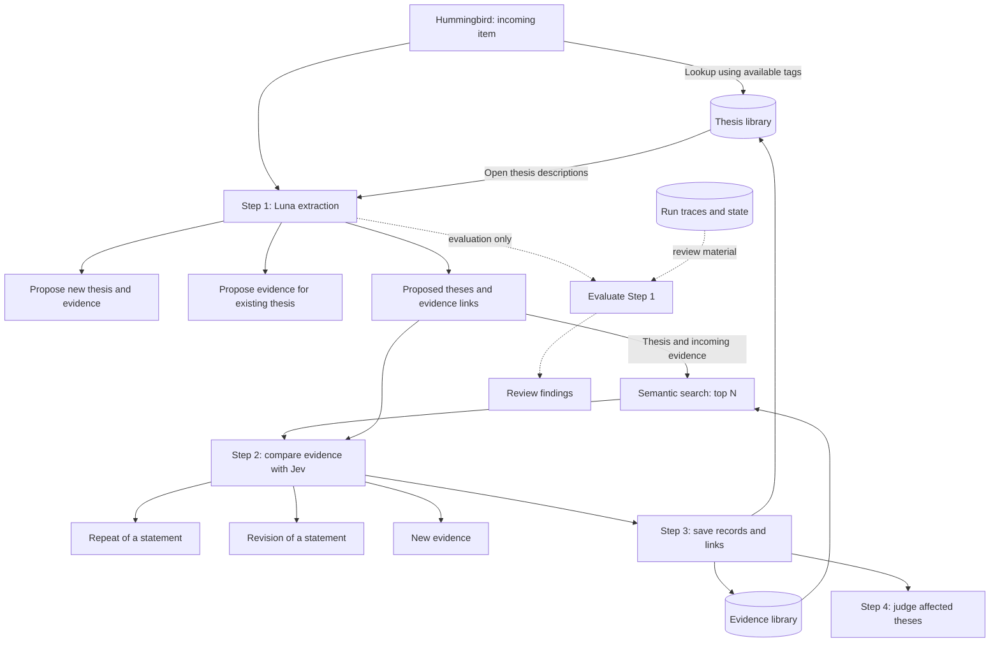

# Hivemind architecture: the hedge fund research brain

**Status: working draft.** This document defines the architecture being developed from Alex's diagram and the discussion around it. It is a design, not a claim that the system has been built or that its quality has been proven.

## 1. What the system does

Hivemind is building a hedge fund brain: a system that follows the decision process of an investment analyst. It receives source material, identifies information and ideas that may matter to assets or events in the world, connects that information to the research being followed, and maintains a dossier of the evidence and events behind each thesis.

A thesis is a research idea, issue or question the system is tracking. Evidence is information that can inform it. A judgement is an assessment of what the accumulated evidence means for the thesis. The thesis, its evidence and its judgement are different things. The agreed minimum for a new thesis is its entity, research question, outcome to track and period when known; further details remain open.

For example, the thesis could be **“How much will a company's capital spending grow this year?”** An article reporting a 25% forecast is evidence. The judgement is what that and the other evidence imply for the answer.

The dossier should preserve how the research develops: the events and statements that inform a thesis, where they came from, how they relate to earlier information and what they imply for an asset or a broader event. The system must keep those connections clear enough that a reader can understand why a judgement exists.

## 2. Architecture at a glance



The live path processes an incoming item through extraction, comparison and saving. Judgement uses the saved evidence downstream; its trigger and timing are open. Evaluation is a separate test of extraction. The thesis library and evidence library are logical stores in this picture; the physical database design is open. The image Alex supplied is available as the [original diagram](reference-diagram.png); the text below explains each box and arrow.

| Part of the diagram | What it receives | What it produces |
|---|---|---|
| Hummingbird stream | Incoming material from its event pipeline. | An item and its available source information. |
| Thesis lookup | The relevant company tags for the item. | All open thesis descriptions in scope for those tags. |
| Step 1: Luna | The item, relevant company tags and open thesis descriptions. | Existing or proposed new theses, each associated with evidence from the item. |
| Step 1 evaluation | Source articles, model inputs and outputs, and thesis state before and after each article. | Human review findings about extraction, thesis reuse and state changes; this is separate from the live path. |
| Semantic search | A thesis and incoming evidence. | Up to N related evidence records from the evidence library. |
| Step 2: Jev | Incoming evidence and the returned evidence candidates. | An evidence relationship: repeat, revision or new. |
| Step 3 | The Step 1 proposals and Step 2 results. | Saved theses, evidence, sources and relationships. |
| Step 4 | The affected thesis and its saved evidence. | A thesis judgement; the detailed contract remains open. |

## 3. The information the system works with

| Information | What it is for |
|---|---|
| Incoming item | The article or other material Hummingbird supplies for processing, with its available source information. |
| Thesis | A research idea, issue or question about an asset or event that is either already open or proposed as new. |
| Evidence | A statement, number, event or view from the item that is relevant to a thesis. |
| Evidence source | The material and relevant passage or location behind the evidence, with speaker and date when known. |
| Evidence relationship | A connection showing that evidence repeats or revises an earlier statement. |
| Judgement | An assessment of what the available evidence implies for a thesis. |
| Run trace | The source item, the thesis context shown to the model, its output and the resulting thesis state, available for review. |

A thesis can have many pieces of evidence. An article can contain evidence for more than one thesis, propose a new thesis, do both, or produce neither. The draft response represents one statement once and links it to each relevant thesis; its mapping to persisted records remains to be verified.

## 4. Step 1: extract theses and evidence

### Input

Hummingbird supplies an item. Step 1 receives the item, all relevant company tags and all open thesis identities and descriptions in scope for those tags, with each tracked outcome and period when available. These descriptions give the model the context needed to identify existing research. For the current single-entity flow, this means the complete open thesis list for the entity being processed.

The model does not need the full history of evidence for every thesis in this step. This input assumes that the relevant tags are available; how to discover affected companies across entities is separate future work (section 16).

### What the model decides

The model reads the item and proposes linked theses and evidence:

1. **Existing thesis:** identify an open thesis that the item informs and propose the relevant new evidence for it.
2. **New thesis:** identify an important research idea, issue or question not already covered by the supplied open thesis list and propose it together with the article evidence that supports it.

These are two possible results from the same reading, not two required calls. Every proposed evidence statement is paired with an existing or proposed new thesis, and a new thesis is proposed with evidence. An existing thesis retains its identity; finding evidence for it does not require renaming it. The Step 1 prompt should define duplicate theses clearly so the model can use an existing thesis when the idea is already covered; the precise definition still needs to be worked out and evaluated.

Step 1 proposes records. Saving them happens in Step 3. The direction discussed for this architecture is that Step 1 decides whether a thesis is new; there is no separate thesis-routing stage in the proposed flow. Whether the model makes that distinction reliably enough must be evaluated. A concrete working draft of the Luna request appears in [section 12](#12-step-1-prompt-luna-working-draft).

### Output

Conceptually, the output is a collection of `{thesis, evidence}` associations:

- The thesis is either a reference to an existing open thesis or a proposed new thesis. A new thesis states the research question and the outcome to track, with a period when known. For the current single-entity flow, code assigns the supplied entity.
- The evidence contains the relevant statement and enough source information to find and interpret it.
- One thesis may have multiple evidence statements.

Section 12 shows a proposed JSON response shape: one list of new theses and one list of evidence, with links from each evidence item to the existing or new theses it informs. Local references connect records in one response; application code assigns persistent identities. The runtime schema has not been finalized or enforced. Preserve the meaning of the source and distinguish what the source says from what is inferred. Do not invent a speaker, date or figure absent from the item.

| What Step 1 finds | Proposed handoff |
|---|---|
| Evidence for an existing thesis | Existing thesis reference plus one or more evidence statements and their sources. |
| A new thesis | Proposed thesis plus the article evidence supporting it. |
| Both | Both kinds of association in the same item output. |
| Neither | An empty result for the item. |

The item itself is the source of the new evidence. The open thesis descriptions provide context for deciding where it belongs. The historical evidence search happens later.

### Step 1 contract and the existing ledger

Step 1's research result is a collection of thesis–evidence pairs. The structured-output example in section 12 is a **proposed model response**, not the existing production response or a final database write contract. A pair can refer to an existing thesis or propose a new one; each pair has one or more source-backed evidence items. One statement can inform more than one thesis.

The first forward run can advance a separate, isolated test thesis library using those proposals. It can review Luna's output and the evolving thesis state without creating production-compatible judgement records. This test library must not be presented as proof that the existing ledger writer or Step 4 can consume the result.

On 2026-11-06, Alex agreed that a new thesis should carry the entity, research question and outcome being tracked, with a period when known. For this single-entity flow, code supplies the entity from the input; Luna supplies the question, outcome and known period. The proposed `period` field is null when the period is unknown. Whether Step 4 needs predefined outcome ranges is a separate open decision; this minimum is not sufficient to claim compatibility with the current production writer.

Alex clarified that a meaningful topic may be opened without a known decision date when later observable developments can help assess it. It must be specific enough to guide what to watch and matter to the research; vague or noisy topics should not be opened. This clean-design decision does not alter the historical signed standard or its frozen ruler.

For reuse of the existing ledger, the new handoff must preserve the fields actually needed by its writer and readers. Section 18 maps the current draft to those fields and separates straightforward mappings, values the system can supply, and unresolved research decisions. The new path must not manufacture evidence tiers, thesis dates or outcome ranges to make an old contract pass. If the user chooses different thesis or judgement semantics, their effect on the writer and readers must be designed and tested explicitly.

### Example

The open list contains **“How much will Company A's capital spending grow this year?”** The item says Company A raised its forecast to 25% and also announces a new manufacturing partnership that could matter for future supply.

Step 1 could return:

- **Existing thesis:** capital-spending growth → **evidence:** the new 25% forecast.
- **Proposed new thesis:** the manufacturing partnership's future supply impact → **evidence:** the partnership announcement.

These examples illustrate the flow; they do not define a fixed list of what is important or establish that a particular item merits a new thesis. The model has to judge relevance in context.

## 5. Step 2: find and compare related evidence

### Why this is separate

An open thesis may accumulate many evidence records. Step 1 needs to understand the article and the open research; it does not need to read every prior statement to do that. Step 2 uses each proposed `{thesis, evidence}` association to find the history worth comparing.

### Find candidate evidence

The proposed design places semantic search over the evidence library. It uses the thesis and incoming evidence to find top-N related evidence across the current entity, including evidence linked to other theses. The thesis is search context, not a restriction to evidence already linked to that thesis. This also applies when the proposed thesis is new. For example, “raised its revenue outlook” and “expects higher sales” can be related despite different wording. Alex chose this entity-wide scope on 2026-11-06.

Search returns **candidates**, not a final decision. Alex discussed a starting point of top 10; the implementation and quality requirements need to be measured.

A match outside the returned set will not be considered by the comparison. Search quality therefore matters independently from the model's ability to compare the records it receives.

### Compare with Jev

**2026-11-08 (candidate, [round log](step1-unfiled-2026-11-08/LOG.md) §§24, 31–35):**
- Comparison reads the full passages; the 600-character cut is removed.
- An unlinked record also searches by its own text.
- `figures` never enter a search or comparison text.
- Jev is asked the clean path's own piece question, aligned with line 2's test: a repeat reports the stored piece's main statement, and
  an official's denial of a report is a revision.
- When a thesis opens, every stored unlinked group from earlier articles is judged against it in batches of ten (a yes/no question; the
  company's overall results inform only a revenue or earnings thesis). Each judged pair is recorded once.
- On c6's records: search 97.9%, wrong merges 1.9% (2 of 104), both lines met; line 3 not re-measured.

Jev compares the new evidence with the returned evidence. The intended outcomes are:

| Outcome | Meaning | Example |
|---|---|---|
| Repeat | The new material presents the same statement again. | Another article reports the same company forecast. |
| Revision | A later account changes the same statement. | The company revises its forecast from 12% to 25%. |
| New evidence | It is not identified as a repeat or revision of the evidence compared. | A different analyst offers a separate forecast. |

The words, amount, speaker, source and time can matter to the comparison. A later statement about the same subject is not necessarily a revision. A matching amount alone does not prove that two statements are the same.

The result “new evidence” is the outcome of the comparison performed; it is not proof that no matching evidence exists elsewhere in the library. When the incoming evidence is judged a repeat of several candidates, it joins only the group Jev judges it most like: the highest same-statement probability, with ties going to the earliest group (Alex, 2026-11-08). A comparison that fails is not saved and is reported.

**Repeat handoff:** when Jev identifies a repeat, the comparison must retain the identity of the existing evidence record it was compared against. Step 3 uses that identity to place the incoming record in the existing record's group, adding its source and any missing thesis link. The typed Jev response need not generate the record ID: the caller can associate the choice with the candidate it supplied. The rule for several matching candidates is stated above.

**Step 2 acceptance (Alex, 2026-11-08).** Three lines apply:
1. For incoming evidence whose earlier version is in the library, search returns it at least 90% of the time.
2. At most 2% of merges are clearly wrong.
3. Grouped dossiers keep no fewer details added by later reports than no merging does.

The first measurement against these lines is in the [Step 2 log](step2-validation-2026-11-07/LOG.md) §12; the isolated modules are `step2/compare.py` and `step3/library.py`.

The diagram's intended sequence is: use `{thesis, incoming evidence}` to search the evidence library; pass the returned candidates and incoming evidence to Jev; pass the comparison result and the proposed association to Step 3. For a new thesis, search the same entity-wide evidence library. A concrete working draft of the Jev comparison request appears in [section 13](#13-step-2-prompt-jev-working-draft).

## 6. Step 3: save evidence and links

Step 3 takes the proposals from Step 1 and the comparison outcomes from Step 2 and writes the resulting research information.

| Result | What is saved |
|---|---|
| New thesis with supporting evidence | The new thesis and its evidence link; save new evidence or reuse a matching record according to Step 2. |
| New evidence for an existing thesis | The evidence and its link to the thesis. |
| Repeat | Place the incoming record in the existing evidence record's group: add its source and any missing link to the relevant thesis, and keep the incoming record's own text and fields inside the group. Do not rewrite the existing record, and do not create a separate evidence record for the same statement. |
| Revision | The new evidence and its source, linked to the earlier statement as a revision. |

A revision does not erase the earlier statement. On 2026-11-06, Alex chose to keep one evidence record for a repeat and add the new source and any missing thesis link. On 2026-11-08 the Step 2 validation showed that keeping only the earlier text discards details a later report adds, such as a guidance condition; Alex then chose to keep each repeat's own text and source inside the stored record's group, without rewriting the original ("A 继续；跑council loop 开始做"; [Step 2 log](step2-validation-2026-11-07/LOG.md) §7). How a judgement reads a group is being tested. Multiple articles reporting the same statement do not automatically establish independent original sources. The current production writer stores separate repeat records, so this is a change for the clean path and needs implementation and verification; the existing historical records remain available. Step 3 ends when the chosen thesis, evidence and relationships are saved. How they are physically stored and written is a separate implementation decision.

## 7. Step 4: judge the thesis

Judgement is separate from processing and saving an article. It assesses what the evidence implies for an affected thesis and whether the thesis's current assessment should change.

For the capital-spending example, saving the revised forecast records **what the company said**. Judgement later considers **what that means for the investment question**. The saved evidence and its relationships must be available to that work.

This discussion has not yet defined the judgement's input selection, output, timing or decision method. Those are open design questions, not implicit requirements of the earlier steps.

## 8. Evaluate Step 1

Step 1 evaluation is an offline forward run followed by a source-by-source review of the trace and the changing thesis state. Alex's direction is to inspect what the system actually does instead of first constructing a hypothetical golden library of thesis–evidence pairs. This does not change the existing frozen references used by historical measurements.

The evaluation should allow us to answer:

- Did the model identify the research ideas an analyst would follow, without proposing already tracked research as new?
- Did it find the relevant evidence in the article, and did it include information that should not have been kept?
- Did it preserve what the source says, including the speaker and date when available?
- Did it connect evidence to the right thesis, given the open theses it was shown?

Review the complete article beside the exact thesis context and the model's raw output. Inspect evidence the model missed as well as what it kept. After each item, inspect what was added to the thesis library and whether a duplicate or incorrect link affects later articles. Alex agreed to review the first run's traces and resulting state before deciding what quality is sufficient to proceed. The articles and review coverage remain to be selected; a trace review does not by itself establish system-wide accuracy.

### Forward run and state review

Run selected articles in a fixed order against a known initial library. Capture, for each article, the source text, the exact open-thesis context, the raw Step 1 output, and the resulting library state. The next article sees the state actually produced by the preceding article. Review the trace and state against the source to identify misses, incorrect evidence or links, and duplicate theses. Document mistakes and their downstream effects rather than silently correcting the run's history.

This can begin with Step 1 and a test library; it does not require completing Jev or the full production pipeline. A separate golden library or validation split is not required by this proposed approach. A selected three-article forward run used the earlier single-passage schema; the partial July 8–9 run below uses the revised multi-passage schema. Broader review coverage remains open.

### Current Step 1 forward run

The [current article replay](../poc/data/clean-step1-2026-07-08-09-continuing/review.html) completed all 49 selected source items from an empty isolated library. It contains 22 thesis records and 160 evidence items; two proposed source passages could not be matched and remain visible as unverified. These are counts from one exploratory run, not a quality score. Unmatched passages and unresolved links are kept for review; affected and subsequent state is provisional. After a stop on article 21, the run continued in a new trace from article 20's recorded state. The [first attempt at article 21](../poc/data/clean-step1-2026-07-08-09-continuing/first-attempt.html#article-21) remains available; the current replay shows the completed prefix and new attempt in order. The source collection has known related-article contamination, and its fixed processing order is not necessarily publication-time order. [Run decisions and learning](STEP1-RUN-LOG.md) record blockers, investigation, changes and their checks.

The [49-article trace review](step1-trace-review.html) explains the source-backed findings and includes an article-by-article assessment. Its [Markdown source](STEP1-TRACE-REVIEW.md) is rendered with `node clean-arch/render_trace_review.mjs`; check synchronization with the same command plus `--check`. This review is not a frozen-ruler acceptance result.

### Prepared-source Step 1 replay

The [seven-article prepared-source replay](../poc/data/clean-step1-prepared-2026-11-06/review.html) uses a separate experimental source database assembled from recorded source-role answers and the original page lines. It ran the existing clean Step 1 prompt in the earlier selected order, starting from an empty isolated library. The viewer shows the selected article, earlier cleaned text, full archived page, source-role decisions, provider response, and before/after thesis state. The recorded source selection is not an integrated live source-preparation service, and neither the selected order nor the underlying captured page is asserted to be complete or chronologically authoritative. This historical replay's `cleaning` metadata describes the earlier cleaned text, not the model-selected text; that field was not included in the model request. New materializations retain the earlier cleaning metadata separately and identify the selected-source preparation.

The seven calls completed, producing four new thesis proposals and 21 evidence items with 33 source passages. Every passage was located contiguously in both the selected text and the archived page, but that **does not prove it supports the whole summary**. Independent readers found that Firmus evidence-1 omits the preceding passage supporting the US$2 billion fundraising amount in its summary; FEV ev-2 omits the passage supporting the limited/no-internet condition. Several other quotations need preceding context to identify the named party. These are visible in the replay. The model's later review identified the Firmus omission and missing FEV party context but did not identify the missing internet condition; those leading follow-ups do not prove why the original answers missed the passages. A controlled comparison completed on the same seven source inputs and before-states, testing the location of the existing final check and a general citation-support clarification. Independent readers assessed anonymous answers before the settings were revealed. In three draws per arrangement, moving the check or adding the clarification reduced this particular Firmus citation miss, but some changed arrangements omitted a named SambaNova customer/deployment or weakened the FEV connectivity condition. Seven Firmus answers also added a currency to a $15.5bn valuation whose currency was not explicit in the source. Neither prompt change is adopted; the [blind review](../poc/data/clean-step1-prepared-2026-11-06/citation-placement-comparison/BLIND-REVIEW.md) records all four arrangements and limitations. The cases were already known and cannot establish production accuracy.

The prepared input restored the article 1 CFO outlook line, which Luna included in E3; it excluded the unrelated October recommendations from the Firmus input while retaining the reported investment. It also restored the article 4 SambaNova funding paragraph, which the model did not extract; whether it matters to NVIDIA's competitive research is a separate judgment. The FEV source is a hosted page with an FEV-issued release; the output does not fully preserve that issuer-versus-host distinction. The FEV and Firmus displayed local dates and stored New York dates are consistent with their timezone-aware timestamps; listing timestamps are separate values. The SambaNova page, however, gives 20:19 UTC in machine-readable metadata and 21:19 UTC in its visible byline. Both are the same New York day, but its exact publication time is unresolved.

This replay uses recorded source-role answers rather than calling the source selector live. The selected source and citations remain provisional; exact source location cannot guarantee complete citation support, correct attribution, or relevance. No production database or frozen prompt was changed.

### Citation-completion diagnostic

A separate model-assisted review was tested on nine saved, known source-and-evidence packets, with three calls per packet and two independent readers. All three Firmus reviews found the missing US$2 billion fundraising passage, but all three FEV reviews missed the source passage for limited or unavailable internet. All three also missed a different FEV record’s reversed local-versus-cloud backup relationship; only two of three identified an unsupported US-dollar currency on the Firmus valuation. Six of 69 expected evidence reviews were left unaddressed because returned identifiers did not match the evidence identifiers. These are selected examples, not a quality rate. [The detailed review](../poc/data/clean-step1-prepared-2026-11-06/citation-completion-probe/BLIND-REVIEW.md) keeps the source-backed examples and limitations.

**Status:** This extra review is an experiment and is not part of the runtime. Additional passages can support a missing citation, but cannot repair a wrong summary or link. A located quotation does not establish that every claim in its evidence is correct. The recorded source-preparation and contiguous-page quotation checks are separate improvements; they do not decide whether a claim matters or is semantically supported.

### Page-time-order Step 1 replay

The [page-time-order replay](../poc/data/clean-step1-page-time-2026-11-06/review.html) runs the same seven prepared source texts in the order of the archived pages' timezone-aware publication metadata, starting from an empty isolated library. It produced three new theses, 17 evidence items and 30 located source passages. The earlier selected-order replay produced four new theses and 21 evidence items. These are two single exploratory draws with different preceding states, not a controlled model-quality comparison. Page publication time is not proof of event time or pipeline arrival order; the SambaNova page's visible and machine-readable times disagree by an hour, although both give it the same position in this selected subset. [Recorded ordering evidence](../poc/data/clean-step1-page-time-2026-11-06/page-time-order.json) keeps the original timestamps.

The Parasail/d-Matrix release appeared first and opened a heterogeneous-inference question; the later d-Matrix report reused that question rather than opening a duplicate. The same run still has material errors: the SambaNova benchmark is described as a deployment although its cited text establishes a test; a named planned customer/deployment present in the source was omitted; and the FEV link explanation reverses which system is the backup, even though its summary states the direction correctly. The FEV summary also omits the source's explicit no-internet case and treats an example model as if it were a definite selection. Firmus cites both investment paragraphs in this draw but assigns a currency to the $15.5bn valuation that the source does not explicitly specify. These findings are annotated in the replay. In a later leading self-review, Luna identified the omitted planned customer but did not identify the reversed FEV backup direction; this does not prove why the original answer failed. Exact source location does not establish a correct link, complete summary or correct attribution.

### Step 1 source-faithfulness council

Codex and Claude Code reviewed the current source, prompt, code and saved answers, then challenged each other over four rounds. Their [detailed council record](STEP1-COUNCIL-REVIEW.md) links to each exchange and distinguishes observed errors from unproven causes. Claude could see earlier experiment reviews during its first pass, so this was not a blind independent assessment.

The shared conclusion is that no tested semantic fix is ready. One evidence item can simultaneously have an incomplete citation, an altered claim, a questionable attribution or an incorrect thesis explanation. Exact source location alone cannot verify these. The tested follow-up review found Firmus's missing financing paragraph in three draws, but missed FEV's missing connectivity condition and a reversed backup relationship in all three; it is not adopted. A quote-first output or stronger reasoning setting may be worth testing later, but neither is proven and either could change or omit useful evidence.

The agreed next investigation is a source-backed review of the 49-item historical forward run and its 160 returned evidence records, with separate, overlapping flags and a separate article-level review for omitted facts. Preserve source contamination and incompleteness as distinct findings, and adjudicate difficult cases with another reader. Then compare the two seven-item replays separately: all seven source IDs are already in the 49-item manifest, and their inputs and order differ. Before the full review, check the review method against known problems and independently checked ordinary records. This is an investigation of recorded runs, not a production-quality rate or a change to the prompt.

### Proposed Step 1 link implementation

Codex and Claude Code challenged concrete implementation options over five rounds. A separate reader audited the final wording against the prompt and clean design. The agreed first candidate preserves the existing one-call, thesis–evidence pair contract: retain valid links to open or newly proposed theses, consider a meaningful new thesis when no existing thesis covers the idea, and omit only an idea that does not inform a thesis and does not merit a new one. No standalone evidence, numerical semantic detector or code-based investment judgment is introduced.

The isolated candidate replaces the existing item-level `NONE` bullet with:

```text
- NONE: If an idea informs no open or proposed thesis and merits no new thesis, omit that idea. If no idea yields a pair, return both lists empty.

Do not link an idea to a thesis it does not inform.
```

This is a proposed clarification, **not a verified fix**: the current request already implies much of the same behavior. Relevant context, counterevidence, multiple valid links and meaningful new topics must remain. The first comparison reuses six stored article requests and their actual open-thesis states, with the original request as a same-day control; it will compare all outputs and useful omissions. The prepared request files pass the existing structural checks, but have not been sent to Luna. [The implementation council plan](STEP1-IMPLEMENTATION-COUNCIL.md) records the exact approach, source examples, independent audit, controls and limitations. The earlier 49-item fidelity review remains incomplete.

### Step 1 link candidate: completed comparison

The [article-by-article comparison](../poc/data/clean-step1-link-none-2026-11-06/review.html) ran the original prompt and the proposed clarification on six saved articles, three times each. All 36 calls completed. Independent readers examined the source, open theses and answers before the prompt labels were revealed. This is a known-case diagnostic with frozen historical states, not a representative accuracy score or a stateful forward replay.

The candidate did not reliably eliminate the problem. On the GeForce NOW article, the answer attached the server expansion to the Shield TV thesis while saying it did not inform it in **1 of 3 candidate draws**, versus **2 of 3 original draws**. In the DeepSeek article, two original answers attached the reported custom chip to an NVIDIA inference-chip partnership thesis; none of the three candidate answers did. These small counts are observations, not proof of a durable improvement. In another article, named domestic-competitor evaluations were absent in two candidate answers versus one original answer; the source and full answer require an analyst's assessment.

Both arms also omitted the DeepSeek article's reported Kyber delay **and** NVIDIA's denial in all six answers, even though the article contains both and the Kyber thesis was open. Its revenue and margin guidance appeared in one of three answers in each arm. These omissions show that avoiding a particular wrong link does not ensure the system captures other important evidence. The active prompt is unchanged. [The detailed blind review](../poc/data/clean-step1-link-none-2026-11-06/BLIND-REVIEW.md) records all six articles, attribution concerns, known source limitations and the blind arm mapping. The next investigation is to trace the persistent missed-evidence case and its full request before proposing another change.

### Trace: Kyber evidence omitted during extraction

Article 34's supplied text reported a possible Kyber delay to 2028 and NVIDIA's denial. An open Kyber thesis explicitly asked whether the roadmap or planned 2027 timeline would be affected. The model's original response and all six later comparison responses omitted the two statements; the runner did not remove them. Current revenue and margin guidance appeared in only two of the six later responses. The [source and request trace](../poc/data/clean-step1-kyber-trace-2026-11-06/TRACE.md) records the inputs, answers and limitations.

Earlier article 10 had reported manufacturing setbacks and a company roadmap statement, but not the specific possible 2028 delay. Step 1 sees open theses, not prior evidence; the later evidence comparison is responsible for deciding repeats. The model can recover the missing statements in a leading follow-up, but a separate neutral self-account said it could not know its earlier reasoning and did not identify Kyber. Neither account proves why the original extraction missed it. In article 10, Kyber appeared later in the text and was returned in all six comparison answers; the different articles and thesis states do not establish that position or an existing thesis caused article 34's omission. No prompt change is adopted from this trace.

### Kyber trace: thesis-visibility diagnostic

A six-call follow-up kept the same article and all request settings, while comparing the full 20-thesis list with a hypothetical list that omitted the Kyber thesis. In both conditions, all three answers omitted the Kyber delay report and company denial. Current revenue and margin guidance appeared in two answers with the thesis shown and none with it hidden; with only three draws this is an observation, not a reliable difference. All six retained the main DeepSeek chip report.

The independent reader first assessed anonymous source and evidence without seeing thesis identities or links. The second pass checked links against the actual input; at that point the condition could be inferred. No thesis state advanced. This result does not support claiming that the mere presence of the existing Kyber thesis caused the omission in this example, and it does not establish the underlying cause. Removing a thesis is a diagnostic only and is not a proposed production change. [The complete trace](../poc/data/clean-step1-kyber-trace-2026-11-06/TRACE.md) preserves the source, self-account, requests and limitations.

### Kyber trace: full article versus its source paragraph

With the same model, prompt, title, source metadata and all 20 open theses, an isolated comparison sent either the full saved article or just its exact 408-character Kyber paragraph, three times each. The full-article answers omitted the reported possible 2028 delay and company denial in **3/3 draws**; the paragraph-only answers returned both and linked them to the existing Kyber thesis in **3/3 draws**. The [six-answer replay](../poc/data/clean-step1-kyber-trace-2026-11-06/review.html) shows the text actually sent, thesis links, source quotations and attribution fields.

This selected example shows the outcome differs between the two inputs; it does not establish whether length, position or competing content caused the omission. The shorter input deliberately lacks the rest of the article and is not a production solution. Its answers combine the report and denial under one party/tier, which may blur provenance; some date and attribution fields also need review. Source-content and exact-passage findings were reviewed anonymously before input conditions were revealed; the later actual-input check was not blind. No production database or prompt changed.

### Whole-article coverage council: prior attempts and next candidate

Codex and Claude Code reviewed the saved extraction traces, older paragraph-by-paragraph experiments, source-first extraction and later split-prompt results. They agree that article 34's Kyber omission is in Luna's raw answer, but that its cause is not established and no complete coverage fix has been validated. The historical experiments found useful content as well as noise, incorrect links and lost context; the paragraph-only Kyber test also changed several input characteristics at once. The [council record](STEP1-COVERAGE-COUNCIL.md) maps each attempt to its results, limitations and original sources.

The council initially proposed moving the existing evidence-reading instructions before the thesis-opening instructions. The subsequent comparison below tested that proposal; its mixed results do not establish a fix. The original council did not itself run a new Luna experiment.

### Whole-article coverage: completed order comparison

The proposed evidence-block reorder was tested without changing the clean prompt in the PRD. On nine previously inspected articles, three fresh answers per arm completed: **54/54 responses**. Each used the saved article and pre-item thesis state; no production state advanced. Independent readers assessed all answers against their source and thesis list before the arm mapping was revealed. The [interactive comparison](../poc/data/clean-step1-coverage-order-2026-11-06/review.html) shows each article, six answers, source passages and review observations.

The candidate returned article 34's Kyber delay report and company denial in **1/3** answers, compared with **0/3** controls; its recovered answer combined the report, denial and journalist's 2027 expectation under one company-statement record. Q2 guidance appeared in **1/3 candidate** answers versus **2/3 controls**. In article 27, **2/3 candidates** linked a cloud-gaming server to the AI-infrastructure-spending thesis without a supported connection; no control did. In article 10, all answers retained the Kyber facts, but **2/3 candidates** did not open a distinct roadmap topic where no Kyber thesis was already open; all controls did. Whether a distinct topic is warranted is a research judgment. In article 8, both arms retained vendor self-benchmark details in every answer alongside the IBM technical preview.

This selected-case comparison does **not** validate the reorder as a fix, and it is not adopted. It also found an attribution error even when the citation locates: an article 41 control summary attributes an Ayar Labs executive's 2028 forecast to a Lightmatter executive, while its own quotation identifies the Ayar speaker. The [detailed results](STEP1-COVERAGE-ORDER-RESULTS.md) distinguish facts, uncertain judgments, blind review, source limitations and the next source-fidelity investigation. The original active prompt and frozen production configuration remain unchanged.

### Completed review: 49 articles and 160 evidence items

The original isolated forward run's **49 articles, 160 evidence items and 199 links** have now been reviewed against the complete text supplied to Luna, citations, attribution, dates, conditions and before-state. Independent readers checked the concrete findings and selected controls; that second pass was focused, not a second complete annotation of all 160 records. The [article-by-article fidelity replay](../poc/data/clean-step1-fidelity-review-2026-11-07/review.html) shows the sent text, captured page, thesis state, each evidence item, citations, links and review notes.

Four records were judged to change source meaning or qualification, including article 29's stock-market investment becoming infrastructure spending and article 28's example model becoming a definite selection. Eight records were flagged for incomplete citation support or an unverified quote; ten records across three articles were flagged for unsupported thesis links, seven of them from one robotics article under a different agent-stack question. Four date-field cases were identified; other date interpretations remain concerns. These categories overlap, include human judgment and describe one selected run, not a population accuracy rate. The source itself was contaminated in article 3, while article 2 and article 16 lost relevant captured-page text before the model saw it. The [full review](STEP1-FIDELITY-REVIEW.md) records controls, uncertainty and the distinction between source losses, model errors and the unimplemented clean writer.

A completed isolated comparison moved only `source_passages` before `summary` in the output schema. Across 11 previously inspected articles, three answers per condition were reviewed with condition labels hidden. The provider followed the requested field order, but both conditions omitted article 34’s Kyber delay and denial in all three answers, and all six article 11 answers stated a $1bn financing without citing the sentence that establishes the amount. Article 28 still turned an example model into an actual selection in one candidate answer, and one candidate turned investment in stocks into infrastructure investment in article 29. The small, selected comparison does not establish a general rate or a fix; the change is not adopted. See the [full results](STEP1-CITATION-ORDER-RESULTS.md) and [66-answer replay](../poc/data/clean-step1-citation-first-2026-11-07/review.html). The original prompt, production configuration and databases remain unchanged.

### Source handoff council: ongoing investigation

Codex and Claude Code are examining the source-to-extraction handoff and prior attempts. The original 49 saved requests and seven prepared-source requests had empty author fields; the prepared records retained proposed source roles, but those roles were not sent in the extraction request. Roles can mix bylines, outlets, dates and uncertain page material, so they cannot safely be promoted to an author field. A 20-article overlap check found that previously cited passages excluded by the recorded selections were an unrelated recommendation or explicitly labeled AI summaries; it does not establish full body coverage. Sixteen repeated article-34 controls omitted the same Kyber report and denial; the cause remains unproven. The [council record](STEP1-SOURCE-HANDOFF-COUNCIL.md) links the reproduced comparisons and previous failures. An isolated ten-article comparison completed 60 calls with the same prompt, schema and pre-item thesis states. Prepared text removed a known unrelated-story error in article 3 (2/3 original, 0/3 prepared) and generated-summary citations in article 8 (2/3, 0/3), but did not reliably improve extraction: article 16’s restored financing paragraph was in all three prepared inputs and in none of their answers; article 28’s example model was stated as a selection in all six answers; and article 34’s delay report and denial appeared in 2/3 controls and 0/3 prepared answers despite being present in both inputs. These are selected-case observations, not general rates or established causes. The [full results](STEP1-SOURCE-TEXT-RESULTS.md) and [60-answer replay](../poc/data/clean-step1-source-text-comparison-2026-11-07/review.html) show source and output. In two retrospective follow-ups, the model recognized that the article 28 wording did not establish a fixed model selection, but could not recover its original reasoning; the article 16 follow-up did not identify the financing paragraph. These accounts are diagnostic, not a fix. No production change is adopted. An isolated low-versus-medium reasoning comparison on six known prepared articles completed and was reviewed with setting labels hidden. Both settings stated an example model as actually used in all three article-28 answers. In article 29, stock-market flows were blurred into infrastructure spending in 3/3 low and 0/3 medium answers, but the medium answers did not retain that stock-flow statement. Other attribution and context concerns remained. These are selected-case observations, not a production acceptance or proof of cause. See the [full results](STEP1-REASONING-FIDELITY-RESULTS.md) and [36-answer replay](../poc/data/clean-step1-reasoning-fidelity-2026-11-07/review.html). The [source-fidelity prompt audit](STEP1-FIDELITY-PROMPT-AUDIT.md) maps observed failures to the complete request and signed standards. The council and an independent reader reviewed a field-local wording hypothesis that asks summaries to preserve source qualifications. In a six-article isolated comparison, all three answers in each arm still described an example model as part of the proposed system without preserving the “such as” qualification; other context and linking concerns remained. The field-description candidate is not adopted. [Full results](STEP1-SUMMARY-FIDELITY-RESULTS.md) and [36-answer replay](../poc/data/clean-step1-summary-fidelity-2026-11-07/review.html) preserve the cases and limits; the council is investigating the next step.

The continuing council has reviewed a possible structured representation of source statements and link explanations within the same extraction call. It is an untested diagnostic, not an adopted design or demonstrated fix. A prior reviewer missed a reversed relationship even with the full article and one evidence record; the proposed representation must still preserve legitimate inference, multiple sources and existing pairs. An independent audit found that the first draft could exclude the very link explanation being investigated, and the council chose not to run this enlarged diagnostic as the next test. A further low-versus-medium comparison completed on six manually selected real articles outside the original 49-item replay, with one fixed 22-thesis exploratory state for both settings. These use the corpus cleaned text, not the earlier prepared-source path; their prior exposure outside the clean replay is unknown. Earlier mixed results and regressions remain unresolved. The [council record](STEP1-SOURCE-HANDOFF-COUNCIL.md) and [draft experiment](../poc/data/clean-step1-structured-claims-2026-11-07/design.md) preserve the discussion, offline checks and limits.

The additional-source comparison produced mixed results: both settings retained several central claims, while the higher setting also produced unsupported CPU-related links and date-field errors in individual answers. An independent review also found 13 fields across eight repeated answers that appear to use an event or data period as the original statement date; ambiguous cases were kept separate. In three later, specifically prompted continuations, the model correctly distinguished those time references; this does not establish the original cause or a fix. A quotation found in the cleaned input was not contiguous in the captured original page. These are selected-case observations, not population rates or a reason to change the production setting. [Results](STEP1-ADDITIONAL-SOURCES-RESULTS.md) and [article-by-article replay](../poc/data/clean-step1-reasoning-new-sources-2026-11-07/review.html) show the source, context, answers and limitations.

An additional [date and link support review](STEP1-DATE-AND-LINK-CENSUS.md) examined the original replay's non-null date-text fields and 76 links from three later test articles. It separates event periods, uncertain original dates, source facts found elsewhere in an article, and clearly labeled inference. The results identify recurring issues and an open link-citation contract question; they do not establish a fix or a population-wide error rate.

An isolated date diagnostic compared one revised `statement_date_text` schema description with the saved request on eight known source/context pairs. It leaves all schema types, evidence pairing, prompt body and production configuration unchanged. Controls include a third-party statement independently dated to the article day, explicit announcements and a dated party release. Independent review identified risks of losing valid metadata-only or announcement dates; these were inspected alongside omissions and linkage. The results were mixed, including persistent date mistakes, unsupported-link concerns and literal `"null"` text in two fields; the candidate is not adopted. [Results](STEP1-DATE-DESCRIPTION-RESULTS.md) and [48-answer replay](../poc/data/clean-step1-date-description-2026-11-07/review.html) retain the details. The [design](../poc/data/clean-step1-date-description-2026-11-07/design.md) records the exact scope and prior attempts.

Two retrospective continuations of the robotics-link answers recognized that the cited article did not establish adoption of the specific Nemotron/NemoClaw stack when asked directly. They were leading follow-ups and do not prove the original cause. A distinct robotics topic may be considered on its merits; demonstrated commercial impact is not required merely to open a useful question. [Full trace](../poc/data/clean-step1-robotics-link-accounts-2026-11-07/).

A further isolated comparison completed on eight new source IDs selected before reading article contents using a recorded seed and a structured inventory of available clean-Step-1 artifacts. It reuses the same unmodified date-text candidate and the same fixed exploratory thesis context for both arms. The selection cannot prove absence from all past work or exclude syndicated stories under different IDs. An independent source review found related-story contamination and unlabeled generated summaries in some cleaned inputs; these were assessed separately. One company article lost its supported full statement date in all three candidate answers, while another preserved its date in both arms; the candidate is not adopted. [Results and replay](STEP1-DATE-NEW-SOURCES-RESULTS.md) and the [selection design](../poc/data/clean-step1-date-unseen-2026-11-07/design.md) retain the evidence.

An independent [thesis-link review](STEP1-ROUTING-CENSUS.md) examined all 214 links across the eight preregistered articles. It records unsupported topic bridges and explanations that negate their own link, alongside valid indirect context and source-supported prospective topics. These are selected-case findings, not population error rates or a hardcoded relevance filter.

A [source-provenance census](STEP1-SOURCE-PROVENANCE-CENSUS.md) found 163 records across three explicitly recognizable page components where generated-summary content was retained but its label was removed. This is a bounded source-structure count, not a count of model errors. On two NVIDIA pages, the cleaner's template removal and long-line restoration reproduce the mismatch; a general provenance-preserving handoff is under review. An offline probe reproduced the current cleaned text for 163 affected pages and 200 seed-selected additional pages. It retains all candidate original positions, marks transformed bylines, and shows one missing-HTML fallback; positions do not by themselves establish source role. [Lineage replay](../poc/data/clean-step1-source-lineage-2026-11-07/review.html). Source content remains available and no production data or prompt has been changed.

An [offline source-context observation](STEP1-SOURCE-CONTEXT-OBSERVATIONS.md) compared immediate original-page neighbors with complete adjacent unmatched runs, without modifying inputs. They exposed 144 and 149 respectively of 163 known labels but also many unrelated page lines, and did not cover the TradingKey cases. Thirty preselected pages received a line-by-line human review. These are partial diagnostics, not an adopted cleaning rule. A replay of 153 quotations from 18 saved answers across three selected articles found no changes in quote-verification status under either hypothetical text, but the Ising quotation falsely accepted after cleaning remained falsely accepted because both approaches omitted the intervening lines. A further full-page quote check flagged that Ising passage as unverified; this does not test extraction on the full page. This limited replay does not establish general safety or source meaning. In the earlier 49 completed forward-play articles, a separate count found 248 of 250 saved passage instances located in the captured page and two already unverified; the [observations](STEP1-SOURCE-CONTEXT-OBSERVATIONS.md) distinguish this from semantic accuracy. [Source-context viewer](../poc/data/clean-step1-context-restoration-2026-11-07/review.html).

A [saved quote-integrity census](STEP1-QUOTE-INTEGRITY-CENSUS.md) independently matched 360 answers in eight overlapping cohorts to their original requests and results, and reconstructed a further 60-answer source-text comparison separately. It distinguishes exact page location, unverified quotations and cleaned-text-only joins. Five unverified passage instances are full matches under the existing normalizer, including spaces before punctuation. The isolated Step 1 runner now locates a complete normalized match when every matching source slice has the same original bytes. It retains the model quotation, displays the located source text, and records lookup errors without stopping the exploratory stream. The [installed-path review](STEP1-QUOTE-INTEGRITY-CENSUS.md) covers saved-answer replays, Unicode and duplicate controls, resource checks and limitations. This fixes a narrow location issue in the isolated runner; semantic accuracy, original-page provenance and production compatibility remain unproven.

A [source-first 49-article coverage review](STEP1-COVERAGE-CENSUS.md) separates text removed before extraction from material present in the input but absent from Luna’s raw answer. It records concrete cases and uncertain matter boundaries, without creating a new golden set or asserting a population recall rate. Previously tested source selection, prompt order and reasoning changes remain unproven. Seven older production-era raw answers returned the same article’s Kyber report and denial, but differed in request context, schema and run date, so the [continuing council](STEP1-COVERAGE-COUNCIL.md) treats the difference as a lead rather than a proven cause.

In the continuing council, Codex and Claude Code agreed that repeating one article alone would measure variation rather than identify a remedy. The complete clean prompt already includes examples and asks for a full article reading; no single prompt sentence has been established as the cause of the omissions. One proposed general clarification to the standard's named-party claims and estimates is an untested audit hypothesis, not an adopted prompt. A useful future comparison would hold each article and its pre-article thesis state fixed, interleave control and one candidate, and review complete outputs against the source for missed information, noise, attribution, conditions and links. Its chosen articles and review procedure must be recorded before the sends; selected cases cannot establish production quality. Source text lost before the model call is a separate problem, to diagnose against the existing cleaning code and saved pages. Step 1 remains one call with thesis–evidence pairs. [Council exchange and limits](STEP1-COVERAGE-COUNCIL.md).

The [source-loss investigation](STEP1-SOURCE-LOSS-CENSUS.md) traced two different ways the historical cleaner can discard article content before Step 1: a financial statement grouped with related-story headlines, and a financing paragraph omitted by the HTML extractor whose final marker prevented the long-line fallback from keeping it. A corpus-wide count identifies thousands of lines meeting the underlying structural conditions, including many unrelated titles, code and advertisements; these are not all lost investment facts. No general source-cleaning repair has been established. A new read-only council is examining the trace and previous source-selection attempts; the original corpus remains unchanged.

**Test-data correction:** Alex confirmed on 2026-11-07 that the source-cleaning script and source test data may be changed when their defects are confirmed to affect testing. Preserve the original inputs for comparison and verify the effect of a candidate on real sources. This permission concerns the test source data; it does not change the frozen evaluation standard, gold, production configuration or production database.

The investigation also found that the historical extractor-matching key removes non-ASCII characters and can accidentally match an empty key. Two Unicode-aware offline alternatives had different effects on the saved articles, including adding unrelated page titles; neither is adopted. A proposed punctuation change recovered the financing paragraph but also added serialized HTML and navigation on other pages. The [investigation](STEP1-SOURCE-LOSS-CENSUS.md) records the full-corpus comparisons and their limits. Source identity and article boundaries need to be evaluated alongside text matching.

An existing HTML-tag-based candidate was also replayed across all 6,463 originally fed articles. It reproduced its earlier 49-article comparison, but would change 1,054 pages. For example, it adds unrelated news recommendations to an AI investment report and removes a sourced timeline from an AI training article. This does not establish a general error rate; it shows why HTML tags alone cannot decide whether material belongs to the article. No candidate has been integrated.

A [full-page diagnostic](STEP1-FULL-PAGE-DIAGNOSTIC.md) compares the cleaned text with the saved captured page under the same thesis state and instructions. It checks whether Luna can find the target article while preserving its source and ignoring unrelated page material. The captured page can itself be wrong or incomplete, and using it is not an adopted implementation.

Two independent readers have completed [source-first notes for the 17 proposed articles](STEP1-FULL-PAGE-SOURCE-NOTES.md), before any new comparison outputs. These notes identify source roles, incomplete captures, uncertain statements and later page material; they are not a new golden set or mandatory extraction checklist.

The isolated full-page comparison completed all **102 calls** across 17 articles, with three answers for each input per article. Three independent readers examined the answers against the source, with imperfect condition hiding. In one selected article the page exposed an outlook qualification absent from the cleaned input, and all three page answers included it; in another, all three cleaned-input answers misattributed an unrelated later-story teaser, while the page answers did not. In a third, five of six answers turned an example model into a definite selection despite both inputs preserving the qualification. The [source-backed results](STEP1-FULL-PAGE-RESULTS.md) distinguish source loss, attribution and model meaning errors, and the [article-by-article replay](../poc/data/clean-step1-full-page-diagnostic-2026-11-07/review.html) shows the inputs and answers. These selected cases do not establish a general accuracy rate or production readiness.

The cleaner also switched off 615 of 6,463 articles originally marked for processing. A replay of the current cleaner reproduces all 615 switches, and one confirmed example contains a 9,874-character article compressed to a single line: it fails the cleaner's requirement for three long lines. Other excluded captures are a paywall, a weather page or challenge code. An offline candidate that replaces long-line counts with long-sentence counts would recover 89 records but disable 49 currently processed records, including readable reports; a sample of the 89 includes unrelated pages. These are concrete evidence of a source-test problem and of why simply adjusting a length or count threshold would not resolve it. How many articles were wrongly excluded remains unknown; the [results](STEP1-FULL-PAGE-RESULTS.md) link the cases and reproducible comparisons.

A [test-source preservation candidate](STEP1-SOURCE-PRESERVATION-DESIGN.md) describes a separately versioned comparison that retains the saved page, the previous cleaned input and both historical processing flags. It is a proposal for making source losses inspectable and exposing previously excluded inputs; it does not assert that a saved page is a complete or correctly identified article. Its database mapping, runner behavior and offline checks are specified before implementation. The existing production source and frozen configuration are not changed by this candidate.

The isolated candidate has now been built and its 34,084 records compared with the two source snapshots. A fake-answer run through the actual Step 1 runner confirms that the previously excluded CNBC article reaches the runner with its saved page. Replays also preserve the recorded validation results for 102 saved comparison answers and 49 completed forward-run answers. This verifies the handoff and historical checks, not model extraction or article identity. The [council regroup](STEP1-SOURCE-REGROUP-COUNCIL.md) records why source cleanup comes first for a stable test and which model-processing errors remain separate.

The [source-only controls](STEP1-SOURCE-CONTROLS.md) document a real article, a wrong-page capture and two partial or paywalled captures before any new model run. A partial headline may itself carry a useful attributed statement; a wrong page does not establish that the missing target article was irrelevant. Two additional non-NVDA-tagged bad captures are source controls only and are not placed into an NVIDIA thesis context.

The [control-run design](STEP1-CAPTURE-CONTROLS-DESIGN.md) sends four eligible captured pages independently with one fixed hypothetical thesis state, plus one comparison using the CNBC article's previous cleaned text. It preserves the existing extraction request and treats missing article content, source attribution and model interpretation as separate questions. All five calls completed; the [replay](../poc/data/clean-step1-capture-controls-2026-11-07/review.html) shows the actual inputs and proposals. In these selected draws, the wrong page yielded no pairs, while the two partial pages yielded qualified proposals. Source review also found summary details whose supporting headline or article passage was not included in the attached quotations. The [results](STEP1-CAPTURE-CONTROLS-RESULTS.md) record the evidence and remaining uncertainty; these draws are not a general quality measurement. A [request audit](STEP1-CITATION-SUPPORT-AUDIT.md) confirms that the current prompt already asks for all passages needed to support each summary; the cause of these omissions is not established.

A subsequent [numeric citation triage](STEP1-NUMERIC-CITATION-TRIAGE.md) looked for exact digit tokens in summaries that were absent from their own passages and sent the flags to readers. Several items combined facts from later paragraphs without attaching those paragraphs; other flags were formatting or date-context differences. This is a case-finding aid, not an automatic citation judgment, a quality rate, or a rule that decides what the analyst should keep.

An independent [citation review of all 160 returned records](STEP1-CITATION-COMPLETENESS-49.md) in the historical 49-article run found nine preliminary cases where details appear in the supplied article but not in their own evidence passages. A second reader checked those cases, distinguishing substantive missing conditions from source-identity or contextual antecedents. Meaning changes and whole-article omissions are separate problems, measured in different units; this selected run does not establish which problem is largest in production.

The council is also examining whether selecting source-unit IDs could reduce copying errors. An [offline boundary and size check](STEP1-SOURCE-ID-OBSERVATIONS.md) found that the existing quote-repair boundary heuristic splits real abbreviations and that many saved quotations cross its units; a simple numbered JSON representation also increased source-only input size on the checked pages. IDs would not establish semantic support or article identity. No such representation is adopted.

### Source-fidelity council: what must be preserved

Codex and Claude Code completed five rounds of review of the source-fidelity failures, existing trace and downstream code, and previous experiments. They agree that no tested fix has yet been established. An article 41 answer quotes an Ayar Labs executive accurately but names a Lightmatter executive in its standalone summary; a previous FEV link explanation reverses the relationship described by its source. Missing citation context, incorrect source meaning and contaminated inputs are different failures. Exact quotation matching cannot settle them.

The agreed record-by-record review of the original 49-article, 160-evidence run is now complete, with the later 54-answer comparison kept separate. For each evidence item, compare its claims, citations, actor, reporting source, time, qualifications and thesis-link explanation with the complete source. Check real downstream readers and include correct records as controls. The subsequently completed field-order comparison is described above; it did not establish a fix. No automatic split, semantic gate or arbitrary count threshold is adopted. [Full council analysis and prior attempts](STEP1-FIDELITY-COUNCIL.md).

The existing clean trace keeps multiple passages, but its Step 3 mapping to the older single-quote evidence store has not been implemented. The existing writer stores an unknown original day as empty; the older Jev comparison and revision-order path can use publication day as a fallback. These are different paths and do not establish that a clean production write has already lost information.

### Step 1 joint review: causes and priorities

**Execution order approved by Alex:** (1) source text and event ordering, (2) thesis links, (3) faithful summaries and omissions, (4) thesis granularity and noise. Investigate and validate each in that order; retain the original traces and distinguish proven causes from proposals. The detailed findings below are the recorded joint-review consensus.

Codex and Claude Code (`claude-fable-5-1`) reviewed the 49 source records, original requests and answers, state, and the clean runner over three rounds. They challenged each other's claims against the saved records and code. Claude read the earlier Codex review before completing its first pass through all 49 articles, so this was **not a fully blind independent review**. The [first](../poc/data/clean-step1-review-consensus/claude-round1.md), [second](../poc/data/clean-step1-review-consensus/claude-round2.md) and [third](../poc/data/clean-step1-review-consensus/claude-round3.md) responses, [Codex's checks](../poc/data/clean-step1-review-consensus/CODEX-OBSERVATIONS.md), and local packets are retained for inspection. These are findings and proposed investigations, not approved changes to the architecture or production behavior.

| Priority | What is observed | Cause established, or still a hypothesis | Direction to investigate |
|---|---|---|---|
| 1. Wrong thesis links | In article 4, valuation and revenue are linked to Nemotron performance; in article 27, a cloud-gaming server is linked to the Shield TV thesis. Three of the 199 returned links explicitly say the item does not inform the selected thesis. Article 18 puts robotics evidence under the Nemotron/NemoClaw thesis; article 41 links general networking details to a specific Kyber setback. One 2027 roadmap statement in article 41 can also be defensible context for that thesis. | Luna returned these links; the clean runner checks reference identity and source location, not whether the link answers the thesis. That separation is deliberate: code does not decide importance. The cause of the model's decision is **not proven**. A forced pairing or insufficient deliberation may contribute; neither is established by one run. | Compare matching decisions against the complete question and outcome, including valid indirect links. Preserve the user's thesis–evidence pairing rule. Do not add a hard-coded list of keywords or make code decide investment relevance. |
| 2. Source contamination and order | Article 3's July Firmus text includes two October related-story summaries; the model uses one as Firmus evidence. Article 28 also includes later recommendations, though its output did not cite them. Of 46 records with parseable timezone-aware page timestamps, 26 of 45 adjacent comparisons in that known-timestamp subsequence are inverted relative to the run order; one crosses a New York day. The other three lack comparable timestamps, and page metadata may itself be wrong. An earlier count of 45 and 25 missed a valid `+0000` timestamp. | In article 3, the clean pipeline re-adds long lines the structural extractor omitted; both unrelated snippets meet that fallback. The same fallback retains real guidance and other article text in article 34. In article 28, the structural extractor itself includes the recommendations. The manifest follows fixed processing order, not guaranteed page-publication order; a Google listing time is not automatically the page's original time. | Test source extraction and time provenance separately from model changes. Any cleaning proposal must remove unrelated content without losing real article tails. For a stateful chronological test, define and inspect the timestamp source and missing-time handling; do not rewrite the recorded run. |
| 3. Meaning, attribution and omissions | Article 29 turns funds flowing into AI-infrastructure **stocks** into infrastructure **spending**. Articles 17 and 37 combine results and attributed commentary in fact-labeled items; whether they are one matter or should be separated needs review. Article 34 omits reported revenue guidance and Kyber claims; article 36 omits reported $1 trillion revenue visibility. | The statements are present in the inputs and the problematic summaries or omissions are in the raw model answers. Exact quote matching cannot establish semantic support, attribution or completeness. The reason for each model choice is not yet established. | Audit the assembled prompt, schema and affected traces against the analyst standard. Keep reports, expectations and forecasts distinct from completed results. Review what the model omitted as well as what it returned. |
| 4. Thesis granularity and noise | Some vendor technical benchmarks and broad comments were returned despite the draft's not-kept guidance; some narrowly scoped topics may be noisy. Other specific launches, partnerships or investments can still be meaningful. | The trace proves what was returned, not a general precision rate or why the model chose it. Alex explicitly permits an observable, meaningful topic without requiring a proven financial impact. | Judge the actual investment question and subsequent observable evidence. Do not impose a universal financial-size rule or automatically exclude an industry, product or partnership. |
| 5. Handoff and provenance | The clean trace stores per-link `relevance`; the inspected existing `evidence_links` table stores evidence ID, thesis ID and sequence, not that explanation. Step 2 and the clean Step 3 writer were not run. | This is a future integration risk, not a claim that this experiment wrote or lost data in production. Unmatched source passages and unresolved links remain visible and provisional in the exploratory path. | Verify the actual writer and reader mapping before claiming the explanation or a multi-passage source survives into a dossier. Compare repeated evidence in Step 2, rather than counting Step 1 repeats as a dedup failure. |

**Reasoning-token observation, not a root-cause verdict:** 13 of 49 recorded Luna answers report zero reasoning tokens. The three links whose own explanations explicitly reject the match occur in two of those answers. However, other questionable links, the article-29 meaning change and article-34 omissions also occur in answers with nonzero reported reasoning tokens. The zero/nonzero categories were examined after seeing the run; they cannot establish cause or predict production performance. Claude's initial stronger claim that no nonzero answer had a relevant error was corrected in discussion.

**Link-setting diagnostic (completed; results below):** use the same stored source and before-state for a few wrong-link examples and valid direct/indirect-link controls; compare same-day `low` and `medium` settings with repeated sends. Have readers inspect source, output, thesis and attribution without seeing the setting or reported token count. Record both wrong attachments and useful evidence lost. This can indicate whether a setting is worth studying; it cannot prove why the model erred or establish production improvement. The frozen historical ruler and gold remain unchanged, and no new golden dataset is required for this exploratory trace review.

**First no-cost source test, completed as an investigation, not a replacement pipeline:** compare saved HTML, the structural extractor and the current cleaned text for article 3 and article 28, with article 34 as a positive control for real text that the fallback preserves. Count both unrelated content retained and relevant article content lost before proposing a change. The [candidate census](../poc/data/clean-step1-review-consensus/source_fallback_census.py) found 112 long retained lines across 23 of these 49 records that are absent from the extractor output; these are candidates, **not 112 proven errors**. The [timestamp census](../poc/data/clean-step1-review-consensus/timestamp_census.py) and raw outputs record its scope and limitations.

### Execution 1: source text and event ordering

The source investigation used the 49 archived pages and the exact text sent to Luna. It identified both added and missing content:

- Article 3 includes two later related-story summaries. The existing cleaner adds long lines excluded by the structural extractor; Luna used one unrelated summary as evidence. Article 28 also contains related-story recommendations, but those already appear in the structural extractor output. One fallback rule does not explain both.
- Article 2 loses a genuine statement that NVIDIA excluded China revenue from its outlook because the headline-removal step removes it. Article 16 loses the reported $1 billion funding and $11 billion valuation sentence because the fallback does not recognize its final symbol as punctuation. These are defects in the supplied source, before Luna reads it.
- The same long-line fallback preserves real guidance and other body text in article 34. The default extraction mode removes the unrelated article 3 and 28 examples and restores article 34, but returns unrelated headlines instead of the actual article 16 body. Another existing extractor loses substantive article 28 content. Neither is a safe wholesale replacement. A separate structural candidate recovered the omitted article 2 and 16 passages and removed article 3’s recommendations, but added unrelated headlines and promotional text and missed article 28’s recommendations. Its narrower variant proposed 14 additions across six articles, not all valid. Extractor agreement also either retained promotion or lost real content. These are observed controls, not a complete measurement of all source errors.
- Of 46 comparable page timestamps, 26 of 45 adjacent known-time comparisons are reversed in the saved processing order. Three pages lack comparable timestamps. Page times need provenance and are not automatically authoritative. Article 20 precedes article 18 by page time but was processed later; whether a different order would change the model's links is untested. The original run is retained unchanged.

The author gap is wider than one article: all 34,084 records in both the saved page and cleaned snapshots have an empty `authors` field; the clean runner forwards that value. The assembly script initializes it empty and the cleaner does not populate it. In the 5,848 cleaned, feed-eligible article rows it is also empty. On 16 selected pages with visible named bylines, the existing HTML metadata extractor captured all visible names on 11, some on two and none on three; some wrong names appeared in page metadata even when the metadata identified the correct article URL. It is a source hint, not a safe automatic author replacement. Article 6's cleaned text also omitted the visible author. The [source-only diagnostic design](STEP1-DESIGN.md) tests byline handling without changing a production writer or selecting an unverified name.

A separate model-assisted source-preparation experiment asked Luna to identify article lines in the archived whole-page text without rewriting them. One draw on six known pages recovered the real body paragraphs checked in articles 2, 3, 16, 28, 34 and 42, including the previously missing CFO and funding statements; it excluded the identified unrelated recommendations in articles 3, 28 and 34. An independent reader checked the selected text against the page and HTML. But article 2's selected text presents the page's AI-generated summary without its label, and also includes a photo caption and credit. Articles 3 and 16 lose visible author names while the stored author field is empty. All six returned no uncertain lines. Each selected line was copied unchanged from the stored normalized page, with no invalid or repeated IDs; exact copying does not solve source attribution. These six selected pages and one draw do not establish production safety, quality across the source pool, or completeness of a paywalled article.

A second isolated source-boundary experiment separated article text, bylines, captions, page-generated summaries and uncertain material, allowing a line to have several roles. An independent reviewer compared one draw on ten selected pages with the saved page and HTML. They found no wholly missing authored body paragraph or visible byline name among those pages, and the explicitly labeled AI summaries were separate from the article role. The CFO and funding statements remained, and the known unrelated recommendations were excluded. Figure captions on two pages were available only in the caption role; article 7's AI-widget disclosure was omitted; and the source of some widget “Next Steps” text is unclear even though the model marked no lines uncertain. A downstream consumer would need the separate source roles and their provenance, not just the article text. These are selected-case observations, not a completeness or accuracy guarantee. A further check used three sends each on ten other articles, randomly selected from the same 49-article corpus. Independent readers found the substantive paragraphs visible in the archived article regions in all 30 outputs, but one output omitted a visible author whose stored `authors` field was empty. Some outlet labels, contributor roles and article/caption roles also require care. The model later identified the missed author when prompted, which does not prove why it missed her initially. These articles appeared in the earlier extraction review, so this is not a fully unseen corpus; the [independent check](../poc/data/clean-step1-review-consensus/source-prep-check/INDEPENDENT-REVIEW.md) is not a population accuracy estimate. The [second probe](../poc/data/clean-step1-review-consensus/source-prep-probe-v2/) is not integrated into the pipeline.

A subsequent blinded source-role comparison fixed a caption field-name mismatch in both arms, then tested a byline clarification against the corrected baseline: ten sends per arm on article 6 and three per arm on six provenance controls. The author was retained in the source role in 8/10 baseline and 10/10 candidate answers. However, two of three candidate outputs for article 28 incorrectly labeled the host's introduction as generated; all three also selected a site clock as source information. The introduction itself remained selected as article text. The candidate therefore fails the source-attribution controls and is not adopted. This is a selected-case diagnostic, not a population score; [the blind review](../poc/data/clean-step1-review-consensus/source-byline-comparison/BLIND-REVIEW.md) records the cases and their limits.

For the 49 selected records, the archived whole-page text contains about 107,119 local tokenizer tokens versus 49,656 for the current cleaned text; a separate source-preparation call would add those input tokens and another model call before extraction. This is a local token estimate, not a provider bill or a projection over all records. The [six source-preparation traces](../poc/data/clean-step1-review-consensus/source-prep-probe/) are isolated; no model-selected text has been substituted into the replay or production pipeline.

**Status:** the causes above have been traced, but no general source-cleaning or ordering fix is established. Do not silently remove the fallback, switch extractors or invent times for missing records. Compare a candidate against both contamination and genuine-body controls before using it in a new stateful run. The [source fallback census](../poc/data/clean-step1-review-consensus/source_fallback_census.json), [headline-filter census](../poc/data/clean-step1-review-consensus/headline-filter-census.json), [extractor comparison](../poc/data/clean-step1-review-consensus/default-extractor-comparison.json), and [corrected timestamp census](../poc/data/clean-step1-review-consensus/timestamp_census_v2.json) preserve the local investigation. The censuses identify candidates, not independently adjudicated error counts.

The earlier review's Firmus date concern is corrected: the archived page timestamp is `2026-07-09T01:03:59Z`, which is July 9 in Sydney and July 8 in New York. The stored New York day and displayed Sydney day therefore represent the same instant. The separate listing timestamp and the order of the run still need their own evaluation.

### Execution 2–4: link, fidelity and topic review

A second reader independently checked eight saved link cases. Across their 41 evidence items and 47 links, the stored links match the raw provider answers; the runner did not choose them. The reader confirmed article 4's two links and article 27's one link explicitly contradict the model's own explanations. Article 18 attaches seven robotics statements to a Nemotron/NemoClaw thesis without a named connection in the item. Article 41 requires care: its general networking facts do not state a connection to the Kyber setback, but its 2027 plan can be relevant context to the roadmap. Article 10's provider commitments and roadmap counter-evidence are examples of links that can legitimately inform more than one question. Source contamination and the original order limit all these observations.

For articles 4 and 27, Luna was shown its own stored answer and the original context and asked to review the links. It acknowledged both contradictions. In article 4 it suggested a new, evidence-backed revenue thesis; in article 27 it suggested no pair. It attributed the errors to an overly broad interpretation of indirect relevance. This is a **retrospective account**, not proof of the original cause. The full [requests and responses](../poc/data/clean-step1-review-consensus/link-account-probes/) are retained. A controlled exploratory comparison resent eight unchanged saved requests and their original before-states three times at low and three at medium reasoning. Independent readers reviewed anonymous outputs before the settings were revealed. In five selected wrong-link scenarios, 6 of 15 low-setting answers contained at least one clear wrong-product or unrelated-question link, compared with 0 of 15 medium-setting answers in that specific class. Other links and source-fidelity issues remained, and the examples were selected after the original run, so this is not a general accuracy estimate or proof of cause. The 24 low responses used 45,091 completion tokens versus 106,839 for the 24 medium responses; these are usage counts, not a cost or latency comparison. [Blind review and limitations](../poc/data/clean-step1-review-consensus/link-setting-probe/BLIND-REVIEW.md) records the cases. The experiment did not advance state or change the production setting. A second isolated test compared the saved prompt with a candidate that makes the existing final check actionable and makes the technical-comparison exclusion explicit. Three independent readers inspected six unlabeled answers for each of three known articles before the prompt labels were revealed. Every candidate and baseline answer still retained excluded technical comparisons, while also retaining the IBM integration, relevant AMD competitor comparison and Perplexity usage in the applicable controls. A candidate answer additionally misstated which company’s hardware was in a 100 kW rack. The candidate is not adopted. This small, selected test does not establish a general rate; the [blind review](../poc/data/clean-step1-review-consensus/benchmark-prompt-probe/BLIND-REVIEW.md) records the outputs and limits. Neither test changes the current prompt or database.

For source fidelity, article 29 changes flows into AI infrastructure **stocks** into infrastructure **spending**, which the source does not say. Article 34's input contains revenue guidance, margins, its China assumption, and a reported delay and denial, none of which appear in the answer. Article 36 omits reported management revenue **visibility**, not realized revenue. In articles 17 and 37, a factual result and an analyst or author's interpretation appear under one fact tier. The summaries identify the commentary as such; article 37's `original_party` field names only the company, so whether that field alone gives a downstream reader enough context needs review. The standard allows a mixed single matter to use its main claim's tier; separate matters should be evaluated separately. Article 34 also attributes a report to unnamed sources although the supplied article only says reports. The exact source and raw answer establish these examples, but not why the model made each choice. The request instructs the model to preserve meaning, attribution and guidance; it asks for separation when attribution would blur, while allowing a mixed statement to use its main claim's tier. Those instructions can coexist when applied to the correct unit; whether they were applied correctly to these items remains an analyst judgment. Article 34's supplied text also contains unrelated recommendations.

For topic and evidence noise, article 8's company-reported technical benchmark items and article 33's benchmark conflict with the saved prompt's final check. An independent reader inspected all 160 output items and flagged 13 primarily technical test or comparison items, two mixed items whose non-benchmark content needs separate review, two competitor-comparison controls and six uncertain boundary items. These are item-level leads from one run, not a count of research matters or a general error rate. This does not prove every technical detail is unhelpful. In article 1 the only evidence for the newly opened performance thesis is a company-reported benchmark; excluding that item under the existing standard would leave that proposed thesis without evidence. Its separate adoption thesis has other evidence and must be considered independently. Article 8 also reports IBM production-workload testing and integration, which should not be discarded with the benchmark. A rival's comparison and reported use in article 19, the named robotics integration in article 20, and NVIDIA-backed financing in article 44 require their own relevance judgment. The user's rule remains: an observable, meaningful topic can be opened before its financial impact is known; avoid noise without imposing a blanket size or industry threshold.

**Status:** these reviews identify source-backed errors and prompt tensions; they do not yet establish a general fix or justify editing the prompt. The original 49-item answers and states remain unchanged. In a separate follow-up, the model recognized article 29’s substitution and several omissions in article 34; on article 8 it described the benchmark items but read the rival-comparison exception more broadly than the original prompt states. These are retrospective answers to leading questions, not proof of the original decision. The [full continuation requests and answers](../poc/data/clean-step1-review-consensus/fidelity-account-probes/) and [request audit](STEP1-PROMPT-AUDIT.md) are preserved. The controlled comparison is a diagnostic on selected known cases, not a fresh stream, acceptance test or general accuracy estimate.

### July 8–9 Step 1 replay

The [July 8–9 article replay](../poc/data/clean-step1-2026-07-08-09/review.html) records an exploratory run of 49 selected NVDA-tagged articles in source order, starting with an empty isolated thesis library. Five July 8 articles completed; article 6 failed source-passage validation and stopped the run. The remaining 43 articles were not processed. Four theses were in the isolated library after the completed articles. This is not a production write or a golden evaluation.

The failed article's model proposals are visible as unaccepted output; they were not added to the library. The first proposed quotation replaced the source words “The GPU giant” with “Nvidia,” so it was not an exact source passage. On a copy of the answer, restoring the full original phrase makes all three proposed evidence items pass source-location checks; this is a manual diagnostic, not an automatic recovery or a semantic correctness check. Article 5 reused the revenue-growth thesis opened by article 4.

The third completed article returned no pairs even though its stored excerpt reports a proposed NVIDIA investment of about US$500 million in Firmus. This is a useful new company action to follow, with the reported terms and uncertainty preserved. A follow-up model account suggested it required a stated business benefit; that account does not establish why the original answer was empty. Three additional sends of the original request and three of an initial revised prompt all extracted the investment, so this small comparison does not establish that the prompt change improves recall. The prompt now removes a universal scale restriction that conflicted with Alex's broader clean-design topic rule.

The stored article text also includes two recommendations from October that were appended to the July article; the underlying stored page identifies them as related articles. All six comparison outputs quoted one of those later snippets as evidence. The article's stored day is July 8 in New York while its page displays July 9 in Sydney; the page timestamp represents the same instant in both time zones. The listing timestamp is a separate value. This is not itself a date error. The replay's fixed source order is not proof of publication-time order, and even a verified quotation can be wrong evidence if the supplied source text contains later material. These issues must be addressed before treating this replay as a reliable chronological assessment; the stored run is preserved unchanged.

The trace and reading page are local run artifacts, not included in Git. If available, regenerate the page with `python3 clean-arch/step1/render_replay.py --source poc/data/clean-step1-2026-07-08-09/trace.sqlite --output poc/data/clean-step1-2026-07-08-09/review.html --annotations poc/data/clean-step1-2026-07-08-09/replay-notes.json`.

The [subsequent rerun](../poc/data/clean-step1-2026-07-08-09-rerun/review.html) used the revised prompt, the same 49 selected items and an empty isolated library. It stopped on article 1: one proposed source passage added “NVIDIA” before the source's “NemoClaw,” so the quotation was not contiguous. No thesis state advanced and the other 48 articles were not processed. The failed answer and its proposed pairs are preserved in the rerun replay. The known source contamination and publication-time ordering limitations remain unresolved.

### Step 1 run replay

The [article replay](../poc/data/clean-step1-h200-2026-11-06/review.html) shows the actual three-article Luna run: the thesis proposals or existing thesis references, associated evidence and recorded source passages for each article. The reader shows review notes for the known incomplete citation and source limitations. It is an exploratory run using the earlier single-passage schema, not a golden answer or a test of the revised multi-passage prompt.

The replay is generated from a local run database, which is not included in Git. If that local run is available, regenerate the reading page with `python3 clean-arch/step1/render_replay.py --source poc/data/clean-step1-h200-2026-11-06/trace.sqlite --output poc/data/clean-step1-h200-2026-11-06/review.html --annotations poc/data/clean-step1-h200-2026-11-06/replay-notes.json`. The architecture page and prompt drafts remain readable without the local trace.

### Exploratory playforward: H200 articles

This is a manual simulation of Step 1, not a Luna model run, a frozen golden reference or a measurement. It uses three cleaned records from the local source database in their stored replay-day order, with an initially empty hypothetical NVIDIA thesis library. This is a selected example for inspecting the design, not evidence of broad performance. The old production Luna prompt was consulted as a reference, but it proposes candidates and leaves folding into an existing question to later code; the clean design asks Step 1 itself to identify the existing thesis.

Source limitations: the first record's stored `publication_day` is July 8 while its `published_at` says July 9; the order below follows the stored replay day and is not proof of real publication order. The second cleaned text is only 855 characters and appears to contain a short article excerpt; conclusions are limited to the stored text. In all cases the quoted reports and uncertain estimates remain attributed, not treated as confirmed outcomes.

**Initial library:** empty.

**1. July 8 — [China to let AI firms buy Nvidia H200s, says report](https://www.straitstimes.com/business/china-to-let-ai-firms-buy-nvidia-h200s-information-says).** The Information reports that China plans to permit limited purchases by selected AI companies, subject to applications; it reports that the possible total may be fewer than 200,000 chips. Separately, the article says NVIDIA's CFO had said in May that H200s had generated no China revenue and that imports were uncertain.

| Proposed thesis | State | Evidence from this article |
|---|---|---|
| Will China permit selected companies to purchase and import NVIDIA H200 chips, and under what limits? | New | The Information's reported plan, application conditions and possible scale, all as reports rather than a confirmed final quota: "the total may end up being fewer than 200,000". |
| Will NVIDIA realize H200 shipments and revenue from China? | New | The CFO's earlier statement that H200 chips "had yet to generate any revenue for the company in China", with its original May timing. The reported possible purchases are also relevant, but do not establish sales or revenue. |

**Library after article 1:** two open theses: purchase and import permissions; actual shipments and revenue.

**2. July 9 — [Why China is finally letting AI firms buy the Nvidia H200](https://www.scmp.com/tech/policy/article/3360027/game-changer-why-china-finally-letting-its-ai-firms-buy-nvidia-h200).** A source with knowledge of the matter tells the South China Morning Post that China plans to allow selected companies, including Alibaba, to buy limited numbers.

| Proposed thesis | State | Evidence from this article |
|---|---|---|
| China purchase and import permissions | Existing: reuse thesis 1 | The article's separately attributed report of a plan for selected companies to "buy limited numbers of the device". It does not establish that purchases or shipments happened. |

**Library after article 2:** the same two theses. Step 1 proposes the article's evidence with the existing thesis; deciding whether it repeats an earlier statement belongs to Step 2, not this simulation.

**3. July 14 — [U.S. trade official says very few Nvidia H200 AI chips have been shipped to China](https://www.cnbc.com/2026/07/14/nvidia-h200-ai-chips-china.html).** U.S. official Jeffery Kessler says that very few shipments against licenses for H200s and equivalents have occurred, involving a very small quantity, to China and Hong Kong. He also describes case-by-case U.S. licensing. The article says whether China will ultimately approve large quantities remains unclear.

| Proposed thesis | State | Evidence from this article |
|---|---|---|
| NVIDIA H200 shipments and revenue from China | Existing: reuse thesis 2 | Kessler's statement that "very few shipments against licenses for H200s and equivalents have taken place" to China and Hong Kong. It does not specify revenue, a precise count or China alone. |
| China purchase and import permissions | Existing: reuse thesis 1 | The article says it "remains unclear whether China will ultimately approve the import of large quantities". This is the article's assessment, not a new government decision. The U.S. licensing process is a related but distinct policy constraint and must not be represented as Chinese approval. |

**Library after article 3:** still two theses. The earlier CFO statement and later shipment statement have different dates and geographic scopes; the later statement does not establish an amount of revenue or automatically revise the earlier statement.

The precise boundaries between these two theses, and which additional material an analyst would retain from each complete source, need independent review. The exercise illustrates how to save before-state, article, proposed pairs and after-state. It does not establish a finalized golden answer or acceptance rule.

The diagram's evaluation branch uses the captured run traces and state for review. It does not gate the live flow or write to the live thesis and evidence records. A live item goes from Step 1's output to Step 2 without waiting for offline review.

Separately, Step 2 requires evaluation of two things: whether search finds the relevant prior evidence, and whether Jev correctly identifies the relationship once it is shown that evidence. The saved result and its effect on a later reader also need to be assessed. No accuracy, cost or speed claim is established by this PRD.

## 9. Walk one item through the system

Assume the thesis library already contains **“How much will Company A's capital spending grow this year?”** Its evidence library contains Company A's earlier 12% forecast. A new article reports that Company A has raised the forecast to 25%.

1. **Receive and read:** Hummingbird supplies the article. Step 1 receives the open capital-spending thesis and reads the article.
2. **Extract:** Step 1 returns the existing thesis linked to the 25% statement and its source. It does not need to read all of the thesis's old evidence to extract this pair.
3. **Find history:** search uses the thesis and 25% statement to retrieve related prior evidence, including the 12% forecast if search works correctly.
4. **Compare:** Jev identifies the 25% statement as a revision of the earlier forecast, if it is given enough information and judges the relationship correctly.
5. **Save:** Step 3 saves the 25% statement, its source and its link to the thesis, and records its revision relationship to the 12% statement. The earlier evidence remains available.
6. **Judge separately:** Step 4 may assess the thesis using the evidence. Its decision process is not specified here.

If search misses the 12% statement or Jev chooses the wrong relationship, the saved record may be wrong. Those are different failure points and should be tested separately. This example describes intended behavior, not a test result.

## 10. Open design questions

1. **Thesis lookup:** Step 1 is to receive all relevant company tags and all open theses in scope for those tags. How tags are supplied and how this input performs in practice still need verification; cross-entity discovery and linkage are separate future work in section 16.
2. **New thesis identity:** How should the Step 1 prompt define duplicate theses, and how accurately does the model apply that definition without a separate thesis-routing stage?
3. **Search:** How should semantic search be built, how many candidates should it return, and how will its recall, speed and cost be measured?
4. **Evidence comparison:** How should Jev handle conflicting candidates, uncertainty, attribution, dates and evidence linked to multiple theses?
5. **Saving:** What are the exact record, link and write contracts for theses, evidence, sources and relationships?
6. **Evaluation:** Which articles and review coverage should the first forward run use? Review its traces and state first, then decide what quality is sufficient to proceed. Step 2 review remains to be designed.
7. **Judgement:** What evidence does Step 4 use, when does it run, and what does it produce?
8. **Integration:** What exactly does Hummingbird deliver, and how does a new item see the appropriate library state?

## 11. Design boundary

This PRD owns the new architecture described here. The [original diagram](reference-diagram.png) is the starting picture; this document contains the clarified flow. Open questions are intentionally open. No search provider, database product, model-call count, pass threshold, judgement schedule or runtime behavior has been selected by this draft.

## 12. Step 1 prompt: c8, adopted (D387)

**Configuration (Alex, 2026-11-09: "采用 c8").**
- **Model:** c8 on DeepSeek Flash, high effort, 64,000-token output cap.
- **Request:** the system prompt, the closing check that ends the user message, and the schema are written below.
- **Transport:** DeepSeek runs in JSON mode, and the transport states the schema at the end of the system text.
- **Failures:** a format failure or a cut answer is resent once. If the resend fails too, the item is marked failed and the run
  continues (D380).

The files are frozen as `step1-unfiled-2026-11-08/arms/c8-*`; a run with no candidate files reads all three from this section. Any
change is a new version, measured against c8.

**What c8 carries (Alex's decisions D380–D386):**
- **A financial figure is a condition, not a thesis.** A statement of the company's own useful figures lists them in `figures`, and
  code checks each value against a verified passage (D382).
- **A thesis opens only for a big matter**, for one of the standard's four reasons: a product node, a binding obligation, a shared
  quantity, or a policy stage (D384).
- **A material statement that no thesis takes is kept without links**, and is linked later when a covering thesis opens (D383). What
  the closing check rejects is dropped.
- **Target prices and valuation conclusions are not kept** (D385).

**Acceptance** ([protocol](step1-unfiled-2026-11-08/ACCEPTANCE-PROTOCOL.md); [round log](step1-unfiled-2026-11-08/LOG.md) §§40–44):

| Run | Result |
|---|---|
| 50 fresh, unused articles (2026-09-05 to 09-07, a holiday weekend with no NVIDIA posts), one draw, two readers and a third on disputes | helpful 132/139; wrongly opened theses 1/10; search 141/143 available repeat pairs (141/145 for the whole system; one 11-article story supplies 55 pairs; revisions barely exercised); clear wrong merges 1/57 (2 overlaps); detail retention 22 = 22 (a storage comparison, not a usability test) |
| Dev, three draws (frozen golden-v5, a lead) | helpful 214, 211 and 212 of 234 |

The weak point is link clutter: a blind recheck of the 34 disputed fresh links found 19 weak and 2 wrong; 10 accepted links mixed in as controls were all useful, and the other 49 links were not rechecked. Step 4 is not built, so these results do not show that the clean system can judge an investment view.

### What the model receives

- The whole source item, with available source, speaker and publication information.
- All relevant company tags and all open thesis descriptions and identities in scope for those tags, with outcomes and periods when available.
- The instructions below. Historical evidence is not included in this Step 1 input.

### System prompt

```text
ROLE

You are a senior hedge-fund analyst reading one source item for the company in scope (current_entity); "the company" below is that
company. The research already tracked for it is listed in open_theses. Your first job is evidence: decide by the rules below which
statements in the item are material, then link each one to every thesis it informs: an open thesis that covers it, a new thesis you
propose, or both. Your second job is new theses: the important research questions this item raises that no open thesis
covers. Every new thesis comes with evidence from this item. A material statement that no open thesis covers and that is not
itself a big matter (section 3) is returned with empty links: code keeps it in the company's record without links and links it
when a thesis that covers it opens. Never open a thesis only to give a statement a home.

INPUT

- current_entity and company_tags: the company in scope and the companies the item is tagged with. Code assigns the entity; do not
  invent one. Evidence can describe another party when it informs research on the company.
- open_theses: the identity, question, tracked outcome and period of each thesis already tracked. They tell you where evidence belongs
  and whether an idea is already covered; they are not evidence. You do not see the evidence already stored; a later step compares
  new evidence with history.
- source_item: the complete text and its source metadata.

1. EVIDENCE: WHAT TO KEEP

- A material statement is one of four kinds. (1) The company's own figure, guidance or decision: "same-store sales rose 4.2% in the
  quarter"; "management guided full-year revenue to $12–13 billion"; "the board approved a $10 billion buyback". (2) A customer's,
  supplier's, competitor's or partner's action or reported figure with a size, date or name that bears on the company's demand,
  supply, input costs, competition, prices or products: "the largest customer said it will cut orders by a fifth next year"; "a bank
  chose a rival's system"; "a software firm is integrating the company's model into its government systems"; "the main supplier said
  its capacity will double by 2027"; "a rival cut list prices 15% in Europe"; "the largest customer reported its order backlog doubled
  to $40 billion". An action is a step the item reports as news: taken, decided or planned (an order, a contract, a selection, an
  integration under way, an expansion, a cut, a price change, a deployment plan). A party that already uses, hosts, runs or has built
  on the company's products, and the benefits it describes from that use (faster, cheaper, more accurate), describe an arrangement in
  place, which is background; its own revenue, capacity, orders or contracted amounts are figures under (2) ("a hospital chain uses
  the company's scheduling software and reports shorter waits"). (3) A named party's new claim or estimate about the company or its
  industry, with or without a figure, whether an analyst, a customer's or rival's executive or an official makes it: "the CFO said
  plants built a decade ago still run at full capacity"; "an analyst raised next year's EPS estimate to $4.10"; "an analyst said the
  bank's loan losses next quarter will come in well above consensus"; "a short seller accused the company of overstating receivables
  by $2 billion". (4) A policy or regulatory decision or
  step, including one still in force that the item reports: "the regulator approved the drug for a second indication"; "the
  government required licences for exports of the product"; "the regulator still bars sales of the drug in the country".
- Go through the item from its first paragraph to its last, including paragraphs about matters other than the headline. The four
  kinds describe what material statements usually look like; they do not decide what is kept. Take a statement when an analyst
  following the company would write it in this week's notes because it makes some question's answer more or less likely, and no row
  of the closing check at the end of this request rejects it; a row's "it does not cover" clause sends the statement back to that test
  and keeps it only where the row says so. Most of an item is background, but a page with eight statements that pass yields eight
  evidence items, not a selection.

2. LINK EACH STATEMENT TO ITS THESES

- EXISTING: if an open thesis covers the statement, link it to that thesis's exact supplied ID, including contrary facts. Do not
  return or rename the thesis's description.
- NEW: if the statement raises a research question that merits separate tracking and no open or newly proposed thesis covers it,
  propose a thesis (section 3) and link the statement to it.
- NO THESIS YET: if no open or newly proposed thesis covers a statement you judge material, and the matter is not big enough by
  its own scale to merit a thesis (section 3), return it with empty links; it is kept without links.
- CONDITION: a statement of the company's own financial figures (a reported result or balance, its guidance, or a named party's
  or consensus estimate) lists its useful figures in figures. Its results, guidance and estimates, margins included, inform an open thesis about its revenue or earnings
  path when they bear on that path; a different period is not on its own a reason to leave them unlinked. When no open or new
  thesis covers it, its links stay empty. A figure is useful when it can change what an analyst
  expects of the company's revenue, profitability, funding or credit risk, or competitive position: a retailer's quarterly
  same-store sales, an airline's guidance for next year's unit costs and analysts' consensus earnings for a bank are; a cash-rich
  company's cash balance or cash flow usually changes none of these when the item ties it to nothing, while a heavily indebted
  firm's cash burn changes its credit risk. The share price, a target price and other companies' figures are never conditions.
- Link one statement to every thesis it informs, and to none that its own relevance says it does not inform; use the narrowest
  relevant thesis only when choosing between theses that cover the same thing.
- Match by the underlying question or outcome, subject and scope, and time when relevant, not by word overlap. A different wording,
  source, forecast or direction alone does not make a new thesis. Related questions can be separate when their outcomes matter
  independently.
- Do not exclude evidence solely because it concerns a related period, population or product variant. Assess whether it can inform
  the open question, preserving the difference in the record. Do not present a forecast for a later year as a forecast for the
  thesis's year. If another open thesis covers the evidence more directly, consider that thesis as well; do not assume different
  periods are automatically the same thesis or automatically unrelated.

Examples of linking evidence to research:

- Supply chain: an open thesis asks whether a manufacturer's production is constrained. A named supplier announces a capacity
  expansion for a component the manufacturer uses. Link the announcement as a potential supply signal; it does not establish
  allocations or deliveries.
- Geopolitics: an open thesis asks whether an exporter can sell in a specified market. The relevant government proposes a licensing
  restriction on that product. Link the proposal as evidence about market access; a proposal is not an enacted restriction.
- Macro: an open thesis asks whether a company's borrowing costs will rise. The item reports that its floating-rate debt is tied to a
  benchmark that has risen. Link the benchmark movement and the stated exposure; do not calculate the expense change unless the
  source supports it.
- Competition: an open thesis asks whether a company can retain customers in a product market. A named competitor cuts the price of a
  competing product. Link the price cut as competitive evidence; do not assert lost customers or share without support.

3. WHEN TO PROPOSE A NEW THESIS

A thesis is a question a senior analyst would hold a card for: its answer could change a position because it could change the
company's revenue, profit, cash or credit risk, or competitive position in a way you can name; public material will settle it on a
date; and no open thesis already asks it. A thesis asks one quantity for one period, or one event. It opens for one of four reasons, a closed set; a matter that fits none of them is
evidence, kept and linked to the theses it informs or left unlinked, never a thesis:
- product_node: when the generation of the main product that carries the company's value reaches the step that brings revenue,
  usually first shipments; announcements and samples are its evidence, and only milestones an analyst bets on separately (a drug's
  trial result and its approval) are separate theses ("will the carmaker's new platform start deliveries in 2026?";
  "will the drugmaker's next-generation inhaler, the product line that carries its value, reach pharmacies by mid-2027?").
- binding_obligation: an obligation the company takes on in its own name, large enough to change its revenue, profit, cash or credit
  risk: guaranteeing, backing or giving credit support for another party's debt, lease, revenue or capacity, lending to it,
  committing to buy capacity or services, or a sized stake or acquisition not yet completed. One already undertaken is tracked by its
  amount at the next annual report; one not yet signed by whether it is signed by a check date within 18 months of the item ("how much will the
  utility have guaranteed for its project companies' loans at its next annual report?"; "will the retailer sign a guarantee for its
  franchisees' leases, large enough to change its credit risk, by the check date?"). Its own borrowing or leases and a completed
  or unsized investment are not obligations.
- shared_quantity: a quantity or price outside any one company that several companies depend on, for this or next calendar year:
  several companies' combined output or spending, a contract price, an interest rate ("the largest container lines' combined capacity
  added in 2026"; "next year's average contract price of a raw material"). Another population or wording of the same aggregate is
  evidence for it.
- policy_stage: the step a policy or regulatory process reaches, naming who decides ("will the regulator approve the drug for a second
  indication?"; "will the government require licences for the product's exports by a date?").

- Open only matters an analyst would bet on separately; small matters open no thesis and their statements are kept as evidence. A
  customer's deployment plan is evidence for the company's demand and product theses, unless it changes the company's own cash or
  credit risk, which is judged as an obligation.
- Give the date the item supports. When it gives none, use the date the reason fixes and say how it was set: an obligation already
  undertaken, its next annual report; an unsigned obligation, a check date within 18 months of the item; a pending regulatory
  decision, the current fiscal year-end. A shared quantity takes its release date and a product event the date its outcome can be
  checked, only when the item supports one. A question no date can settle is rewritten or not opened.
- Do not open a thesis about: an executive appointment or organisational change; the company's own borrowing or leases as an
  obligation; a buyback authorisation or dividend declaration; a financial measure's level, growth, margin or guidance for any period,
  on its own; an undated moat or strategy; a feature, content or software update, price point, regional service or variant of a
  product already on sale; another estimate, source or wording of what an open thesis tracks; an annual quantity after next year (an
  obligation excepted); shareholder votes, bylaws or routine litigation procedure. Their statements are evidence for the theses they
  inform, or left unlinked.
- Before proposing a new thesis, name its reason (opens_as), the public material that will settle it (settled_by), and the closest
  open thesis with why an analyst would bet on the two separately because their answers can move apart; with no open thesis, say so.
  If the two cannot move apart, link the evidence to every open thesis it informs instead.

Counterexamples:

- "The company's outlook is interesting" or "the industry may change" is too vague: it names no outcome later evidence can inform.
- If an open thesis tracks sales growth, a revised sales forecast is evidence for it; do not open a second thesis to repeat it.
- A customer expanding capacity informs demand; it is not a thesis of its own, and not a claim that the supplier has received orders.
- "Is the stock attractively valued?" is an investment conclusion, not a research question about the business.

4. HOW TO WRITE EVIDENCE

- One evidence item records one statement, and that statement is what you judge: a figure, date or comparison in the neighbouring
  words does not make another claim in the same passage new or material. A statement told in several sentences of the item, with its
  terms, figures and conditions, is one item.
- Write a standalone summary: who did or said what, how much and for which period, naming the measure even when a neighbouring
  sentence gives it. Preserve conditions, uncertainty and attribution. Return every passage the summary rests on, each copied
  verbatim and contiguously from the item, without translation; do not join distant passages with an ellipsis.
- Name the actor in the summary and identify the original party whose action, figure or claim it is. Give the reporting speaker when
  available. The item's publisher and publication date come from its source metadata.
- Use only this item's information. Distinguish forecasts, allegations and unconfirmed reports from confirmed outcomes. Report plans
  as plans; do not infer committed funding, orders, deliveries or revenue.
- For each item, return its evidence tier, the original statement date and the period the statement describes. These are separate
  pieces of information.

EVIDENCE TIER

Classify the statement by what is confirmed, not how important it is:

- rumour: the item attributes the claim to unnamed sources or calls it unconfirmed.
- fact: an official action, published actual figure or completed transaction, including an announcement or completed transaction
  reported by an article.
- party_statement: a company's guidance, management statement or official's remarks. A forecast is a statement, not a completed
  outcome.
- third_party_view: an analyst's, journalist's or expert's opinion or estimate.

Apply the first matching category in that order. An unnamed-source or unconfirmed claim remains a rumour even if it describes an
action or number. If none matches and the claim is unattributed, use rumour. The tier is not an importance score.

EVIDENCE TIME

- statement_date: the original statement's full day in YYYY-MM-DD when known; otherwise null. Do not use the article date as the
  original date unless the statement was made in the originating party's own release, filing, call or analysis. Do not assign that
  date to an older statement quoted there.
- statement_date_text: the original date or partial date as stated, if present; otherwise null. Preserve a month or relative date
  without inventing a day. A forecast horizon or an occasion is not a date.
- evidence_period: the period the reported fact, plan or forecast covers, as supported by the item; otherwise null. This is not the
  statement date.

Return the theses and evidence in the supplied response schema, after the closing check at the end of this request. Return empty
lists when nothing passes.
```

### Closing check

Appended after the item, at the end of the user message, so that the model applies it last (AGENTS §6).

```text
Before you return the answer, check it once. Read each evidence item back as the analyst following the company and keep it when you would write it in this week's notes because it makes some question's answer more or less likely, about the company or its customers, suppliers, competitors, regulators or the economy. Ask first whether it is new: repeated common knowledge, a long-standing situation retold and an unargued view are noise. Do not drop a reported step, figure, guidance, forecast or decision because the item retells it or another outlet reported it before: a later step compares each statement with the evidence already stored and records a repeat there. Guidance, a forecast, a plan or a decision still in force keeps its place even when retold, including a change to a plan, design or schedule that another outlet reported days or weeks before. Judge the action or information itself, not its verb tense, and do not take a statement as old because its date is missing. Fitting one of the four kinds does not keep an item. A missing amount, date or scale never drops an item on its own: a forecast, a rumour, a counter-example or a distant or conditional statement is judged like any other.
These are not kept, even when a named party states them. What a row says it does not cover goes back to the test above, unless the row says it is kept:
- background the analyst already knew, such as the company's history ("the company was founded in 1998"); an arrangement the item only describes as in place, even when no date is given: customers or partners that use, host, run or have built on the company's products, and the benefits they describe from that use ("two airlines fly the planemaker's jets"; "three insurers run claims on the company's software and report faster payouts"); a partnership, contract, plant or investment the item itself dates to an earlier month or year with no new step ("earlier this year the company partnered with the glassmaker on three plants"; "in May it signed a $3 billion cloud contract"); it does not cover a step the item reports as news, taken, decided, planned or under way (an order, a selection, an integration, an expansion, a deployment), even when it gives no date ("the retailer's largest supplier is opening its own stores, people familiar said this week"; "the two largest cement makers are adding kilns to meet demand"), nor a customer's, supplier's or partner's newly disclosed revenue, capacity, orders or contracted amount; a deal the item mentions as already existing is an arrangement in place even with its amount ("a rival airline already leases 40 of the same jets");
- a typical claim that is common knowledge, without a figure and a specific account: that a firm leads or competes, that demand is strong or supply tight, a general risk ("if demand slows it would hurt"); a number does not lift a familiar position ("the rival grocer has led this market for years and still holds 40%"); it does not cover a dated forecast of a shortage, a price or demand ("the steelmaker expects the shortage to peak next year and last until 2028"), a competitor's newly reported share, volume or price in the company's market ("the local rival now holds about half of the regional market, worth about $5 billion"), nor a reported movement of a named price, rental rate, lead time or order book, even without a figure ("rental rates for used trucks have been climbing this quarter"); a general statement that demand stays strong or a product stays popular is not one;
- a product, game, driver or benchmark specification with no business scale ("the vacuum runs 60 minutes on a charge"; "a benchmark score"), a retail price detail ("a retailer marks one model down by $50"), and a comparison the company, a partner or a third party publishes ("the maker says its drug works twice as fast as older ones"; "a reviewer's test"); it does not cover a competitor's comparison against the company's product, a partner's or customer's adoption or integration (also when a comparison shares its sentence), a reported launch, shipment, delay or cancellation of any of the company's products or a change to a product plan or configuration, including a reported sign that a planned product is going ahead ("the long-range version of the jet is likely delayed or limited to a few deliveries"; "a parts supplier's catalogue lists the unannounced model"), nor the company's decision to change the price it charges; uncertainty or a smaller product line does not make it a specification;
- an unargued view or a quote that only characterises ("the stock is a hold"; "a pivotal moment"; "an industry-leading platform"), and a named analyst's reading of an event already recorded that adds no new fact or calculation ("the recall shows quality risks are rising"); it does not cover a reading that adds a new fact or calculation, nor the company's own statement that its plan, schedule or guidance still stands ("the carmaker said the launch date has not moved"), which is judged as the plan itself would be; a target price or valuation of the company is not kept, even with its assumptions and derivation, while the estimates it rests on are judged on their own (an analysts' earnings forecast is kept);
- a political or strategic stance with no figure and no decision ("diversifying suppliers will not reduce dependence"); it does not cover a policy or regulatory step, nor a decision still in force that the item reports;
- a share-price move, an investor's position or trade, or the market value ("shares fell 13% this month"; "he is short the stock"); it does not cover the news behind the move;
- another company's matter that touches none of the company's markets (its valuation, share price, governance or a deal outside them), or that sits next to the company only by sharing an article, an event or an ecosystem; you supply the connection as the analyst and the item need not state it: a customer's spending, orders or backlog bears on demand, a supplier's capacity, output, prices or revenue on supply and input costs, a rival's products, prices or share in the company's markets on competition ("a large customer's order backlog doubled"; "the main supplier's quarterly revenue jumped on demand for the part");
- the same fact said again in other words within this item: one deal, hire, programme or reported measure told in several sentences, with its terms, figures and growth rates, is one evidence item; keep the fuller wording ("a $2 billion order for 120 stores in 15 countries over three years"; "cloud revenue of $8 billion, up 30% on the year and 6% on the quarter, 40% of the total"); a deal one party signs under a wider programme, with its own amount or capacity, is its own evidence item, and a fact another outlet reported before is not a repeat within this item;
- company boilerplate, bylines, forward-looking-statement text.
A report and another party's denial or confirmation of it are two items, each kept only if it passes the test above; an estimate stays apart from any valuation drawn from it, and the valuation is not kept; one party's statement keeps its own planned or rumoured details.
Return only the evidence items you keep.
Then check the theses and links. A new thesis that asks the same underlying question, about the same subject and scope, as an open thesis or another new thesis is not proposed: link its evidence to that thesis. A new thesis needs at least one kept evidence item, and a vague or noisy topic with no outcome to watch is not proposed. Each kept evidence item links to every thesis it informs and to no thesis its own relevance says it does not inform.
For each new thesis, check its opens_as, settled_by, closest_open_thesis and why_a_separate_bet: drop the thesis if it fits none of the four reasons in section 3, if no public material will settle it on a date, if an open thesis exists and its answer cannot move apart from it, or if it falls under a 'do not open' item in section 3; then link its evidence to every open thesis it informs, or leave it without links.
An item whose only home would be a new thesis that is not a big matter is returned with empty links and kept without links; an item an open thesis covers is linked there, not left without links. Then read back each statement you return with empty links that states the company's own figures: return it only if a figure can change what an analyst expects of the company's revenue, profitability, funding or credit risk, or competitive position; for example, a cash-rich company's balance or cash flow that the item ties to nothing usually cannot; return only what passes.
```

### Proposed per-item input

The following is an illustrative user-message payload. It is data for this article, not the system prompt or the output schema. The item-level publisher and publication date stay with the source item; an evidence statement's original speaker and date can be different. Whether the runtime sends this as serialized JSON or equivalent labelled text remains to be decided.

```json
{
  "company_tags": [
    "RETAILER"
  ],
  "open_theses": [
    {
      "id": "t1",
      "description": "Will the retailer grow sales?",
      "outcome": "Whether the retailer's sales grow.",
      "period": null
    }
  ],
  "source_item": {
    "id": "example-article",
    "publisher": "Example publisher",
    "publication_date": "2026-01-10",
    "source_uri": "https://example.com/article",
    "text": "The retailer raised its sales forecast. The regulator proposed export restrictions on the retailer's main product. The retailer operates stores in several regions. The regulator said that shipments would require a permit."
  }
}
```

### Structured-output schema

The request names this schema in `response_format`. For DeepSeek, the transport states the same schema at the end of the system text and requests JSON mode. Code checks every answer against it.

```json
{
 "type": "object",
 "additionalProperties": false,
 "required": [
  "new_theses",
  "evidence"
 ],
 "properties": {
  "new_theses": {
   "type": "array",
   "description": "New thesis proposals, each referenced by at least one evidence link.",
   "items": {
    "type": "object",
    "additionalProperties": false,
    "required": [
     "local_id",
     "description",
     "outcome",
     "period",
     "opens_as",
     "settled_by",
     "closest_open_thesis",
     "why_a_separate_bet"
    ],
    "properties": {
     "local_id": {
      "type": "string",
      "description": "Local reference for this new thesis in the answer; not a database ID."
     },
     "description": {
      "type": "string",
      "description": "The proposed research question, stated clearly."
     },
     "outcome": {
      "type": "string",
      "description": "The outcome or event being tracked by this thesis."
     },
     "period": {
      "anyOf": [
       {
        "type": "string"
       },
       {
        "type": "null"
       }
      ],
      "description": "The period or check date that settles the thesis: the one the item supports, or the one its reason fixes (section 3), with how it was set."
     },
     "opens_as": {
      "type": "string",
      "enum": [
       "product_node",
       "binding_obligation",
       "shared_quantity",
       "policy_stage"
      ],
      "description": "The reason this thesis opens, one of the four in section 3."
     },
     "settled_by": {
      "type": "string",
      "description": "The public material that will settle the answer on a date (a filing, an official decision, a shipment confirmation, a statistics release).",
      "pattern": "\\S"
     },
     "closest_open_thesis": {
      "anyOf": [
       {
        "type": "string"
       },
       {
        "type": "null"
       }
      ],
      "description": "Exact ID of the open thesis closest to this one; null when the open list is empty."
     },
     "why_a_separate_bet": {
      "type": "string",
      "description": "Why an analyst would bet on this question separately from the closest open thesis: how their answers can move apart."
     }
    }
   }
  },
  "evidence": {
   "type": "array",
   "description": "Evidence statements extracted from this item, with their thesis links.",
   "items": {
    "type": "object",
    "additionalProperties": false,
    "required": [
     "local_id",
     "summary",
     "source_passages",
     "original_party",
     "reporting_speaker",
     "tier",
     "statement_date",
     "statement_date_text",
     "evidence_period",
     "links",
     "figures"
    ],
    "properties": {
     "local_id": {
      "type": "string",
      "description": "Local reference for this evidence in the answer; not a database ID."
     },
     "summary": {
      "type": "string",
      "description": "Standalone faithful summary naming the actor and preserving relevant figures, periods and conditions."
     },
     "source_passages": {
      "type": "array",
      "minItems": 1,
      "description": "Contiguous verbatim passages from this source item that jointly support the summary; return each passage separately.",
      "items": {
       "type": "string"
      }
     },
     "original_party": {
      "anyOf": [
       {
        "type": "string"
       },
       {
        "type": "null"
       }
      ],
      "description": "Party whose action, figure or claim is reported; null if unknown. Use the reporting outlet or author as the original party only for its own estimate, analysis or unnamed-source report."
     },
     "reporting_speaker": {
      "anyOf": [
       {
        "type": "string"
       },
       {
        "type": "null"
       }
      ],
      "description": "Person or outlet making or reporting the statement in this item, when known; null if unknown."
     },
     "statement_date": {
      "anyOf": [
       {
        "type": "string",
        "pattern": "^[0-9]{4}-[0-9]{2}-[0-9]{2}$"
       },
       {
        "type": "null"
       }
      ],
      "description": "Original statement day as YYYY-MM-DD when known; null if the full day is unknown."
     },
     "figures": {
      "type": "array",
      "items": {
       "type": "object",
       "additionalProperties": false,
       "required": [
        "measure",
        "period",
        "value",
        "kind",
        "basis"
       ],
       "properties": {
        "measure": {
         "type": "string",
         "description": "The financial measure as the passage states it."
        },
        "period": {
         "anyOf": [
          {
           "type": "string"
          },
          {
           "type": "null"
          }
         ],
         "description": "The period as stated; null when none is given."
        },
        "value": {
         "type": "string",
         "description": "The figure copied exactly from one of this item's passages, with its unit."
        },
        "kind": {
         "type": "string",
         "enum": [
          "actual",
          "guidance",
          "estimate"
         ],
         "description": "actual: reported, including a balance as of a date; guidance: the company's own outlook; estimate: a named party's or consensus forecast."
        },
        "basis": {
         "anyOf": [
          {
           "type": "string"
          },
          {
           "type": "null"
          }
         ],
         "description": "Scope and qualifications as stated (GAAP or non-GAAP, segment or company, conditions); null when none."
        }
       }
      },
      "description": "The company's own useful financial figures this statement states (section 2, CONDITION); empty for any other statement. A statement with several useful figures stays one item and lists them all."
     },
     "links": {
      "type": "array",
      "minItems": 0,
      "description": "The existing or proposed theses this evidence informs; empty when it is material but no thesis takes it yet: it is kept in the company's record and linked when a covering thesis opens.",
      "items": {
       "type": "object",
       "additionalProperties": false,
       "required": [
        "target_type",
        "target_id",
        "relevance"
       ],
       "properties": {
        "target_type": {
         "type": "string",
         "enum": [
          "existing",
          "new"
         ],
         "description": "Whether the reference identifies an open thesis or a new proposal."
        },
        "target_id": {
         "type": "string",
         "description": "Exact supplied ID when existing, or local_id of a new thesis in this answer."
        },
        "relevance": {
         "type": "string",
         "description": "How this evidence informs the referenced thesis, distinguishing source claims from inference."
        }
       }
      }
     },
     "tier": {
      "type": "string",
      "enum": [
       "fact",
       "party_statement",
       "third_party_view",
       "rumour"
      ],
      "description": "Source tier of the statement; an unconfirmed or unnamed-source claim takes precedence as rumour."
     },
     "statement_date_text": {
      "anyOf": [
       {
        "type": "string"
       },
       {
        "type": "null"
       }
      ],
      "description": "Original date or partial date as stated in the item; null when absent."
     },
     "evidence_period": {
      "anyOf": [
       {
        "type": "string"
       },
       {
        "type": "null"
       }
      ],
      "description": "Period the fact, plan or forecast describes, as supported by the item; null when unknown."
     }
    }
   }
  }
 }
}
```

For an OpenAI Chat Completions request, the existing [request builder](../src/hivemind/model.py) wraps its schema with `type: json_schema`, a name and `strict: true`. OpenAI's [Structured Outputs guide](https://developers.openai.com/api/docs/guides/structured-outputs) requires object fields to be required, allows nullable types for unknown values, and uses `additionalProperties: false` for objects. The guide lists `minItems` for arrays; the exploratory run sent this multi-passage schema to Luna and received structured responses. This does not establish production compatibility. A schema-conforming response can still be factually wrong, incomplete or semantically mislinked; refusal and incomplete responses also need separate handling. [OpenAI Structured Outputs](https://developers.openai.com/api/docs/guides/structured-outputs).

The official [GPT-6 Luna model page](https://developers.openai.com/api/docs/models/gpt-6-luna) lists both Chat Completions and structured outputs as supported. The exploratory run shows that the model accepted this schema for those requests, not that its answers were correct or production-ready. OpenAI's [prompt engineering guide](https://developers.openai.com/api/docs/guides/prompt-engineering) describes using headings, lists and examples to make instructions and context clear. In this draft, the system prompt carries analyst decisions; the per-item message carries the changing data; and the separate schema owns response fields and their descriptions.

Application checks are needed for cross-record and source rules the schema alone cannot enforce: each existing target must resolve to the supplied open list; each new target must resolve to one new thesis in the same answer; each new thesis must be referenced by evidence; local IDs must be unique within their list; each evidence item must have a link; and every evidence item must contain at least one nonempty source passage, and every passage must come from this item. Code retrieves an existing thesis description from the supplied list rather than asking Luna to echo it. These are the intended source and identity relationships, not proof that the source supports every summary claim or that an analyst agrees with the thesis. In the isolated exploratory runner, unmatched passages and unresolved links are retained and explicitly marked as provisional rather than blocking the stream; an unlinked new thesis is not added to the state. Production integration remains open.

Alex approved returning the evidence tier, original statement date and described period in Step 1. The draft also identifies the original party and reporting speaker separately. Mapping these fields to the existing writer and readers remains to be verified, including how source-specific attribution and tier are retained when a repeat adds another source. The signed historical standard uses more specific opening categories and check-date rules; Alex has clarified that the clean design may open a meaningful topic without a known decision date when later observable developments can help assess it. Other differences remain subject to audit. This draft must not be described as fully compatible with that standard or the production schema without a separate review.

### Illustrative output for the sample input (earlier Luna draft, kept as history)

This section and the two after it describe the earlier Luna draft. They are not c8.

The first sentence informs `t1`. The proposed restriction on the retailer's main product raises a separate question about market access. The new thesis tracks whether the restriction takes effect; its period is null because no decision date is supplied. The proposal does not establish that a restriction has taken effect or that sales have changed. The original parties are named in the text; the reporting outlet is in the item metadata, and original statement dates are not specified.

```json
{
  "new_theses": [
    {
      "local_id": "n1",
      "description": "Will the proposed export restriction on the retailer's main product take effect?",
      "outcome": "Whether the proposed export restriction takes effect.",
      "period": null
    }
  ],
  "evidence": [
    {
      "local_id": "e1",
      "summary": "The retailer raised its sales forecast.",
      "original_party": "the retailer",
      "reporting_speaker": "Example publisher",
      "statement_date": null,
      "links": [
        {
          "target_type": "existing",
          "target_id": "t1",
          "relevance": "A higher forecast informs the question of future sales growth."
        }
      ],
      "tier": "party_statement",
      "statement_date_text": null,
      "evidence_period": null,
      "source_passages": [
        "The retailer raised its sales forecast."
      ]
    },
    {
      "local_id": "e2",
      "summary": "The regulator proposed export restrictions on the retailer's main product and said shipments would require a permit.",
      "original_party": "the regulator",
      "reporting_speaker": "Example publisher",
      "statement_date": null,
      "links": [
        {
          "target_type": "new",
          "target_id": "n1",
          "relevance": "The regulator's proposal is evidence about whether the restriction may take effect."
        },
        {
          "target_type": "existing",
          "target_id": "t1",
          "relevance": "A potential export restriction on the main product may affect sales; the impact is not stated."
        }
      ],
      "tier": "fact",
      "statement_date_text": null,
      "evidence_period": null,
      "source_passages": [
        "The regulator proposed export restrictions on the retailer's main product.",
        "The regulator said that shipments would require a permit."
      ]
    }
  ]
}
```

The second evidence item is written once, contains two separately quoted passages from the same article, and links to both theses; the sales connection is explicitly an inference rather than a source fact. If there are no pairs, the output is `{"new_theses": [], "evidence": []}`. The example explains the proposed contract; it is not a golden case or an actual Luna response.

### Mapping to the Step 1 diagram

| Diagram requirement | Where the working prompt addresses it |
|---|---|
| Open theses from the database | **Input** describes the open list as research already tracked and the reference for matching ideas. It is not evidence or the historical evidence list. |
| Decide what constitutes a thesis | **1. Identify research and evidence** describes a meaningful research idea, issue or question and gives examples. These criteria are a working proposal to review in the forward run. |
| Propose evidence for an existing thesis | **2. Choose a thesis**, existing outcome, uses its supplied identity. Code obtains the description from the supplied list. |
| Propose a new thesis with evidence | **2. Choose a thesis**, new outcome, compares against existing and newly proposed theses and requires supporting evidence. |
| Both outcomes or no pair | **2. Choose a thesis** allows both in one item; the proposed schema permits both lists to be empty for neither. |
| Thesis and evidence coexist | **3. Pair and describe the evidence** requires a thesis and at least one evidence item in every pair; the proposed schema and example show the structure. |
| Historical evidence comparison | **Input** explicitly leaves historical evidence comparison to the later step. |

### Request review and remaining limits

The review covered the visible system prompt, sample input, proposed schema and sample response together, with an independent reader. It found three places needing more than formatting: the thesis bar did not explain which business outcome the question could change; the within-item repeat instruction could hide distinct useful facts; and the output did not distinguish the original party from the reporting speaker. The draft above addresses those points. Its expanded examples teach these distinctions across industries; their added length is intentional for that purpose, not a measured quality improvement.

As historical context, two saved responses and their input articles were read in the local [older-run archive](../poc/data/e2e-v83-seed-d2/archive.sqlite): call 4 records two descriptions of an investment in the same article, while call 7 reports a company's plan alongside a separate party's capacity figures. These are examples from an older request, not outputs of this draft. They illustrate why the new request must distinguish repeated descriptions from distinct facts and the original party from the reporter; they do not establish that the revised prompt fixes either case.

The assembled clean request and partial forward-run answers now exist in the local trace. This review is not the measured failure-class audit required for an existing measured prompt. The exact thesis-opening boundary, storage mapping for evidence tier and source provenance, handling of ambiguous thesis identity, and compatibility with the existing ledger are still open. The partial run and source contamination do not establish that the draft works end to end.

## 13. Step 2 prompt: Jev working draft

**Purpose:** let a reader inspect the proposed comparison instructions after semantic search has selected candidate evidence. This is a draft for the clean architecture, not the current Jev request or a validated Jev API payload. Response format, score handling, uncertainty and multi-candidate resolution remain open.

**Existing interface:** Jev uses a typed `choice` question and returns a choice with probabilities, not a generated explanation. The current evidence criteria are `same_statement`, `supersedes` and `different`, asked for each selected evidence candidate. `cannot_tell` exists in the current **thesis** relation criteria, not in the evidence criteria. The prose below describes the intended comparison; it still needs to be translated into and tested as an actual Jev request. How to use probabilities and resolve several candidates remains open. [Jev evidence criteria](../src/hivemind/views/jev_matching.py) and [transport](../src/hivemind/jev.py).

**Repeat decision:** `same_statement` is the comparison needed for Alex's chosen repeat behavior. The application must retain which existing evidence candidate produced that result so Step 3 can reuse it, add the incoming source and create any missing thesis link. A similar topic or number alone is not enough to establish a repeat. This is a clean-design requirement, not a claim that the current writer already does it.

### What Jev receives

- The thesis the incoming evidence is proposed for.
- The incoming evidence, including its available source, speaker and stated time.
- A candidate prior evidence record returned from the entity-wide search, with its available context; it may be linked to another thesis.
- The comparison instructions and the three relationship descriptions below. The diagram specifies the outcomes; how comparisons are batched is not yet decided.

### Proposed comparison instruction

```text
Compare the incoming evidence with the candidate existing evidence for the entity.
Use the supplied statements and their available source, speaker and time.

Determine which relationship best describes the two statements:

REPEAT: The incoming statement presents the same claim again, including a
retelling or another source reporting that claim.

REVISION: The incoming statement is a later account that changes the same
earlier statement, such as a revised forecast or an updated statement by its
source. Merely being later or about the same subject is not enough.

DIFFERENT: The statements describe different facts, claims or periods rather
than a repeat or revision of the same claim. Distinct original claimants can
make separate claims; a different reporting source may simply retell one.

Consider the wording, figures, speaker, original source, what each statement
refers to, and when it was stated. Similar wording or the same figure alone
does not prove the statements are the same. Do not infer missing details.
Identify the relationship and the existing evidence being compared. If the
supplied information does not establish a relationship, express uncertainty.
```

### Input to be inserted at runtime

```text
[Thesis]
<thesis identity and description>

[Incoming evidence]
<statement and available source, speaker and time>

[Existing evidence]
<one search result and its available source, speaker and time>
```

Jev's pairwise `DIFFERENT` outcome is not proof that no other record in the library matches. Search selection, N, confidence thresholds, the representation and handling of uncertainty, and the rule for combining multiple comparisons are open; this draft does not specify a forced choice when the information is insufficient.

## 14. Existing components to reference during the rebuild

The intended starting point is the existing thesis and evidence database. This map identifies the repository components corresponding to the diagram so they can be inspected and selectively reused. A link identifies existing code or data; it does not mean that the component already implements the clean design or that it should be copied unchanged.

### Thesis and evidence database

The documented local serving default is the existing [thesis ledger](../poc/data/served-2026-10-28-v34-nvda-3m-through-0828/views.sqlite), together with its [source item database](../poc/data/items-nvda-2026-07-01-10-27.sqlite). The ledger stores both theses and evidence; the diagram's two libraries do not require two physical databases. The source item database holds the original material used to resolve evidence sources. These data files are local and are not included in a fresh Git checkout. [Local data and service defaults](../README.md#local-requirements-and-data).

Read-only inspection of this local serving snapshot found 68 theses, 4,298 evidence records, 6,578 thesis-evidence links, 2,023 recorded repeat relationships and 121 revision relationships. Its 746 distinct source item IDs all resolve in the documented local item database. These counts describe this snapshot, not the state of any live deployment.

The existing [storage implementation](../src/hivemind/views/store.py) defines `views`, `evidence`, `evidence_sources`, `evidence_links`, `same_claims`, `revisions` and `judgements`. Evidence records retain the source quotation and attribution; links connect evidence to theses; repeat and revision relationships preserve earlier records. The tables are append-only. This is a strong basis for reuse, but compatibility with the new Step 1 output, Step 2 outcomes, writer, readers and any actually deployed database must be verified before adopting it as the new system's write contract.

### Source pool and golden validation data

There are two different datasets to keep clear:

| Dataset | What it is | What it is used for |
|---|---|---|
| **34,084 stored source records** | The full local collection of source records in the stand-in Hummingbird database. | The pool from which a replay selects source material for processing. The current replay does not send every record to extraction. |
| **148 golden articles** | Selected articles with expected extraction answers: 118 development and 30 test. | Comparing extraction output with the existing golden reference. These articles are a selection from the source database, not an additional 148 documents. |

The 148 golden articles are not the total amount of source material available. Conversely, the 34,084 figure does not mean all records are eligible for processing or have golden answers. The 30 test articles were used in previous experiments and are not a fresh unseen test for the rebuild.

### Source data standing in for Hummingbird

The existing replay uses the local [cleaned source item database](../poc/data/items-nvda-2026-07-01-10-27.sqlite) as a stand-in for the incoming Hummingbird stream. Its records come from collected documents, including news, filings and official material; they are not invented articles. The [corpus pipeline](../poc/corpus/README.md) assembled and cleaned them for experiments. Each record can contain a title, publisher, publication date, source URL, company identifiers and cleaned text; `text_page` retains the fetched page text. This source database is separate from the thesis and evidence ledger.

Read-only inspection of the local file found 34,084 stored records dated 2026-02-25 through 2026-10-26, of which 6,874 have `feed = 1`. These are counts for this file, not for a live Hummingbird service or for any particular run. The collection is NVDA-oriented but also contains other entities and topics. The file is local and excluded from Git.

The existing [replay entry](../scripts/replay.py) defaults to this database, though a run can select another. The [source reader](../src/hivemind/testdb.py) reads the chosen date window in publication order, including feed items and identified copies; [dispatch](../src/hivemind/dispatch.py) then decides which items enter extraction. Thus the number actually processed depends on the window, filters and dispatch. This is a historical replay path; a live Hummingbird connector and its contract have not been established for the clean architecture.

### Existing extraction reference split

The existing frozen extraction reference is a small labelled selection, not a split of every record in the source database. Its files name different source items, with no shared `input_id` between the two sets:

| Existing reference | Articles | Article dates | Source mix in the local item database |
|---|---:|---|---|
| [Development](../docs/research/2026-10-29-ledger-standard/golden-v5/golden-v5-dev.json) | 118 | 2026-07-01 to 2026-07-14 | 108 news-search records, 9 NVIDIA blog records, 1 filing. |
| [Test](../docs/research/2026-10-29-ledger-standard/golden-v5/golden-v5-test.json) | 30 | 2026-09-01 to 2026-10-24 | 30 news-search records. |

All 148 IDs resolve in the local source database. Of the 118 development records, 117 are currently marked `feed = 1`; all 30 test records are. The source categories in each set are 20/73/25 and 5/19/6 for T6/T7/T8 respectively. The two sets have different time windows, but the test set has been used in prior experiments, including full-set runs in the [historical experiment log](../docs/research/2026-10-29-ledger-standard/loop-log.md); it must not be described as a fresh unseen test for the rebuild. NVDA appears in the stored company identifiers of all 118 development records and 26 of the 30 test records.

These files are the existing frozen reference, not an approved evaluation set for the clean architecture. Their applicability to the new thesis-and-evidence output and linking needs to be assessed; no new split or acceptance criteria is decided here. The source item database and the golden references serve different purposes: source items are input material, while golden references are expected answers for selected items.

### Diagram-to-code map

| Diagram block | Existing artifact | What it offers and what remains to be checked |
|---|---|---|
| Hummingbird stream | [Item dispatch](../src/hivemind/dispatch.py), [replay entry](../scripts/replay.py), [source item database](../poc/data/items-nvda-2026-07-01-10-27.sqlite) | The existing path accepts stored items and records processing. A live Hummingbird event connector and its contract have not been verified in this map. |
| Thesis database and lookup | [Ledger store](../src/hivemind/views/store.py), [extraction thesis selection](../src/hivemind/extraction.py), [historical research reader](../src/hivemind/research_context.py) | Existing records and readers provide thesis identities and descriptions. Their scope and timing must be checked against the clean design's input contract. |
| Step 1: Luna | [Extraction](../src/hivemind/extraction.py), [model transport](../src/hivemind/model.py), [existing extraction prompt](../src/hivemind/prompts/role-v74i.txt), [replay configuration](../poc/config/poc-v118.json) | Existing extraction uses Luna and produces evidence and thesis proposals. Its prompt, response shape and selection behavior are not the clean draft in section 12 and require an explicit compatibility review. |
| Step 1 golden evaluation | [Golden development set](../docs/research/2026-10-29-ledger-standard/golden-v5/golden-v5-dev.json), [golden test set](../docs/research/2026-10-29-ledger-standard/golden-v5/golden-v5-test.json), [extraction scorer](../docs/research/2026-10-29-ledger-standard/score_gold.py) | Existing references and scoring code can be inspected. Their coverage and scoring assumptions must be matched to the new test before claiming they evaluate every proposed output or thesis-evidence link. |
| `{thesis, evidence}` handoff | [Extraction handover](../src/hivemind/extraction.py), [item orchestration](../src/hivemind/views/round.py) | Existing extraction returns evidence, candidates and links. The clean architecture's exact handoff contract is still open. |
| Evidence database | [Ledger store](../src/hivemind/views/store.py), [evidence writer](../src/hivemind/views/writing.py) | Evidence, sources and thesis links already exist in the same ledger. Verify the new writes and existing reader behavior on a copy before choosing how to reuse the writer. |
| Semantic search over evidence | [Current evidence ranking](../src/hivemind/views/matching.py), [existing semantic search](../src/hivemind/search.py) | The current evidence candidate ranking uses word overlap. The semantic index in `search.py` indexes **theses**, not evidence. It is a reference for a search implementation, not the evidence search required by this diagram. |
| Step 2: Jev | [Jev transport and request](../src/hivemind/jev.py), [evidence comparison](../src/hivemind/views/jev_matching.py) | The existing path asks Jev to compare incoming and selected existing evidence. Its candidate selection, response and decision logic must be checked against the new search and section 13. |
| Step 2 evaluation | [Evidence decision reference](../poc/eval/gold/evidence-decisions-seed-2026-10-25.json), [evidence decision scorer](../scripts/score_evidence_gold.py) | Existing cases and a scorer cover evidence outcomes and targets for an earlier setup. Their applicability to semantic retrieval and the clean architecture has not been established. |
| Repeat, revision and new outcomes | [Evidence comparison](../src/hivemind/views/jev_matching.py), [evidence writer](../src/hivemind/views/writing.py) | Existing code records these relationships. The clean design must specify the outcome and uncertainty contract before reuse is accepted. |
| Step 3: save and link | [Writer](../src/hivemind/views/writing.py), [store](../src/hivemind/views/store.py), [item orchestration](../src/hivemind/views/round.py) | Existing code writes theses, evidence, source links and relationships. Its current input contract includes old matching decisions and must not be assumed to accept the new handoff directly. |
| Step 4: thesis judgement | [Judgement](../src/hivemind/views/judging.py), [round orchestration](../src/hivemind/views/round.py) | An existing judgement path can be inspected. What to reuse depends on the clean design's still-open judgement contract. |
| Dossier and source reading | [Bundle reader](../src/hivemind/bundle.py), [service](../src/hivemind/service.py), [HTTP entry](../scripts/hivemind_api.py) | Existing readers assemble thesis, evidence and source information. Their coverage of repeat, revision and provenance relationships must be checked against the new dossier requirements. |

One concrete reader boundary matters for this reuse: the local serving snapshot records a revision from `e191` to `e280` under `v8`, and a repeat from `e6` to `e16` under `v1`. A read-only call to the existing bundle reader returns the newer evidence records without those revision or same-claim relationships. The ledger retains them, and the [store's evidence reader](../src/hivemind/views/store.py) reads them; the [bundle reader](../src/hivemind/bundle.py) currently reads the older `replacements` relationship instead. These are the existing matcher's recorded decisions; their semantic correctness was not reviewed here. This is a reader compatibility finding for these inspected cases, not a claim that the underlying evidence is missing or that every reader has the same behavior.

Do not write to the documented serving snapshot as part of this mapping. Any future compatibility exercise must identify the actual target database and source store, use an appropriate copy, and verify both new writes and existing reads. Reusing data and storage does not imply adopting every old prompt, routing rule or judgement behavior.

## 15. Architecture challenge: questions before building

This section records the read-only challenge of the clean design, including the independent Claude Code Fable 5.1 review and discussion. The reviewers found no evidence requiring the existing thesis and evidence ledger or its records to be discarded. Reuse still requires checking the actual readers, writers and meaning of the historical relationships. The points below are risks or open contracts unless a specific observation is identified. They are not new product rules or evidence that the proposed system has failed.

1. **Can Luna see the right research? Resolved as an input design.** Step 1 receives all relevant company tags and all open theses in scope for those tags. For the current single-entity flow, it receives the entity's complete open thesis list. This addresses the concern that a relevant in-scope open thesis is excluded from the model's input. It does not establish that the model will always recognize a matching thesis; that is an evaluation question. How relevant tags are supplied and cross-entity discovery and linkage remain separate questions (section 16).
2. **What makes a thesis new? Prompt design and evaluation.** Alex's direction is to define duplicate theses clearly in the Step 1 prompt, so Luna associates evidence with an existing thesis when the idea is already covered. The exact definition and the model's ability to apply it remain to be worked out and evaluated. This does not introduce a separate thesis-routing stage. Articles processed concurrently against an older library may present a separate implementation issue; handling it is not decided here.
3. **Evidence without a thesis: resolved as an output design.** Alex's direction is that Step 1 outputs thesis and evidence together: either evidence for an existing thesis or a proposed new thesis with evidence. The working prompt states this pairing. There is no separate standalone-evidence output in this design; this is a product choice, not proof that every source fact will be extracted.
4. **Can the evidence history be reconstructed? An implementation and validation question for the existing flow.** Jev's role in Step 2 is to decide whether evidence repeats or revises a prior statement, or is new. Search must first return the relevant prior evidence, and the saved relationship must reach the dossier reader. In the inspected local database, repeat and revision relationships exist, but the existing bundle reader does not expose the two inspected relationships described in section 14. This does not require a new architecture stage; it identifies retrieval and reader behavior to verify when implementing the existing stages.
5. **What should judgement see?** Two different sources can independently support or contradict one another without being a repeat or revision. Step 2 can save them as different evidence, but whether those relationships must be recorded explicitly or can be understood by Step 4 remains open. Step 4's input and output are not yet designed.

The next proposed work is the Step 1 forward run and source-by-source trace review in section 17. The stored repeat and revision relationships and the dossier reader remain relevant to the later saving-and-reading milestone. Their historical model-generated labels are observations, not automatically verified reference answers.

## 16. Future design: entity relationships and cross-entity linkage

**Status: discussion and open design, not part of the current extraction flow.** The current architecture focuses on one entity at a time. Before supporting cross-entity relationships and impact propagation in production, the relationship data structure, maintenance process and linking behavior need a deeper design and validation. This section records the direction discussed; it does not prescribe a schema or add a new step to Luna, Jev or the four-step flow.

### Why this is needed

A thesis can matter to several companies or assets. A supplier disruption may be relevant to its customers and suppliers; a macro thesis may be relevant to many entities for different reasons. If the system makes separate copies of the same thesis and its evidence for every entity, keeping those copies consistent becomes difficult. A possible direction is to keep a shared thesis and evidence history and link it to each relevant entity with an explanation of the connection. How this fits the existing thesis and evidence database remains to be designed.

### Separate, asynchronous relationship maintenance

The entity relationship map should be maintained separately from the live extraction path:

- **Cold start:** preprocess an initial map of entities and their explicit relationships from available sources. The sources, coverage and way to resolve entity identity are open.
- **Periodic reassessment:** revisit the map asynchronously using available evidence and, where appropriate, a broader review of potential relationships. A weekly run is an example, not a fixed schedule. What is reviewed, how often and how changes are accepted are open.
- **Explicit links:** maintain a data structure that can represent relationships between entities and, where relevant, links from a thesis to entities. The form, ownership and integration of those links are not yet specified.

An entity relationship identifies a possible path of relevance; it does not by itself prove that an event affected another entity, or establish the direction or size of an impact. The system needs to retain the reason and supporting source for a link, including whether a connection is reported in a source or inferred. The representation of uncertainty and time remains open.

### Illustration: a supplier disruption

This is a hypothetical example, not a statement about actual companies. Suppose a source reports a disruption at Foxconn, and a previously established relationship indicates that Foxconn supplies Apple. The system could maintain one disruption thesis and its evidence, then identify Apple as potentially relevant through the supplier relationship. If later evidence changes the assessment, or the supplier relationship is found to have ended before the disruption, the affected connection would need to be reconsidered. The original source and the history of how the connection was reached should remain understandable. The exact reassessment and update mechanism is not yet designed.

### Questions to resolve before cross-entity production use

1. What entity identities and relationship types are needed, and how are relationships represented in or alongside the existing database?
2. How are the initial map and its sources built, checked and refreshed, and how is incomplete or conflicting information handled?
3. How are a relationship's source, reason, uncertainty and valid dates recorded and updated?
4. How are relevant entities discovered for a thesis, including broad macro themes, without assuming every connected entity is affected?
5. What causes existing thesis-to-entity links to be reconsidered when evidence, a business relationship or a thesis changes? How are historical decisions preserved?
6. What should an analyst see as a potential connection versus an established impact, and what review or evaluation is needed before exposing it in production?
7. What are the scale, freshness and cost of an initial map and periodic reassessment, and how will those be measured?

These are cross-entity design questions. They do not change the current single-entity extraction inputs, prompts, evidence routing or database write contract.

## 17. Implementation plan for review

**Status: proposed plan, not an authorization to change the production path or a claim that the work is built.** This plan turns the four-step architecture into a sequence of reviewable milestones. Each milestone ends with something that can be inspected before moving on. The immediate goal is a Step 1 forward run on real articles, not a new end-to-end system built all at once.

**Implementation progress:** the isolated [Step 1 runner](step1/README.md) and its [design](STEP1-DESIGN.md) exercise the handoff with recorded responses. The bounded live path reuses the existing model client and archive and records source, request, raw response and changing test state. The [prompt audit](STEP1-PROMPT-AUDIT.md) records the evidence-boundary review and Alex’s opening rule. On 2026-11-06, a selected three-article Luna forward run completed on an isolated test library. Its local trace and source-by-source review are exploratory, not a production-compatible extractor or a general quality result. A source-passage repair in the first article lost part of the cited support; investigate it before relying on that path.

### Working boundaries

- Work in the clean-architecture area on the `clean-arch` branch. The existing source database and thesis/evidence ledger are inputs and references; inspect and reuse their components where they fit. Establish compatibility before treating any existing code as the new contract.
- Use an isolated test library and run artifacts for development. Do not write the forward run into the existing serving snapshot. Where existing records are needed, first identify the target data and use a copy.
- The existing production prompt, configuration, frozen evaluation references and historical runs remain unchanged. The draft Luna and Jev prompts in this PRD are starting points for the new design, not replacements already adopted. Prompt and evaluation work must follow the repository's applicable frozen-reference and audit rules.
- The current slice processes one entity at a time. Cross-entity relationship maintenance remains future design work in section 16. Live Hummingbird integration and Step 4 judgement are not prerequisites for the first Step 1 run.
- The PRD is the architecture source; regenerate the HTML after each document change. Keep run traces and findings identifiable by run, separate from the agreed architecture and from historical artifacts.

### Milestone 0 — Prepare the first Step 1 run

**Goal:** define the request, references, test-library behavior and failure handling needed for an isolated Step 1 forward run. A complete production writer and reader census is not a prerequisite to this run.

1. Use the field map in section 18 to identify the source data and fields needed for the first run. Keep the meaning of unknown values explicit. A full census of production writers and readers belongs before milestone 3, not before the isolated Step 1 test.
2. Review the proposed list-and-link response in section 12 against the system prompt and schema field by field. Keep the agreed existing/new/empty outcomes and the requirement that each thesis and evidence coexist. One evidence item can link to several theses using local references; those references are not persistent IDs. The example is not production-compatible as written.
3. Decide how the isolated test library assigns an ID to a new thesis and carries its description into the next item's open list. Existing IDs must resolve to the exact list Luna saw. The code owns IDs; the model judges whether an idea merits tracking and which thesis it informs.
4. Separate Step 1 testing from production compatibility. The test library needs enough information to advance and inspect theses; using the existing production writer additionally requires the evidence and new-thesis contracts described in section 18. A fresh isolated database using the existing store schema is a candidate, but check its open-thesis reads and writes on real objects before relying on it; table nullability alone does not prove reader compatibility. Do not fill missing values by guessing.
5. Review the complete assembled request and response checks as a unit: instructions, source and open-thesis payload, structured-output schema and field descriptions, followed by the code that reads them. The prompt must not ask for a value the schema or reader cannot represent. Apply the repository's prompt-audit and independent-review rules; the draft has not had a measured clean-design run to audit.

**Milestone output:** a reviewed Step 1 request and test-library contract, with the production-ledger mapping questions recorded for milestone 3. This is the prerequisite to building the first runner, not a claim that the existing production writer is already compatible.

### Milestone 1 — Make Step 1 runnable and inspectable

**Goal:** send an ordered selection of real source articles to Luna, one at a time, while the test thesis library grows.

1. **Choose the input and starting state.** Read the local source database through an explicit path. Select one entity, a bounded date range and an ordered list of eligible articles. Record their IDs, dates, source information and the order used. Define the initial open-thesis library explicitly: an empty library can exercise new theses, while a copied existing library can exercise reuse. The exact first selection and initial state are still to be chosen.
2. **Implement the reviewed handoff.** Supply the article and source fields, relevant company tags, and complete open-thesis identities and descriptions. Consume the reviewed response for existing-thesis evidence, new thesis with evidence, and no result. Keep source passages and attribution. The field mapping and any unresolved thesis-identity boundary must be reviewed in milestone 0.
3. **Prepare the request and runner.** Use the reviewed prompt, input and schema from milestone 0. Build a separate runner that accepts explicit input, configuration and output paths, and uses a supplied model transport. It must not overwrite the frozen production prompt or configuration. The existing extractor accepts only the frozen prompt version, so the new draft is not runnable by pointing that extractor at the PRD.
4. **Advance the test library.** For each article, send the current open-thesis list, capture Luna's proposals, and make the resulting thesis state available to the next article. This is a Step 1 test-library update, not the final production evidence writer or a Jev decision. Use the reviewed identity and reference contract from milestone 0. Start with ordered, one-at-a-time processing so the next item sees the prior result; the existing production selector uses the start-of-day list and cannot simply be assumed to do this.
5. **Capture a readable trace.** For every item preserve the source article, the exact company tags and thesis context supplied, request configuration and schema, raw model answer, interpreted thesis–evidence pairs, and library state before and after. Record failures with their cause and the state reached. Preserve the run's sequence so a reviewer can follow a mistake into later items.
6. **Keep the exploratory replay moving.** If a source passage cannot be matched, retain the article, model's original passage and evidence, mark that passage unverified, and advance the isolated test-library state so the remaining articles can be reviewed. If an evidence link references a thesis the model did not supply, retain the unresolved link for review without inventing or adding a thesis; a proposed new thesis without a resolved evidence link is not added to the open state. The affected and subsequent states are provisional and are not production records. Do not present a partial or inferred passage as a verified quotation. Malformed responses and schema failures retain the raw response and stop the run. Record any source correction and its original wording; do not silently drop a pair or retry. Alex chose this exploratory behavior on 2026-11-06 to avoid mechanical checks stopping the whole review.
7. **Review the forward run.** Read the complete articles beside the traces and states. Inspect both what Luna returned and information it missed; check source meaning, attribution, new-versus-existing thesis decisions, links and duplicate accumulation. Report the articles inspected and concrete findings. The intended review is not a prebuilt golden set; a limited run does not prove overall quality.

**Milestone output:** a reproducible ordered run, its before/after state and raw traces, and a source-backed review of what worked and failed. Before any model send, check the exact assembled request and its reader using stored or fake responses, and run the applicable no-cost preflight. The existing production preflight is not assumed to exercise the new clean-design path; establish what it covers and what no-cost checks the new path needs. The first-run size, model cost budget and article selection remain open and should be explicit before a paid run. Review the resulting traces and state before deciding what quality is sufficient to proceed. This exploratory review does not replace the frozen ruler for historical measurements or product acceptance; no such run has been performed for this plan.

**Review before moving on:** Does Step 1 produce useful pairs, retain the relevant source meaning, and reuse the existing thesis when the library contains it? Which observed failures are prompt, input, output-shape or test-library issues? A finding is traced to the article and raw output before changing the request or code.

### Milestone 2 — Retrieve and compare prior evidence

**Goal:** implement the Step 2 path for a proposed thesis–evidence pair.

1. Review the existing evidence store and Jev integration using the component map in section 14. Decide the evidence search representation and how the thesis and incoming evidence contribute to the entity-wide query. The current evidence ranking is word-based; the existing semantic index searches theses, so neither is assumed to be the proposed evidence search.
2. Build candidate retrieval over evidence with an explicit top-N setting and return the IDs and content needed for comparison. Search across the entity for existing and new theses, as Alex chose. Measure retrieval separately: inspect whether the relevant previous evidence appeared in the returned candidates.
3. Connect Jev to compare incoming evidence with retrieved candidates for repeat, revision or new evidence. Define the response and what happens when several candidates conflict or the comparison is uncertain before choosing write behavior. Keep attribution, original date, amount and source available to the comparison.
4. Review search and Jev traces against real source passages. A correct Jev decision with a missed candidate does not prove retrieval works; a retrieved candidate does not prove the comparison is correct. Choose the review set and criteria as part of this milestone.

**Milestone output:** an inspectable search-and-comparison path, including candidate lists and Jev decisions, with separate findings for retrieval and comparison. The search technology, N and performance requirements remain open.

### Milestone 3 — Save and read evidence and links

**Goal:** make the outcomes of Steps 1–2 available as a coherent dossier using the existing ledger where it fits.

1. Specify the write contract for a new thesis, new evidence for an existing thesis, a repeat and a revision. For a repeat, reuse the existing evidence and add the incoming source and any missing thesis link, per Alex's decision. Earlier statements remain available for revisions. Decide the storage mapping for one evidence item linked to multiple theses before implementing that case.
2. On a copy of the intended ledger, check the existing store, writer and reader against the new contract. In particular, trace saved repeat and revision relationships through the actual dossier reader; section 14 records two local examples that the existing bundle reader does not expose. Check source passages before treating an old relationship as correct.
3. Implement or adapt the smallest compatible write-and-read path and verify that the resulting thesis, evidence, sources and relationships can be read back. Define how repeated processing and an interrupted write should behave before connecting an ongoing stream.

**Milestone output:** an isolated ledger and a readable dossier showing the saved records and their relationships, with compatibility findings for the existing data. This milestone does not by itself establish that the historical data or every reader is correct.

### Milestone 4 — Connect and review the four-step flow

**Goal:** take a bounded source sequence through the completed extraction, comparison and saving path; design judgement before implementing it.

1. Define Step 4's input, output, timing and treatment of accumulated evidence. This is an open design, not a contract already determined by the diagram.
2. Run the completed Steps 1–3 together on an isolated library and inspect the source-to-dossier trace, including search misses, comparison decisions and saved links. Verify that a later item sees the state produced by the earlier item.
3. Only after the Step 4 contract is decided, integrate and review judgement using saved evidence. Define the actual Hummingbird event contract and live integration separately; the local source database remains the stand-in until then.

**Milestone output:** a bounded, inspectable end-to-end research flow for the parts implemented, plus a report of what has and has not been validated. Cross-entity propagation and asynchronous relationship maintenance remain outside this first single-entity implementation.

### Decisions to resolve as the work reaches them

| Before | Decision |
|---|---|
| First Step 1 implementation | Exact thesis–evidence response shape, thesis identity and duplicate definition; how the isolated test library advances. The agreed minimum for a new thesis is entity, question, tracked outcome and period when known. |
| First paid forward run | Entity, initial state, ordered source items, run size, budget and what the review will inspect. |
| Evidence search and Jev | Search representation and N within the agreed entity-wide scope; comparison response and uncertain or conflicting outcomes. |
| Production-compatible saving | Existing ledger compatibility, write and read contracts, repeated processing and interrupted writes. |
| Step 4 and live integration | Judgement contract, source event contract and timing. |

**Recommendation for the first implementation slice:** define and review the Step 1 input/output and test-library contract, then run a small ordered set of real articles and inspect every resulting trace and state. The exact run and its limits remain to be selected.

## 18. Luna draft and existing production compatibility review

**Finding: the draft in section 12 cannot be plugged into the existing production extraction and writer as-is.** The architecture's desired pair is a reasonable way to express the result, but the current production response and its readers use a different contract. This review compares local code and a draft example; it does not claim that the new prompt has been run or that a live deployment was inspected.

### The concrete compatibility check

The existing [production extraction schema](../src/hivemind/extraction.py) has three top-level arrays: `evidence`, `candidates` and `new_groups`. The clean draft now returns `evidence` and `new_theses`, linked by response-local references. Running the section 12 example through the existing local schema checker with production `v74i` still returns errors, including:

```text
$.candidates: required
$.new_groups: required
$.new_theses: not allowed
$.evidence[0].id: required
$.evidence[0].quote: required
$.evidence[0].original_day: required
$.evidence[0].links[0]: expected string
```

This is a local, no-model contract check. It proves the example cannot pass that schema; it does not test semantic extraction or any deployed endpoint.

### What differs and why it matters

| Area | Existing production path | Clean-architecture draft | Consequence |
|---|---|---|---|
| Shape and links | Separate evidence and new-candidate arrays; each evidence item has an ID and links to open thesis IDs or local candidate IDs. | Separate evidence and new-thesis arrays; each evidence item carries typed references and per-thesis relevance. | A new reader or explicit conversion is needed. Both shapes express thesis–evidence relationships, but no conversion has been built or verified. |
| Evidence and attribution | Evidence includes `id`, `quote`, `one_line`, `speaker`, `original_who`, `original_day`, `tier`, `event_time` and `links`. | Evidence has a response-local ID, source passages, summary, attribution, tier, original statement date and date text, described period and per-link relevance. | Analogous fields need a tested mapping; the described period is not automatically equivalent to `event_time`, and local identity differs from a stored ID. The current writer does not write per-link relevance. In the 49-article exploratory forward trace, 63 of 160 evidence items have multiple passages; one survey item needs its second passage to identify the 60-person population. This confirms that dropping additional passages loses source context in an actual output, while the correct storage and reader mapping is still open. [Handoff evidence and counts](STEP1-QUOTE-INTEGRITY-CENSUS.md). Unknown-date representation also differs. |
| New thesis | A candidate includes the object, question, kind, year, due date, outcome ranges, typed identity fields, opening reason and evidence IDs. | A new proposal has a question, tracked outcome, period when known and response-local ID, referenced by evidence; code supplies the entity. | The existing thesis creation and downstream judgement contracts need additional information that the draft does not supply. Missing dates, outcome ranges, source tiers or research meaning cannot safely be manufactured just to satisfy the old writer. Whether Step 4 needs outcome ranges remains open. |
| Thesis reuse | The existing path can propose candidates and then match them against stored theses. | Luna uses the supplied open list and proposes either an existing ID or a new thesis. | The routing behavior is deliberately different. Reusing the old matcher unchanged would not by itself implement the new diagram. |
| Thesis context over time | The local production `shown_views` reads theses open at the start of the item's day. | The proposed forward run lets each item see the preceding item's resulting library state. | The same-day visibility behavior must be addressed and tested in the new path; the existing default cannot be assumed to provide the proposed sequence. |
| Prior evidence search | The current evidence ranking uses word overlap within a thesis, followed by Jev comparison. | The diagram proposes semantic retrieval before Jev; Alex chose entity-wide search, including evidence linked to other theses and evidence for a new thesis. | The existing matcher is useful reference code but is not the proposed semantic evidence search. |

The existing [writer](../src/hivemind/views/writing.py) consumes the production-shaped evidence and candidate records. It stores source, speaker, original party, original day, tier and event time; tier and original timing also participate in its revision checks. The [ledger tables](../src/hivemind/views/store.py) already represent thesis–evidence links, repeat relationships and revisions. The finding is about the contracts and behavior of the current readers and writer; it is not evidence that the database or its existing records must be replaced.

### Field ownership and proposed mapping

This is a **design map**, not a built adapter or a decision to preserve every old rule. The current reader examples below are grounded in the linked code; a complete reader and writer census belongs before milestone 3. In the test run, an application-assigned ID is a test-library identity until an eventual ledger write; it is not automatically a production ledger ID.

| Information | Proposed source for the clean path | Existing field and reader | What still needs to be decided or verified |
|---|---|---|---|
| Source item, publisher, URL and publication date | Supplied with the article by the source database or later Hummingbird input. | The writer records `input_id`, category, publication day and location in `evidence_sources`; the source item database supplies document details. | Confirm the selected target has the source records and the dossier can resolve them. Publication day is not automatically the original statement day. |
| Source passages and standalone statement | Luna returns `source_passages` and `summary`. Each evidence item has one or more separately checked passages from the same article. | Existing evidence uses one `quote` and `one_line`; the extraction checker and writer read them. | Verify each nonempty passage against the item; the production storage mapping for multiple passages is not yet designed. |
| Reporting speaker, original party and original statement day | Luna returns `reporting_speaker`, `original_party`, a full `statement_date` when known and `statement_date_text` for the date as stated, including partial dates. | Existing evidence uses `speaker`, `original_who` and `original_day`; Jev, the writer and judgement read these. | Validate actual calendar dates and the null-to-empty mapping; a publisher, actor and original claimant may differ. Preserve partial dates without inventing a day. The existing normal path does not retain a partial date as `original_day`. |
| Evidence tier | Luna returns `tier`: `fact`, `party_statement`, `third_party_view` or `rumour`, following the signed standard's precedence. | The existing writer stores `tier`; Jev and judgement receive it, and revision checks use it. | Verify the mapping and how source-specific tier and attribution are retained when several reports link to one evidence record. Do not assume the current source table already retains all such distinctions. |
| Described period and event time | Luna returns `evidence_period` as supported by the source, or null when unknown. | The existing writer expects `event_time`. | Verify whether and how these meanings map and which readers require them. A described period is not automatically publication day, original statement day or the old `event_time`. |
| Evidence identity and links | Luna uses response-local IDs and attaches typed links with per-thesis relevance; code assigns persistent IDs. | Existing evidence has a local `id` and `links`; the writer assigns stored IDs and writes `evidence_links`. | Verify how response-local IDs become stored IDs and how per-link relevance is retained. Do not collapse records solely because their text is equal. |
| Existing thesis | Luna references an ID from the supplied open list; code retrieves its unchanged description. | The existing ledger stores `view_id`, `question` and other fields in `views`. | Verify the ID belongs to the exact list shown. Existing stored fields remain associated with that ID; Luna does not need to recreate them. |
| New thesis proposal | Luna returns a question, the outcome to track and a period when known, with evidence; code supplies the current entity. | The current candidate and thesis writer expect object, kind, question, due date, year, rungs and additional typed identity and admission fields. | The minimum is agreed. Verify how it maps to the writer and what judgement requires; whether outcome ranges are needed remains open. Do not invent dates, categories or ranges to force compatibility. An isolated Step 1 test library may track a proposal before those production questions are settled. |
| Why the evidence matters | Luna returns `relevance` for the pair. | The inspected evidence writer does not store this field. | Decide whether a downstream reader needs the explanation and, if so, its destination; do not silently discard it while claiming it is preserved. |
| Groups and old candidate matching | No direct equivalent is specified by the pair draft. | The current response includes `new_groups`; the old round matches candidate theses before writing. | Decide which existing behaviors, if any, are needed by the clean design. Neither is automatically implied by the diagram. |

### Acceptance of the Step 1 handoff

Before any paid forward run, a no-cost check should exercise the **actual new path**, not just parse the example JSON. Use one example for each outcome: existing thesis with evidence, new thesis with evidence, both in one item, and no pairs. Verify that source passages and supplied IDs resolve, that each pair has evidence, that unknown values remain unknown, and that the test library's next item sees the preceding result. Check the captured request and output as the runner actually constructs and consumes them. A separate check on a copy of the intended ledger is required before claiming compatibility with its writer and dossier reader. The prior single-passage path has been exercised locally and in one selected three-article run. The revised multi-passage schema was sent to Luna in the exploratory run; its output has not been validated against the production writer.

### Prompt review and next design task

The draft prompt describes the new Step 1 decision, evidence pairing, source attribution and examples, but the **full request and its downstream path are not ready to run**. In particular, the precise thesis identity boundary and what the existing writer and judgement require for a new thesis need further work. The production prompt's opening rules and its later thesis matcher are not automatically part of the clean design. The old production configuration is frozen; the new draft is not a supported production prompt version.

The recommended next task is to finish the Step 1 request and isolated test-library contract, including the open product decisions, and perform the no-cost checks in section 17. The full field-to-reader census and production-compatible writer test are required before milestone 3, not before the first isolated Step 1 run. The new shape must carry the required meaning without inventing fields or silently dropping information.

## 19. Claude review: verified findings and open choices

This section records the verification of [Claude's review](CLAUDE-REVIEW-FINDINGS.md). The snapshot counts below are local observations, not a semantic audit or a claim about live production. Alex has decided the repeat behavior, minimum new-thesis fields, Step 1 evidence tier/date/period fields, entity-wide evidence search and review of the first run before deciding whether quality is sufficient; other product choices remain open.

| Finding | Verification and disposition |
|---|---|
| 1. Repeat handling | The local snapshot has 2,023 `same_claims` rows for 4,298 evidence records, and the current writer saves a separate linked record. These are model-generated relation labels, not 2,023 independently confirmed duplicates. On 2026-11-06 Alex selected option B: reuse the evidence record and add the new source and missing thesis link. Sections 5, 6 and 13 record the decision and Jev handoff. |
| 2. Multiple thesis links and search | 1,918 of 4,298 stored evidence records link to two or more theses. The nested draft lacked one explicit shared local evidence identity. Section 12 now proposes separate new-thesis and evidence lists, typed links and response-local IDs; code must verify that all links resolve and every new thesis has evidence. This handles one statement linked to multiple theses **within the response**. Alex chose entity-wide evidence search, including for a new thesis; the count does not prove the proposed cross-thesis failure happened. |
| 3. What not to retain | The draft lacked the signed standard's explicit boundaries and a final check of what was kept. Section 12 now includes scoped counterexamples and exceptions for meaningful actions, current plans, competitor comparisons and named-party statements without amounts or dates. The exploratory run returned both useful items and possible technical-detail noise; it is not a formal noise measurement. Claude's reference to the evidence-bloat D206 is the retired worktree's number, carried into this repository as [D358](../docs/DECISIONS-log.md); this repository's D206 is a different decision. |
| 4. Thesis shape and significance | The draft example was broad and its prompt requested a thesis explanation without a corresponding thesis field. The example is now a concrete question about completion; the prompt asks Luna to consider business relevance rather than demanding an output field that does not exist. On 2026-11-06 Alex agreed to the entity, question, outcome and period when known as the minimum. A separate explanation field and outcome ranges remain open. For deals, investments, products and projects, the clean draft asks for a relevance judgment rather than requiring an established financial impact. This broader clean-design topic rule does not change the historical standard's narrower binding-obligation rule. |
| 5. Period and population boundaries | [E1](../docs/research/2026-11-06-e1-no-home-drops/README.md) found 12 agreed cases involving another period, quarter or product variant among 17 agreed linking misses in the studied population. Its model-account probes named question IDs, and the report does not establish that a generic instruction fixes those misses. Section 12 now tells Luna to consider whether related-period, population or variant evidence informs a thesis while preserving the differences; it does not force unrelated periods or populations to be the same thesis. |
| 6. Identity and tags | The response now references an existing thesis by ID only; code retrieves its description. A new thesis and each evidence item have response-local references; persistent IDs are assigned by code. Existing and new target namespaces are explicit. The first run's entity comes from its input rather than an invented company tag; cross-entity discovery remains outside scope. |
| 7. Evidence tier, date and period | Alex approved returning tier, original statement date and the period described. The draft separates a full ISO statement day from date text and evidence period; unknown values remain null. The current production `statement_day` converts a month or other non-ISO value to an empty day before writing, so Claude's example that `"May"` passes through this normal path as a literal comparison is not established. Writer fallbacks for revision ordering do not prove the original statement date. Mapping and source-specific provenance still need verification. |
| 8. First-run workload | The cited archive has 243 extraction calls averaging about 4,964 input and 1,207 output tokens; median recorded duration is 12.5 seconds. Median times 118 is about 25 minutes, but the first 118 recorded durations sum to about 31 minutes, before any new-run overhead. The clean request may be different. Of the 118 old development articles, one is not marked for the normal feed. These figures are estimates, not a commitment to a run, cost or eligible sample. Section 17 now separates first-run preparation from the later production writer/reader census. |
| 9. Pass line | Alex agreed to review the first forward run's traces and state before deciding what quality is sufficient to proceed. A review sheet should record missed material, noise, incorrect links, duplicate or unhelpful theses and attribution/date errors, with source passages; a sample of reviewed traces does not establish general accuracy. Formal acceptance remains governed by the frozen ruler where applicable. |
| 10. Failed checks | The first-run plan originally stopped on schema, reference or source failures. Alex subsequently chose to keep unmatched source passages and unresolved references visible and provisional while continuing the isolated run; schema and other blocking failures retain their recorded behavior. The existing production path can drop individual evidence items; this isolated-run behavior is not a claim about production. Existing source-preserving quote normalization and repair are candidates for reuse only after their behavior is checked on the new path; an accepted repair and its source passage must be visible. |

The pending choices include whether Step 4 needs outcome ranges and what quality the first trace review will establish as sufficient to proceed. The original review's recommended answers on those items are proposals, not decisions. The revised multi-passage prompt and schema have been exercised in an exploratory Luna run, not formally accepted; Jev and the production writing path are not implemented by this clean Step 1 slice.

In the Claude-review revisions, the system-prompt draft grew from 7,579 to 10,469 characters. The added text supplied the signed standard's previously missing not-kept boundaries, their exceptions, the related-period distinction, the list-and-link handoff and the supplied-entity boundary. The subsequent clarification of Alex's new-thesis minimum increased that draft to 10,753 characters. The approved evidence tier and time fields brought the prior draft to 12,397 characters. The topic, evidence audit and multi-passage changes increased the system prompt from 12,397 to 13,419 characters and from 2,498 to 2,696 tokens using the local o200k_base tokenizer. The added wording states the agreed topic rule, the signed evidence boundaries and how to return multiple source passages; no model quality result is claimed. The earlier prompt bytes were not archived for a token-count comparison; no token-cost or model-quality improvement is claimed. The assembled-request review is recorded in the Step 1 audit. The provider accepted the exploratory multi-passage requests; output quality remains under review and has not been formally accepted.

Additional checked boundaries: the current `service.evidence_record` and bundle evidence responses read legacy `replacements`, while `store.evidence_in_force` reads `same_claims` and `revisions`; this is a reader-contract gap, not proof about every UI. The snapshot has zero `replacements` rows. Jev's current evidence question uses the three criteria in section 13; its `cannot_tell` criterion belongs to thesis comparison. The current repository's `docs/check.py` invokes the clean-architecture renderer check; whether that coupling should remain is a maintenance choice, not an extraction-quality finding.
