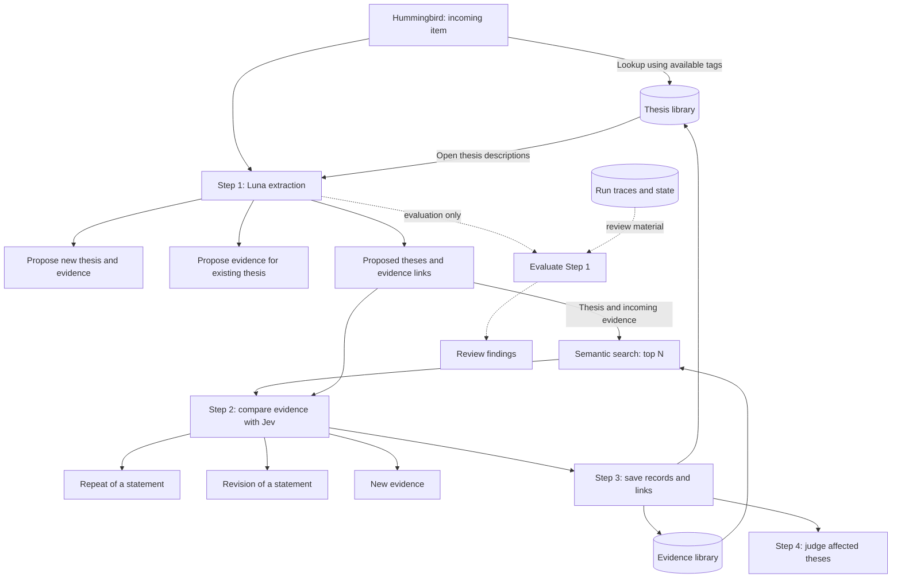

# Hivemind architecture: the hedge fund research brain

**Status: working draft.** This document defines the architecture being developed from Alex's diagram and the discussion around it. It is a design, not a claim that the system has been built or that its quality has been proven.

## 1. What the system does

Hivemind is building a hedge fund brain: a system that follows the decision process of an investment analyst. It receives source material, identifies information and ideas that may matter to assets or events in the world, connects that information to the research being followed, and maintains a dossier of the evidence and events behind each thesis.

A thesis is a research idea, issue or question the system is tracking. Evidence is information that can inform it. A judgement is an assessment of what the accumulated evidence means for the thesis. The thesis, its evidence and its judgement are different things. The agreed minimum for a new thesis is its entity, research question, outcome to track and period when known; further details remain open.

For example, the thesis could be **“How much will a company's capital spending grow this year?”** An article reporting a 25% forecast is evidence. The judgement is what that and the other evidence imply for the answer.

The dossier should preserve how the research develops: the events and statements that inform a thesis, where they came from, how they relate to earlier information and what they imply for an asset or a broader event. The system must keep those connections clear enough that a reader can understand why a judgement exists.

## 2. Architecture at a glance



The live path processes an incoming item through extraction, comparison and saving. Judgement uses the saved evidence downstream; its trigger and timing are open. Evaluation is a separate test of extraction. The thesis library and evidence library are logical stores in this picture; the physical database design is open. The image Alex supplied is available as the [original diagram](reference-diagram.png); the text below explains each box and arrow.

| Part of the diagram | What it receives | What it produces |
|---|---|---|
| Hummingbird stream | Incoming material from its event pipeline. | An item and its available source information. |
| Thesis lookup | The relevant company tags for the item. | All open thesis descriptions in scope for those tags. |
| Step 1: Luna | The item, relevant company tags and open thesis descriptions. | Existing or proposed new theses, each associated with evidence from the item. |
| Step 1 evaluation | Source articles, model inputs and outputs, and thesis state before and after each article. | Human review findings about extraction, thesis reuse and state changes; this is separate from the live path. |
| Semantic search | A thesis and incoming evidence. | Up to N related evidence records from the evidence library. |
| Step 2: Jev | Incoming evidence and the returned evidence candidates. | An evidence relationship: repeat, revision or new. |
| Step 3 | The Step 1 proposals and Step 2 results. | Saved theses, evidence, sources and relationships. |
| Step 4 | The affected thesis and its saved evidence. | A thesis judgement; the detailed contract remains open. |

## 3. The information the system works with

| Information | What it is for |
|---|---|
| Incoming item | The article or other material Hummingbird supplies for processing, with its available source information. |
| Thesis | A research idea, issue or question about an asset or event that is either already open or proposed as new. |
| Evidence | A statement, number, event or view from the item that is relevant to a thesis. |
| Evidence source | The material and relevant passage or location behind the evidence, with speaker and date when known. |
| Evidence relationship | A connection showing that evidence repeats or revises an earlier statement. |
| Judgement | An assessment of what the available evidence implies for a thesis. |
| Run trace | The source item, the thesis context shown to the model, its output and the resulting thesis state, available for review. |

A thesis can have many pieces of evidence. An article can contain evidence for more than one thesis, propose a new thesis, do both, or produce neither. The draft response represents one statement once and links it to each relevant thesis; its mapping to persisted records remains to be verified.

## 4. Step 1: extract theses and evidence

### Input

Hummingbird supplies an item. Step 1 receives the item, all relevant company tags and all open thesis identities and descriptions in scope for those tags, with each tracked outcome and period when available. These descriptions give the model the context needed to identify existing research. For the current single-entity flow, this means the complete open thesis list for the entity being processed.

The model does not need the full history of evidence for every thesis in this step. This input assumes that the relevant tags are available; how to discover affected companies across entities is separate future work (section 16).

### What the model decides

The model reads the item and proposes linked theses and evidence:

1. **Existing thesis:** identify an open thesis that the item informs and propose the relevant new evidence for it.
2. **New thesis:** identify an important research idea, issue or question not already covered by the supplied open thesis list and propose it together with the article evidence that supports it.

These are two possible results from the same reading, not two required calls. Every proposed evidence statement is paired with an existing or proposed new thesis, and a new thesis is proposed with evidence. An existing thesis retains its identity; finding evidence for it does not require renaming it. The Step 1 prompt should define duplicate theses clearly so the model can use an existing thesis when the idea is already covered; the precise definition still needs to be worked out and evaluated.

Step 1 proposes records. Saving them happens in Step 3. The direction discussed for this architecture is that Step 1 decides whether a thesis is new; there is no separate thesis-routing stage in the proposed flow. Whether the model makes that distinction reliably enough must be evaluated. A concrete working draft of the Luna request appears in [section 12](#12-step-1-prompt-luna-working-draft).

### Output

Conceptually, the output is a collection of `{thesis, evidence}` associations:

- The thesis is either a reference to an existing open thesis or a proposed new thesis. A new thesis states the research question and the outcome to track, with a period when known. For the current single-entity flow, code assigns the supplied entity.
- The evidence contains the relevant statement and enough source information to find and interpret it.
- One thesis may have multiple evidence statements.

Section 12 shows a proposed JSON response shape: one list of new theses and one list of evidence, with links from each evidence item to the existing or new theses it informs. Local references connect records in one response; application code assigns persistent identities. The runtime schema has not been finalized or enforced. Preserve the meaning of the source and distinguish what the source says from what is inferred. Do not invent a speaker, date or figure absent from the item.

| What Step 1 finds | Proposed handoff |
|---|---|
| Evidence for an existing thesis | Existing thesis reference plus one or more evidence statements and their sources. |
| A new thesis | Proposed thesis plus the article evidence supporting it. |
| Both | Both kinds of association in the same item output. |
| Neither | An empty result for the item. |

The item itself is the source of the new evidence. The open thesis descriptions provide context for deciding where it belongs. The historical evidence search happens later.

### Step 1 contract and the existing ledger

Step 1's research result is a collection of thesis–evidence pairs. The structured-output example in section 12 is a **proposed model response**, not the existing production response or a final database write contract. A pair can refer to an existing thesis or propose a new one; each pair has one or more source-backed evidence items. One statement can inform more than one thesis.

The first forward run can advance a separate, isolated test thesis library using those proposals. It can review Luna's output and the evolving thesis state without creating production-compatible judgement records. This test library must not be presented as proof that the existing ledger writer or Step 4 can consume the result.

On 2026-11-06, Alex agreed that a new thesis should carry the entity, research question and outcome being tracked, with a period when known. For this single-entity flow, code supplies the entity from the input; Luna supplies the question, outcome and known period. The proposed `period` field is null when the period is unknown. Whether Step 4 needs predefined outcome ranges is a separate open decision; this minimum is not sufficient to claim compatibility with the current production writer.

For reuse of the existing ledger, the new handoff must preserve the fields actually needed by its writer and readers. Section 18 maps the current draft to those fields and separates straightforward mappings, values the system can supply, and unresolved research decisions. The new path must not manufacture evidence tiers, thesis dates or outcome ranges to make an old contract pass. If the user chooses different thesis or judgement semantics, their effect on the writer and readers must be designed and tested explicitly.

### Example

The open list contains **“How much will Company A's capital spending grow this year?”** The item says Company A raised its forecast to 25% and also announces a new manufacturing partnership that could matter for future supply.

Step 1 could return:

- **Existing thesis:** capital-spending growth → **evidence:** the new 25% forecast.
- **Proposed new thesis:** the manufacturing partnership's future supply impact → **evidence:** the partnership announcement.

These examples illustrate the flow; they do not define a fixed list of what is important or establish that a particular item merits a new thesis. The model has to judge relevance in context.

## 5. Step 2: find and compare related evidence

### Why this is separate

An open thesis may accumulate many evidence records. Step 1 needs to understand the article and the open research; it does not need to read every prior statement to do that. Step 2 uses each proposed `{thesis, evidence}` association to find the history worth comparing.

### Find candidate evidence

The proposed design places semantic search over the evidence library. It uses the thesis and incoming evidence to find top-N related evidence across the current entity, including evidence linked to other theses. The thesis is search context, not a restriction to evidence already linked to that thesis. This also applies when the proposed thesis is new. For example, “raised its revenue outlook” and “expects higher sales” can be related despite different wording. Alex chose this entity-wide scope on 2026-11-06.

Search returns **candidates**, not a final decision. Alex discussed a starting point of top 10; the implementation and quality requirements need to be measured.

A match outside the returned set will not be considered by the comparison. Search quality therefore matters independently from the model's ability to compare the records it receives.

### Compare with Jev

Jev compares the new evidence with the returned evidence. The intended outcomes are:

| Outcome | Meaning | Example |
|---|---|---|
| Repeat | The new material presents the same statement again. | Another article reports the same company forecast. |
| Revision | A later account changes the same statement. | The company revises its forecast from 12% to 25%. |
| New evidence | It is not identified as a repeat or revision of the evidence compared. | A different analyst offers a separate forecast. |

The words, amount, speaker, source and time can matter to the comparison. A later statement about the same subject is not necessarily a revision. A matching amount alone does not prove that two statements are the same.

The result “new evidence” is the outcome of the comparison performed; it is not proof that no matching evidence exists elsewhere in the library. How to handle conflicting candidates or uncertainty remains to be designed.

**Repeat handoff:** when Jev identifies a repeat, the comparison must retain the identity of the existing evidence record it was compared against. Step 3 uses that identity to add the incoming source and any missing thesis link to the existing record. The typed Jev response need not generate the record ID: the caller can associate the choice with the candidate it supplied. The resolution of conflicting or uncertain candidates remains open.

The diagram's intended sequence is: use `{thesis, incoming evidence}` to search the evidence library; pass the returned candidates and incoming evidence to Jev; pass the comparison result and the proposed association to Step 3. For a new thesis, search the same entity-wide evidence library. A concrete working draft of the Jev comparison request appears in [section 13](#13-step-2-prompt-jev-working-draft).

## 6. Step 3: save evidence and links

Step 3 takes the proposals from Step 1 and the comparison outcomes from Step 2 and writes the resulting research information.

| Result | What is saved |
|---|---|
| New thesis with supporting evidence | The new thesis and its evidence link; save new evidence or reuse a matching record according to Step 2. |
| New evidence for an existing thesis | The evidence and its link to the thesis. |
| Repeat | Reuse the existing evidence record, add the incoming source, and add any missing link to the relevant thesis. Do not create another evidence record for the same statement. |
| Revision | The new evidence and its source, linked to the earlier statement as a revision. |

A revision does not erase the earlier statement. On 2026-11-06, Alex chose to keep one evidence record for a repeat and add the new source and any missing thesis link. Multiple articles reporting the same statement do not automatically establish independent original sources. The current production writer stores separate repeat records, so this is a change for the clean path and needs implementation and verification; the existing historical records remain available. Step 3 ends when the chosen thesis, evidence and relationships are saved. How they are physically stored and written is a separate implementation decision.

## 7. Step 4: judge the thesis

Judgement is separate from processing and saving an article. It assesses what the evidence implies for an affected thesis and whether the thesis's current assessment should change.

For the capital-spending example, saving the revised forecast records **what the company said**. Judgement later considers **what that means for the investment question**. The saved evidence and its relationships must be available to that work.

This discussion has not yet defined the judgement's input selection, output, timing or decision method. Those are open design questions, not implicit requirements of the earlier steps.

## 8. Evaluate Step 1

Step 1 evaluation is an offline forward run followed by a source-by-source review of the trace and the changing thesis state. Alex's direction is to inspect what the system actually does instead of first constructing a hypothetical golden library of thesis–evidence pairs. This does not change the existing frozen references used by historical measurements.

The evaluation should allow us to answer:

- Did the model identify the research ideas an analyst would follow, without proposing already tracked research as new?
- Did it find the relevant evidence in the article, and did it include information that should not have been kept?
- Did it preserve what the source says, including the speaker and date when available?
- Did it connect evidence to the right thesis, given the open theses it was shown?

Review the complete article beside the exact thesis context and the model's raw output. Inspect evidence the model missed as well as what it kept. After each item, inspect what was added to the thesis library and whether a duplicate or incorrect link affects later articles. Alex agreed to review the first run's traces and resulting state before deciding what quality is sufficient to proceed. The articles and review coverage remain to be selected; a trace review does not by itself establish system-wide accuracy.

### Forward run and state review

Run selected articles in a fixed order against a known initial library. Capture, for each article, the source text, the exact open-thesis context, the raw Step 1 output, and the resulting library state. The next article sees the state actually produced by the preceding article. Review the trace and state against the source to identify misses, incorrect evidence or links, and duplicate theses. Document mistakes and their downstream effects rather than silently correcting the run's history.

This can begin with Step 1 and a test library; it does not require completing Jev or the full production pipeline. A separate golden library or validation split is not required by this proposed approach. The test-library implementation, article selection and review coverage remain open. No forward model run is claimed here.

### Exploratory playforward: H200 articles

This is a manual simulation of Step 1, not a Luna model run, a frozen golden reference or a measurement. It uses three cleaned records from the local source database in their stored replay-day order, with an initially empty hypothetical NVIDIA thesis library. This is a selected example for inspecting the design, not evidence of broad performance. The old production Luna prompt was consulted as a reference, but it proposes candidates and leaves folding into an existing question to later code; the clean design asks Step 1 itself to identify the existing thesis.

Source limitations: the first record's stored `publication_day` is July 8 while its `published_at` says July 9; the order below follows the stored replay day and is not proof of real publication order. The second cleaned text is only 855 characters and appears to contain a short article excerpt; conclusions are limited to the stored text. In all cases the quoted reports and uncertain estimates remain attributed, not treated as confirmed outcomes.

**Initial library:** empty.

**1. July 8 — [China to let AI firms buy Nvidia H200s, says report](https://www.straitstimes.com/business/china-to-let-ai-firms-buy-nvidia-h200s-information-says).** The Information reports that China plans to permit limited purchases by selected AI companies, subject to applications; it reports that the possible total may be fewer than 200,000 chips. Separately, the article says NVIDIA's CFO had said in May that H200s had generated no China revenue and that imports were uncertain.

| Proposed thesis | State | Evidence from this article |
|---|---|---|
| Will China permit selected companies to purchase and import NVIDIA H200 chips, and under what limits? | New | The Information's reported plan, application conditions and possible scale, all as reports rather than a confirmed final quota: "the total may end up being fewer than 200,000". |
| Will NVIDIA realize H200 shipments and revenue from China? | New | The CFO's earlier statement that H200 chips "had yet to generate any revenue for the company in China", with its original May timing. The reported possible purchases are also relevant, but do not establish sales or revenue. |

**Library after article 1:** two open theses: purchase and import permissions; actual shipments and revenue.

**2. July 9 — [Why China is finally letting AI firms buy the Nvidia H200](https://www.scmp.com/tech/policy/article/3360027/game-changer-why-china-finally-letting-its-ai-firms-buy-nvidia-h200).** A source with knowledge of the matter tells the South China Morning Post that China plans to allow selected companies, including Alibaba, to buy limited numbers.

| Proposed thesis | State | Evidence from this article |
|---|---|---|
| China purchase and import permissions | Existing: reuse thesis 1 | The article's separately attributed report of a plan for selected companies to "buy limited numbers of the device". It does not establish that purchases or shipments happened. |

**Library after article 2:** the same two theses. Step 1 proposes the article's evidence with the existing thesis; deciding whether it repeats an earlier statement belongs to Step 2, not this simulation.

**3. July 14 — [U.S. trade official says very few Nvidia H200 AI chips have been shipped to China](https://www.cnbc.com/2026/07/14/nvidia-h200-ai-chips-china.html).** U.S. official Jeffery Kessler says that very few shipments against licenses for H200s and equivalents have occurred, involving a very small quantity, to China and Hong Kong. He also describes case-by-case U.S. licensing. The article says whether China will ultimately approve large quantities remains unclear.

| Proposed thesis | State | Evidence from this article |
|---|---|---|
| NVIDIA H200 shipments and revenue from China | Existing: reuse thesis 2 | Kessler's statement that "very few shipments against licenses for H200s and equivalents have taken place" to China and Hong Kong. It does not specify revenue, a precise count or China alone. |
| China purchase and import permissions | Existing: reuse thesis 1 | The article says it "remains unclear whether China will ultimately approve the import of large quantities". This is the article's assessment, not a new government decision. The U.S. licensing process is a related but distinct policy constraint and must not be represented as Chinese approval. |

**Library after article 3:** still two theses. The earlier CFO statement and later shipment statement have different dates and geographic scopes; the later statement does not establish an amount of revenue or automatically revise the earlier statement.

The precise boundaries between these two theses, and which additional material an analyst would retain from each complete source, need independent review. The exercise illustrates how to save before-state, article, proposed pairs and after-state. It does not establish a finalized golden answer or acceptance rule.

The diagram's evaluation branch uses the captured run traces and state for review. It does not gate the live flow or write to the live thesis and evidence records. A live item goes from Step 1's output to Step 2 without waiting for offline review.

Separately, Step 2 requires evaluation of two things: whether search finds the relevant prior evidence, and whether Jev correctly identifies the relationship once it is shown that evidence. The saved result and its effect on a later reader also need to be assessed. No accuracy, cost or speed claim is established by this PRD.

## 9. Walk one item through the system

Assume the thesis library already contains **“How much will Company A's capital spending grow this year?”** Its evidence library contains Company A's earlier 12% forecast. A new article reports that Company A has raised the forecast to 25%.

1. **Receive and read:** Hummingbird supplies the article. Step 1 receives the open capital-spending thesis and reads the article.
2. **Extract:** Step 1 returns the existing thesis linked to the 25% statement and its source. It does not need to read all of the thesis's old evidence to extract this pair.
3. **Find history:** search uses the thesis and 25% statement to retrieve related prior evidence, including the 12% forecast if search works correctly.
4. **Compare:** Jev identifies the 25% statement as a revision of the earlier forecast, if it is given enough information and judges the relationship correctly.
5. **Save:** Step 3 saves the 25% statement, its source and its link to the thesis, and records its revision relationship to the 12% statement. The earlier evidence remains available.
6. **Judge separately:** Step 4 may assess the thesis using the evidence. Its decision process is not specified here.

If search misses the 12% statement or Jev chooses the wrong relationship, the saved record may be wrong. Those are different failure points and should be tested separately. This example describes intended behavior, not a test result.

## 10. Open design questions

1. **Thesis lookup:** Step 1 is to receive all relevant company tags and all open theses in scope for those tags. How tags are supplied and how this input performs in practice still need verification; cross-entity discovery and linkage are separate future work in section 16.
2. **New thesis identity:** How should the Step 1 prompt define duplicate theses, and how accurately does the model apply that definition without a separate thesis-routing stage?
3. **Search:** How should semantic search be built, how many candidates should it return, and how will its recall, speed and cost be measured?
4. **Evidence comparison:** How should Jev handle conflicting candidates, uncertainty, attribution, dates and evidence linked to multiple theses?
5. **Saving:** What are the exact record, link and write contracts for theses, evidence, sources and relationships?
6. **Evaluation:** Which articles and review coverage should the first forward run use? Review its traces and state first, then decide what quality is sufficient to proceed. Step 2 review remains to be designed.
7. **Judgement:** What evidence does Step 4 use, when does it run, and what does it produce?
8. **Integration:** What exactly does Hummingbird deliver, and how does a new item see the appropriate library state?

## 11. Design boundary

This PRD owns the new architecture described here. The [original diagram](reference-diagram.png) is the starting picture; this document contains the clarified flow. Open questions are intentionally open. No search provider, database product, model-call count, pass threshold, judgement schedule or runtime behavior has been selected by this draft.

## 12. Step 1 prompt: Luna working draft

**Purpose:** let a reader inspect the proposed system prompt, per-item input and output schema for turning an item and the open thesis list into thesis–evidence associations. These are first-principles drafts for the clean architecture. They are not the current production request, a deployed schema or a validated model request. No production prompt has been replaced and this draft has not been sent to a model.

### What Luna receives

- The whole source item, with available source, speaker and publication information.
- All relevant company tags and all open thesis descriptions and identities in scope for those tags, with outcomes and periods when available.
- The instructions below. Historical evidence is not included in this Step 1 input.

### Proposed system prompt

```text
ROLE

You are a hedge fund research analyst. Extract thesis–evidence pairs from
one source item to build a source-backed research dossier.

INPUT

- Source item: read the complete text and its source metadata.
- Company tags: the supplied companies in scope for this item. Code supplies
  the current entity; do not invent an entity tag. Relevant evidence can
  describe another party when it informs research for the supplied entity.
- Open theses: identities and descriptions of research already tracked,
  including each tracked outcome and period when available.

Use the open thesis list to find where evidence belongs and decide whether an
idea is already covered. It is not evidence for the new item. You do not have
the historical evidence list; a later step compares evidence with history.

1. IDENTIFY RESEARCH AND EVIDENCE

A thesis is a research idea, issue or question worth tracking because its
outcome could matter to a company's business, an asset or a wider event.

- Identify the subject and the outcome or event being investigated. Consider
  how its answer could matter to revenue, profitability, cash or credit risk,
  competitive position, or another relevant business or asset outcome.
- Make the question clear enough for later evidence to inform it. Preserve
  the scope and period supported by the item; do not invent a deadline.
- Ask whether the idea addresses a meaningfully different question from the
  open research. If the existing thesis already captures its significance,
  attach the evidence there. A number, date or headline alone is not enough
  to open a separate thesis.
- Open a separate thesis for a single deal, product or project only when its
  scale can change the company's revenue, profit, cash or credit risk. A
  detail that does not justify its own thesis may still be useful evidence.
  Do not invent a scale, or discard evidence solely because scale is unstated.

Examples of questions worth tracking when supported by the item:

- Bank: "Will rising borrower stress increase credit losses?" Loan losses can
  affect profitability. A reported rise in overdue loans is evidence; it does
  not establish what losses will ultimately be.
- Manufacturer: "Will a supplier's capacity constraint limit production?"
  A supplier's announced expansion can inform the question; it is not proof
  that the manufacturer has secured additional supply.
- Drugmaker: "Will the regulator approve the treatment?" Approval can affect
  whether the treatment reaches the market. A filing or agency decision is
  evidence; a filing is not an approval.

Examples of linking evidence to research:

- Supply chain: An open thesis asks whether a manufacturer's production is
  constrained. A named supplier announces a capacity expansion for a component
  the manufacturer uses. Link the announcement to the open thesis as a
  potential supply signal; it does not establish allocations or deliveries.
- Geopolitics: An open thesis asks whether an exporter can sell in a specified
  market. The relevant government proposes a licensing restriction on that
  product. Link the proposal as evidence about market access; a proposal is
  not an enacted restriction, and the impact on sales is not yet established.
- Macro: An open thesis asks whether a company's borrowing costs will rise.
  The item reports that its floating-rate debt is tied to a benchmark that has
  risen. Link the benchmark movement and the stated exposure as evidence; do
  not calculate the company's expense change unless the source supports it.
- Competition: An open thesis asks whether a company can retain customers in a
  product market. A named competitor cuts the price of a competing product.
  Link the price cut as competitive evidence; do not assert lost customers or
  market share without support.

Each example assumes the item supplies the named relationship and an open
thesis covers the question. If it does not, assess a source-backed new thesis
on its own merits. Use the item and supplied context to assess direct or
indirect relevance. Explain an inferred connection; do not present it as a
source fact.

Counterexamples:

- "The company's outlook is interesting" is too vague: it does not identify
  an outcome or question that later evidence can meaningfully inform.
- If an open thesis tracks sales growth, a revised sales forecast can be
  evidence for it. Do not open a second thesis solely to repeat that forecast.
- A source saying a customer is expanding capacity may inform demand; do not
  turn it into a claim that the supplier has received orders or revenue.

These examples teach the judgment, not a closed list of sectors, metrics or
questions. Decide relevance using the item and the open thesis list.

Evidence is information in the item that supports, challenges or adds context
to a thesis. Consider company results and plans, other parties' actions or
estimates, and policy developments. These are examples, not a closed list.

- Consider direct and indirect relevance; explain an indirect connection.
- Do not treat a possible impact as an established fact.
- Do not discard meaningful evidence solely because an amount, date or scale
  is missing. A previously reported plan or current guidance can still matter.

2. CHOOSE A THESIS FOR EACH IDEA

Compare each idea with the complete open thesis list:

- EXISTING: If an open thesis covers the idea, link the item's relevant
  evidence to its exact supplied ID, including contrary facts. Do not return
  or rename its description.
- NEW: If the idea merits separate tracking and no open or newly proposed
  thesis covers it, propose a thesis and attach the item's evidence that
  motivates tracking it, whether favorable or unfavorable. State the research
  question and the outcome being tracked. Give a period when known from the
  item or supplied context; use null when unknown. Code assigns the supplied
  entity; do not invent a different entity or a period.
- NONE: If the item produces neither kind of pair, return both lists empty.

Match by the underlying question or outcome, subject and scope, and time when
relevant—not by word overlap. A different wording, source, forecast or direction
alone does not make a new thesis. Related questions can be separate when their
outcomes matter independently. An item may produce existing pairs, new pairs,
both, or none.

Do not exclude evidence solely because it concerns a related period, population
or product variant. Assess whether it can inform the open question, preserving
the difference in the record. Do not present a forecast for a later year as a
forecast for the thesis's year. If another open thesis covers the evidence
more directly, consider that thesis as well; do not assume different periods
are automatically the same thesis or automatically unrelated.

Example: A lower sales forecast can challenge an existing sales-growth thesis;
it does not create a new sales thesis. A distinct margin question may merit its
own thesis. A different date alone does not automatically make a new thesis.

Example: An existing thesis asks whether a manufacturer's production is
constrained. A supplier reports a planned capacity expansion. Link the plan
to that thesis as potential supply evidence; do not claim orders, production
or revenue followed. A separately significant question about the supplier's
own profitability is not automatically the same research question.

3. PAIR AND DESCRIBE THE EVIDENCE

- Every pair contains one thesis and at least one evidence item from this item.
- Do not return evidence without a thesis or a new thesis without evidence.
- One thesis can have multiple evidence items; one statement can inform more
  than one thesis. Combine repeated descriptions of the same matter within
  the item, but retain distinct useful facts, conditions and developments.
- Return each evidence statement once with links to every thesis it informs.
  For a new thesis, use a local reference in this answer. For an existing
  thesis, return its supplied ID; do not restate or rename its description.
  Local references connect this answer only; they are not database IDs.
- For each evidence item, write a standalone summary and copy the source
  passage verbatim. Preserve amounts, periods, conditions and uncertainty.
- Name the actor in the summary and identify the original party whose action,
  figure or claim it is. Give the reporting speaker when available. The
  article's publisher and publication date come from its source metadata.
- Distinguish forecasts, allegations and unconfirmed reports from confirmed
  outcomes. Do not turn a plan into an order, shipment or revenue.
- For each item, return its evidence tier, the original statement date and
  the period the statement describes. These are separate pieces of information.

EVIDENCE TIER

Classify the statement by what is confirmed, not how important it is:

- rumour: the item attributes the claim to unnamed sources or calls it
  unconfirmed.
- fact: an official action, published actual figure or completed transaction,
  including an announcement or completed transaction reported by an article.
- party_statement: a company's guidance, management statement or official's
  remarks. A forecast is a statement, not a completed outcome.
- third_party_view: an analyst's, journalist's or expert's opinion or estimate.

Apply the first matching category in that order. An unnamed-source or
unconfirmed claim remains a rumour even if it describes an action or number.
If none matches and the claim is unattributed, use rumour. For a mixed
statement, classify its main claim and retain the secondary qualification.
The tier is not an importance score and does not establish independence.

EVIDENCE TIME

- statement_date: the original statement's full day in YYYY-MM-DD when known;
  otherwise null. Do not use the article date as the original date unless the
  statement was made in the originating party's own release, filing, call or
  analysis. Do not assign that date to an older statement quoted there.
- statement_date_text: the original date or partial date as stated, if present;
  otherwise null. Preserve a month or relative date without inventing a day.
- evidence_period: the period the reported fact, plan or forecast covers, as
  supported by the item; otherwise null. This is not the statement date.

4. FINAL CHECK

Read the article and proposed pairs again. Check for:
- Relevant evidence missed or incorrectly linked.
- A new thesis already covered by an open or proposed thesis.
- A thesis without evidence or evidence without a thesis.
- Unsupported claims, missing conditions or invented certainty.
- Background the analyst already knew, such as a company's founding date or
  an existing customer arrangement. Do not exclude a newly reported action,
  expansion, integration, order or newly disclosed business figure by this rule.
- Commonplace claims or unargued views, such as "demand is strong" or "the
  stock is a hold". Consider a specific new forecast, reported price movement
  or analysis that adds a fact or calculation on its merits.
- Product specifications or benchmark comparisons without business scale,
  such as a device's wattage or a reviewer's test. Do not exclude a rival's
  comparison with the company's product, a launch, delay or customer adoption
  by this rule.
- Political or strategic stance without a decision or figure, such as a
  general call for independence. A policy step or decision still in force
  must be judged for relevance.
- Share-price moves, trading positions and unrelated other-company matters.
  A post-earnings price reaction or the covered company's valuation may be
  optional; judge the underlying news and another party's relevant actions or
  figures, including a demand, supply, competition or pricing connection.
- Boilerplate, advertisements and the same fact repeated within this item.
  Preserve distinct facts, terms and conditions of a retained matter.

Do not remove relevant current guidance, forecasts or plans merely because
they were reported before, or a meaningful statement solely because it lacks
an amount, date or scale. Forecasts, rumors, counter-evidence, distant or
conditional statements are judged on relevance and retain their uncertainty.

Return the linked theses and evidence in the supplied response schema. Return
empty lists when no pair is warranted.
```

### Proposed per-item input

The following is an illustrative user-message payload. It is data for this article, not the system prompt or the output schema. The item-level publisher and publication date stay with the source item; an evidence statement's original speaker and date can be different. Whether the runtime sends this as serialized JSON or equivalent labelled text remains to be decided.

```json
{
  "company_tags": ["RETAILER"],
  "open_theses": [
    {"id": "t1", "description": "Will the retailer grow sales?", "outcome": "Whether the retailer's sales grow.", "period": null}
  ],
  "source_item": {
    "id": "example-article",
    "publisher": "Example publisher",
    "publication_date": "2026-01-10",
    "source_uri": "https://example.com/article",
    "text": "The retailer raised its sales forecast. The regulator approved the retailer's acquisition of the company operating its nationwide delivery network."
  }
}
```

### Proposed structured-output schema

This JSON Schema is a **draft** to be sent separately as the Chat Completions `response_format.json_schema.schema`, not copied into the system prompt. Separate `new_theses` and `evidence` lists, connected by links, express the required thesis–evidence pairs without copying one evidence item for each thesis. Each new thesis has a question in `description`, a tracked `outcome` and a `period` when known; the application supplies the entity for the current single-entity flow. Local IDs only connect records within this answer; they are not persistent identities. Field descriptions tell the model what the fields mean. This is not the existing production schema and does not implement the new Step 1.

```json
{
  "type": "object",
  "additionalProperties": false,
  "required": [
    "new_theses",
    "evidence"
  ],
  "properties": {
    "new_theses": {
      "type": "array",
      "description": "New thesis proposals, each referenced by at least one evidence link.",
      "items": {
        "type": "object",
        "additionalProperties": false,
        "required": [
          "local_id",
          "description",
          "outcome",
          "period"
        ],
        "properties": {
          "local_id": {
            "type": "string",
            "description": "Local reference for this new thesis in the answer; not a database ID."
          },
          "description": {
            "type": "string",
            "description": "The proposed research question, stated clearly."
          },
          "outcome": {
            "type": "string",
            "description": "The outcome or event being tracked by this thesis."
          },
          "period": {
            "anyOf": [
              {
                "type": "string"
              },
              {
                "type": "null"
              }
            ],
            "description": "The period or horizon when supported by the source or supplied context; null when unknown."
          }
        }
      }
    },
    "evidence": {
      "type": "array",
      "description": "Evidence statements extracted from this item, with their thesis links.",
      "items": {
        "type": "object",
        "additionalProperties": false,
        "required": [
          "local_id",
          "summary",
          "source_passage",
          "original_party",
          "reporting_speaker",
          "tier",
          "statement_date",
          "statement_date_text",
          "evidence_period",
          "links"
        ],
        "properties": {
          "local_id": {
            "type": "string",
            "description": "Local reference for this evidence in the answer; not a database ID."
          },
          "summary": {
            "type": "string",
            "description": "Standalone faithful summary naming the actor and preserving relevant figures, periods and conditions."
          },
          "source_passage": {
            "type": "string",
            "description": "Verbatim passage from the source item supporting the summary."
          },
          "original_party": {
            "anyOf": [
              {
                "type": "string"
              },
              {
                "type": "null"
              }
            ],
            "description": "Party whose action, figure or claim is reported; null if unknown."
          },
          "reporting_speaker": {
            "anyOf": [
              {
                "type": "string"
              },
              {
                "type": "null"
              }
            ],
            "description": "Person or outlet making or reporting the statement in this item, when known; null if unknown."
          },
          "statement_date": {
            "anyOf": [
              {
                "type": "string",
                "pattern": "^[0-9]{4}-[0-9]{2}-[0-9]{2}$"
              },
              {
                "type": "null"
              }
            ],
            "description": "Original statement day as YYYY-MM-DD when known; null if the full day is unknown."
          },
          "links": {
            "type": "array",
            "minItems": 1,
            "description": "At least one existing or proposed thesis informed by this evidence.",
            "items": {
              "type": "object",
              "additionalProperties": false,
              "required": [
                "target_type",
                "target_id",
                "relevance"
              ],
              "properties": {
                "target_type": {
                  "type": "string",
                  "enum": [
                    "existing",
                    "new"
                  ],
                  "description": "Whether the reference identifies an open thesis or a new proposal."
                },
                "target_id": {
                  "type": "string",
                  "description": "Exact supplied ID when existing, or local_id of a new thesis in this answer."
                },
                "relevance": {
                  "type": "string",
                  "description": "How this evidence informs the referenced thesis, distinguishing source claims from inference."
                }
              }
            }
          },
          "tier": {
            "type": "string",
            "enum": [
              "fact",
              "party_statement",
              "third_party_view",
              "rumour"
            ],
            "description": "Source tier of the statement; an unconfirmed or unnamed-source claim takes precedence as rumour."
          },
          "statement_date_text": {
            "anyOf": [
              {
                "type": "string"
              },
              {
                "type": "null"
              }
            ],
            "description": "Original date or partial date as stated in the item; null when absent."
          },
          "evidence_period": {
            "anyOf": [
              {
                "type": "string"
              },
              {
                "type": "null"
              }
            ],
            "description": "Period the fact, plan or forecast describes, as supported by the item; null when unknown."
          }
        }
      }
    }
  }
}
```

For an OpenAI Chat Completions request, the existing [request builder](../src/hivemind/model.py) wraps its schema with `type: json_schema`, a name and `strict: true`. OpenAI's [Structured Outputs guide](https://developers.openai.com/api/docs/guides/structured-outputs) requires object fields to be required, allows nullable types for unknown values, and uses `additionalProperties: false` for objects. The guide lists `minItems` for arrays; model and endpoint compatibility for this draft still need to be verified with the actual request. A schema-conforming response can still be factually wrong, incomplete or semantically mislinked; refusal and incomplete responses also need separate handling. [OpenAI Structured Outputs](https://developers.openai.com/api/docs/guides/structured-outputs).

The official [GPT-6 Luna model page](https://developers.openai.com/api/docs/models/gpt-6-luna) lists both Chat Completions and structured outputs as supported. This confirms the general capability, not acceptance of this particular untested schema or correctness of its answers. OpenAI's [prompt engineering guide](https://developers.openai.com/api/docs/guides/prompt-engineering) describes using headings, lists and examples to make instructions and context clear. In this draft, the system prompt carries analyst decisions; the per-item message carries the changing data; and the separate schema owns response fields and their descriptions.

Application checks are needed for cross-record and source rules the schema alone cannot enforce: each existing target must resolve to the supplied open list; each new target must resolve to one new thesis in the same answer; each new thesis must be referenced by evidence; local IDs must be unique within their list; each evidence item must have a link; and each source passage must be nonempty and come from this item. Code retrieves an existing thesis description from the supplied list rather than asking Luna to echo it. These checks verify shape, identity and source location, not whether an analyst agrees with the thesis. Their final implementation is not present yet.

Alex approved returning the evidence tier, original statement date and described period in Step 1. The draft also identifies the original party and reporting speaker separately. Mapping these fields to the existing writer and readers remains to be verified, including how source-specific attribution and tier are retained when a repeat adds another source. The old signed standard also has more specific question-opening and check-date rules than the clean design has settled. This draft must not be described as fully compatible with that standard or the production schema without a separate review.

### Illustrative output for the sample input

The first sentence informs `t1`. For this example, the nationwide delivery-network acquisition is also considered an independently meaningful question; its business effect is not assumed. The new thesis records the acquisition's completion as its tracked outcome and has a null period because none is supplied. The original parties are named in the text; the reporting outlet is in the item metadata, and original statement dates are not specified.

```json
{
  "new_theses": [
    {
      "local_id": "n1",
      "description": "Will the retailer complete its acquisition of the operator of its nationwide delivery network?",
      "outcome": "Whether the retailer completes its acquisition of the delivery-network operator.",
      "period": null
    }
  ],
  "evidence": [
    {
      "local_id": "e1",
      "summary": "The retailer raised its sales forecast.",
      "source_passage": "The retailer raised its sales forecast.",
      "original_party": "the retailer",
      "reporting_speaker": "Example publisher",
      "statement_date": null,
      "links": [
        {
          "target_type": "existing",
          "target_id": "t1",
          "relevance": "A higher forecast informs the question of future sales growth."
        }
      ],
      "tier": "party_statement",
      "statement_date_text": null,
      "evidence_period": null
    },
    {
      "local_id": "e2",
      "summary": "The regulator approved the retailer's acquisition of the company operating its nationwide delivery network.",
      "source_passage": "The regulator approved the retailer's acquisition of the company operating its nationwide delivery network.",
      "original_party": "the regulator",
      "reporting_speaker": "Example publisher",
      "statement_date": null,
      "links": [
        {
          "target_type": "new",
          "target_id": "n1",
          "relevance": "Regulatory approval is a step toward completing the acquisition."
        },
        {
          "target_type": "existing",
          "target_id": "t1",
          "relevance": "A possible change in control of the delivery network may affect sales; the impact is not stated."
        }
      ],
      "tier": "fact",
      "statement_date_text": null,
      "evidence_period": null
    }
  ]
}
```

The second evidence item is written once and links to both theses; the sales connection is explicitly an inference rather than a source fact. If there are no pairs, the output is `{"new_theses": [], "evidence": []}`. The example explains the proposed contract; it is not a golden case or an actual Luna response.

### Mapping to the Step 1 diagram

| Diagram requirement | Where the working prompt addresses it |
|---|---|
| Open theses from the database | **Input** describes the open list as research already tracked and the reference for matching ideas. It is not evidence or the historical evidence list. |
| Decide what constitutes a thesis | **1. Identify research and evidence** describes a meaningful research idea, issue or question and gives examples. These criteria are a working proposal to review in the forward run. |
| Propose evidence for an existing thesis | **2. Choose a thesis**, existing outcome, uses its supplied identity. Code obtains the description from the supplied list. |
| Propose a new thesis with evidence | **2. Choose a thesis**, new outcome, compares against existing and newly proposed theses and requires supporting evidence. |
| Both outcomes or no pair | **2. Choose a thesis** allows both in one item; the proposed schema permits both lists to be empty for neither. |
| Thesis and evidence coexist | **3. Pair and describe the evidence** requires a thesis and at least one evidence item in every pair; the proposed schema and example show the structure. |
| Historical evidence comparison | **Input** explicitly leaves historical evidence comparison to the later step. |

### Request review and remaining limits

The review covered the visible system prompt, sample input, proposed schema and sample response together, with an independent reader. It found three places needing more than formatting: the thesis bar did not explain which business outcome the question could change; the within-item repeat instruction could hide distinct useful facts; and the output did not distinguish the original party from the reporting speaker. The draft above addresses those points. Its expanded examples teach these distinctions across industries; their added length is intentional for that purpose, not a measured quality improvement.

As historical context, two saved responses and their input articles were read in the local [older-run archive](../poc/data/e2e-v83-seed-d2/archive.sqlite): call 4 records two descriptions of an investment in the same article, while call 7 reports a company's plan alongside a separate party's capacity figures. These are examples from an older request, not outputs of this draft. They illustrate why the new request must distinguish repeated descriptions from distinct facts and the original party from the reporter; they do not establish that the revised prompt fixes either case.

No full assembled clean-design request, runtime validation, or Luna answer exists yet. This review is not the measured failure-class audit required for an existing measured prompt. Before model use, review the actual system message, per-item message, schema and all readers and checks together. The exact thesis-opening boundary, storage mapping for evidence tier and source provenance, handling of ambiguous thesis identity, and compatibility with the existing ledger are still open. A forward run and direct source/trace review are needed to learn whether the draft works.

## 13. Step 2 prompt: Jev working draft

**Purpose:** let a reader inspect the proposed comparison instructions after semantic search has selected candidate evidence. This is a draft for the clean architecture, not the current Jev request or a validated Jev API payload. Response format, score handling, uncertainty and multi-candidate resolution remain open.

**Existing interface:** Jev uses a typed `choice` question and returns a choice with probabilities, not a generated explanation. The current evidence criteria are `same_statement`, `supersedes` and `different`, asked for each selected evidence candidate. `cannot_tell` exists in the current **thesis** relation criteria, not in the evidence criteria. The prose below describes the intended comparison; it still needs to be translated into and tested as an actual Jev request. How to use probabilities and resolve several candidates remains open. [Jev evidence criteria](../src/hivemind/views/jev_matching.py) and [transport](../src/hivemind/jev.py).

**Repeat decision:** `same_statement` is the comparison needed for Alex's chosen repeat behavior. The application must retain which existing evidence candidate produced that result so Step 3 can reuse it, add the incoming source and create any missing thesis link. A similar topic or number alone is not enough to establish a repeat. This is a clean-design requirement, not a claim that the current writer already does it.

### What Jev receives

- The thesis the incoming evidence is proposed for.
- The incoming evidence, including its available source, speaker and stated time.
- A candidate prior evidence record returned from the entity-wide search, with its available context; it may be linked to another thesis.
- The comparison instructions and the three relationship descriptions below. The diagram specifies the outcomes; how comparisons are batched is not yet decided.

### Proposed comparison instruction

```text
Compare the incoming evidence with the candidate existing evidence for the entity.
Use the supplied statements and their available source, speaker and time.

Determine which relationship best describes the two statements:

REPEAT: The incoming statement presents the same claim again, including a
retelling or another source reporting that claim.

REVISION: The incoming statement is a later account that changes the same
earlier statement, such as a revised forecast or an updated statement by its
source. Merely being later or about the same subject is not enough.

DIFFERENT: The statements describe different facts, claims or periods rather
than a repeat or revision of the same claim. Distinct original claimants can
make separate claims; a different reporting source may simply retell one.

Consider the wording, figures, speaker, original source, what each statement
refers to, and when it was stated. Similar wording or the same figure alone
does not prove the statements are the same. Do not infer missing details.
Identify the relationship and the existing evidence being compared. If the
supplied information does not establish a relationship, express uncertainty.
```

### Input to be inserted at runtime

```text
[Thesis]
<thesis identity and description>

[Incoming evidence]
<statement and available source, speaker and time>

[Existing evidence]
<one search result and its available source, speaker and time>
```

Jev's pairwise `DIFFERENT` outcome is not proof that no other record in the library matches. Search selection, N, confidence thresholds, the representation and handling of uncertainty, and the rule for combining multiple comparisons are open; this draft does not specify a forced choice when the information is insufficient.

## 14. Existing components to reference during the rebuild

The intended starting point is the existing thesis and evidence database. This map identifies the repository components corresponding to the diagram so they can be inspected and selectively reused. A link identifies existing code or data; it does not mean that the component already implements the clean design or that it should be copied unchanged.

### Thesis and evidence database

The documented local serving default is the existing [thesis ledger](../poc/data/served-2026-10-28-v34-nvda-3m-through-0828/views.sqlite), together with its [source item database](../poc/data/items-nvda-2026-07-01-10-27.sqlite). The ledger stores both theses and evidence; the diagram's two libraries do not require two physical databases. The source item database holds the original material used to resolve evidence sources. These data files are local and are not included in a fresh Git checkout. [Local data and service defaults](../README.md#local-requirements-and-data).

Read-only inspection of this local serving snapshot found 68 theses, 4,298 evidence records, 6,578 thesis-evidence links, 2,023 recorded repeat relationships and 121 revision relationships. Its 746 distinct source item IDs all resolve in the documented local item database. These counts describe this snapshot, not the state of any live deployment.

The existing [storage implementation](../src/hivemind/views/store.py) defines `views`, `evidence`, `evidence_sources`, `evidence_links`, `same_claims`, `revisions` and `judgements`. Evidence records retain the source quotation and attribution; links connect evidence to theses; repeat and revision relationships preserve earlier records. The tables are append-only. This is a strong basis for reuse, but compatibility with the new Step 1 output, Step 2 outcomes, writer, readers and any actually deployed database must be verified before adopting it as the new system's write contract.

### Source pool and golden validation data

There are two different datasets to keep clear:

| Dataset | What it is | What it is used for |
|---|---|---|
| **34,084 stored source records** | The full local collection of source records in the stand-in Hummingbird database. | The pool from which a replay selects source material for processing. The current replay does not send every record to extraction. |
| **148 golden articles** | Selected articles with expected extraction answers: 118 development and 30 test. | Comparing extraction output with the existing golden reference. These articles are a selection from the source database, not an additional 148 documents. |

The 148 golden articles are not the total amount of source material available. Conversely, the 34,084 figure does not mean all records are eligible for processing or have golden answers. The 30 test articles were used in previous experiments and are not a fresh unseen test for the rebuild.

### Source data standing in for Hummingbird

The existing replay uses the local [cleaned source item database](../poc/data/items-nvda-2026-07-01-10-27.sqlite) as a stand-in for the incoming Hummingbird stream. Its records come from collected documents, including news, filings and official material; they are not invented articles. The [corpus pipeline](../poc/corpus/README.md) assembled and cleaned them for experiments. Each record can contain a title, publisher, publication date, source URL, company identifiers and cleaned text; `text_page` retains the fetched page text. This source database is separate from the thesis and evidence ledger.

Read-only inspection of the local file found 34,084 stored records dated 2026-02-25 through 2026-10-26, of which 6,874 have `feed = 1`. These are counts for this file, not for a live Hummingbird service or for any particular run. The collection is NVDA-oriented but also contains other entities and topics. The file is local and excluded from Git.

The existing [replay entry](../scripts/replay.py) defaults to this database, though a run can select another. The [source reader](../src/hivemind/testdb.py) reads the chosen date window in publication order, including feed items and identified copies; [dispatch](../src/hivemind/dispatch.py) then decides which items enter extraction. Thus the number actually processed depends on the window, filters and dispatch. This is a historical replay path; a live Hummingbird connector and its contract have not been established for the clean architecture.

### Existing extraction reference split

The existing frozen extraction reference is a small labelled selection, not a split of every record in the source database. Its files name different source items, with no shared `input_id` between the two sets:

| Existing reference | Articles | Article dates | Source mix in the local item database |
|---|---:|---|---|
| [Development](../docs/research/2026-10-29-ledger-standard/golden-v5/golden-v5-dev.json) | 118 | 2026-07-01 to 2026-07-14 | 108 news-search records, 9 NVIDIA blog records, 1 filing. |
| [Test](../docs/research/2026-10-29-ledger-standard/golden-v5/golden-v5-test.json) | 30 | 2026-09-01 to 2026-10-24 | 30 news-search records. |

All 148 IDs resolve in the local source database. Of the 118 development records, 117 are currently marked `feed = 1`; all 30 test records are. The source categories in each set are 20/73/25 and 5/19/6 for T6/T7/T8 respectively. The two sets have different time windows, but the test set has been used in prior experiments, including full-set runs in the [historical experiment log](../docs/research/2026-10-29-ledger-standard/loop-log.md); it must not be described as a fresh unseen test for the rebuild. NVDA appears in the stored company identifiers of all 118 development records and 26 of the 30 test records.

These files are the existing frozen reference, not an approved evaluation set for the clean architecture. Their applicability to the new thesis-and-evidence output and linking needs to be assessed; no new split or acceptance criteria is decided here. The source item database and the golden references serve different purposes: source items are input material, while golden references are expected answers for selected items.

### Diagram-to-code map

| Diagram block | Existing artifact | What it offers and what remains to be checked |
|---|---|---|
| Hummingbird stream | [Item dispatch](../src/hivemind/dispatch.py), [replay entry](../scripts/replay.py), [source item database](../poc/data/items-nvda-2026-07-01-10-27.sqlite) | The existing path accepts stored items and records processing. A live Hummingbird event connector and its contract have not been verified in this map. |
| Thesis database and lookup | [Ledger store](../src/hivemind/views/store.py), [extraction thesis selection](../src/hivemind/extraction.py), [historical research reader](../src/hivemind/research_context.py) | Existing records and readers provide thesis identities and descriptions. Their scope and timing must be checked against the clean design's input contract. |
| Step 1: Luna | [Extraction](../src/hivemind/extraction.py), [model transport](../src/hivemind/model.py), [existing extraction prompt](../src/hivemind/prompts/role-v74i.txt), [replay configuration](../poc/config/poc-v118.json) | Existing extraction uses Luna and produces evidence and thesis proposals. Its prompt, response shape and selection behavior are not the clean draft in section 12 and require an explicit compatibility review. |
| Step 1 golden evaluation | [Golden development set](../docs/research/2026-10-29-ledger-standard/golden-v5/golden-v5-dev.json), [golden test set](../docs/research/2026-10-29-ledger-standard/golden-v5/golden-v5-test.json), [extraction scorer](../docs/research/2026-10-29-ledger-standard/score_gold.py) | Existing references and scoring code can be inspected. Their coverage and scoring assumptions must be matched to the new test before claiming they evaluate every proposed output or thesis-evidence link. |
| `{thesis, evidence}` handoff | [Extraction handover](../src/hivemind/extraction.py), [item orchestration](../src/hivemind/views/round.py) | Existing extraction returns evidence, candidates and links. The clean architecture's exact handoff contract is still open. |
| Evidence database | [Ledger store](../src/hivemind/views/store.py), [evidence writer](../src/hivemind/views/writing.py) | Evidence, sources and thesis links already exist in the same ledger. Verify the new writes and existing reader behavior on a copy before choosing how to reuse the writer. |
| Semantic search over evidence | [Current evidence ranking](../src/hivemind/views/matching.py), [existing semantic search](../src/hivemind/search.py) | The current evidence candidate ranking uses word overlap. The semantic index in `search.py` indexes **theses**, not evidence. It is a reference for a search implementation, not the evidence search required by this diagram. |
| Step 2: Jev | [Jev transport and request](../src/hivemind/jev.py), [evidence comparison](../src/hivemind/views/jev_matching.py) | The existing path asks Jev to compare incoming and selected existing evidence. Its candidate selection, response and decision logic must be checked against the new search and section 13. |
| Step 2 evaluation | [Evidence decision reference](../poc/eval/gold/evidence-decisions-seed-2026-10-25.json), [evidence decision scorer](../scripts/score_evidence_gold.py) | Existing cases and a scorer cover evidence outcomes and targets for an earlier setup. Their applicability to semantic retrieval and the clean architecture has not been established. |
| Repeat, revision and new outcomes | [Evidence comparison](../src/hivemind/views/jev_matching.py), [evidence writer](../src/hivemind/views/writing.py) | Existing code records these relationships. The clean design must specify the outcome and uncertainty contract before reuse is accepted. |
| Step 3: save and link | [Writer](../src/hivemind/views/writing.py), [store](../src/hivemind/views/store.py), [item orchestration](../src/hivemind/views/round.py) | Existing code writes theses, evidence, source links and relationships. Its current input contract includes old matching decisions and must not be assumed to accept the new handoff directly. |
| Step 4: thesis judgement | [Judgement](../src/hivemind/views/judging.py), [round orchestration](../src/hivemind/views/round.py) | An existing judgement path can be inspected. What to reuse depends on the clean design's still-open judgement contract. |
| Dossier and source reading | [Bundle reader](../src/hivemind/bundle.py), [service](../src/hivemind/service.py), [HTTP entry](../scripts/hivemind_api.py) | Existing readers assemble thesis, evidence and source information. Their coverage of repeat, revision and provenance relationships must be checked against the new dossier requirements. |

One concrete reader boundary matters for this reuse: the local serving snapshot records a revision from `e191` to `e280` under `v8`, and a repeat from `e6` to `e16` under `v1`. A read-only call to the existing bundle reader returns the newer evidence records without those revision or same-claim relationships. The ledger retains them, and the [store's evidence reader](../src/hivemind/views/store.py) reads them; the [bundle reader](../src/hivemind/bundle.py) currently reads the older `replacements` relationship instead. These are the existing matcher's recorded decisions; their semantic correctness was not reviewed here. This is a reader compatibility finding for these inspected cases, not a claim that the underlying evidence is missing or that every reader has the same behavior.

Do not write to the documented serving snapshot as part of this mapping. Any future compatibility exercise must identify the actual target database and source store, use an appropriate copy, and verify both new writes and existing reads. Reusing data and storage does not imply adopting every old prompt, routing rule or judgement behavior.

## 15. Architecture challenge: questions before building

This section records the read-only challenge of the clean design, including the independent Claude Code Fable 5.1 review and discussion. The reviewers found no evidence requiring the existing thesis and evidence ledger or its records to be discarded. Reuse still requires checking the actual readers, writers and meaning of the historical relationships. The points below are risks or open contracts unless a specific observation is identified. They are not new product rules or evidence that the proposed system has failed.

1. **Can Luna see the right research? Resolved as an input design.** Step 1 receives all relevant company tags and all open theses in scope for those tags. For the current single-entity flow, it receives the entity's complete open thesis list. This addresses the concern that a relevant in-scope open thesis is excluded from the model's input. It does not establish that the model will always recognize a matching thesis; that is an evaluation question. How relevant tags are supplied and cross-entity discovery and linkage remain separate questions (section 16).
2. **What makes a thesis new? Prompt design and evaluation.** Alex's direction is to define duplicate theses clearly in the Step 1 prompt, so Luna associates evidence with an existing thesis when the idea is already covered. The exact definition and the model's ability to apply it remain to be worked out and evaluated. This does not introduce a separate thesis-routing stage. Articles processed concurrently against an older library may present a separate implementation issue; handling it is not decided here.
3. **Evidence without a thesis: resolved as an output design.** Alex's direction is that Step 1 outputs thesis and evidence together: either evidence for an existing thesis or a proposed new thesis with evidence. The working prompt states this pairing. There is no separate standalone-evidence output in this design; this is a product choice, not proof that every source fact will be extracted.
4. **Can the evidence history be reconstructed? An implementation and validation question for the existing flow.** Jev's role in Step 2 is to decide whether evidence repeats or revises a prior statement, or is new. Search must first return the relevant prior evidence, and the saved relationship must reach the dossier reader. In the inspected local database, repeat and revision relationships exist, but the existing bundle reader does not expose the two inspected relationships described in section 14. This does not require a new architecture stage; it identifies retrieval and reader behavior to verify when implementing the existing stages.
5. **What should judgement see?** Two different sources can independently support or contradict one another without being a repeat or revision. Step 2 can save them as different evidence, but whether those relationships must be recorded explicitly or can be understood by Step 4 remains open. Step 4's input and output are not yet designed.

The next proposed work is the Step 1 forward run and source-by-source trace review in section 17. The stored repeat and revision relationships and the dossier reader remain relevant to the later saving-and-reading milestone. Their historical model-generated labels are observations, not automatically verified reference answers.

## 16. Future design: entity relationships and cross-entity linkage

**Status: discussion and open design, not part of the current extraction flow.** The current architecture focuses on one entity at a time. Before supporting cross-entity relationships and impact propagation in production, the relationship data structure, maintenance process and linking behavior need a deeper design and validation. This section records the direction discussed; it does not prescribe a schema or add a new step to Luna, Jev or the four-step flow.

### Why this is needed

A thesis can matter to several companies or assets. A supplier disruption may be relevant to its customers and suppliers; a macro thesis may be relevant to many entities for different reasons. If the system makes separate copies of the same thesis and its evidence for every entity, keeping those copies consistent becomes difficult. A possible direction is to keep a shared thesis and evidence history and link it to each relevant entity with an explanation of the connection. How this fits the existing thesis and evidence database remains to be designed.

### Separate, asynchronous relationship maintenance

The entity relationship map should be maintained separately from the live extraction path:

- **Cold start:** preprocess an initial map of entities and their explicit relationships from available sources. The sources, coverage and way to resolve entity identity are open.
- **Periodic reassessment:** revisit the map asynchronously using available evidence and, where appropriate, a broader review of potential relationships. A weekly run is an example, not a fixed schedule. What is reviewed, how often and how changes are accepted are open.
- **Explicit links:** maintain a data structure that can represent relationships between entities and, where relevant, links from a thesis to entities. The form, ownership and integration of those links are not yet specified.

An entity relationship identifies a possible path of relevance; it does not by itself prove that an event affected another entity, or establish the direction or size of an impact. The system needs to retain the reason and supporting source for a link, including whether a connection is reported in a source or inferred. The representation of uncertainty and time remains open.

### Illustration: a supplier disruption

This is a hypothetical example, not a statement about actual companies. Suppose a source reports a disruption at Foxconn, and a previously established relationship indicates that Foxconn supplies Apple. The system could maintain one disruption thesis and its evidence, then identify Apple as potentially relevant through the supplier relationship. If later evidence changes the assessment, or the supplier relationship is found to have ended before the disruption, the affected connection would need to be reconsidered. The original source and the history of how the connection was reached should remain understandable. The exact reassessment and update mechanism is not yet designed.

### Questions to resolve before cross-entity production use

1. What entity identities and relationship types are needed, and how are relationships represented in or alongside the existing database?
2. How are the initial map and its sources built, checked and refreshed, and how is incomplete or conflicting information handled?
3. How are a relationship's source, reason, uncertainty and valid dates recorded and updated?
4. How are relevant entities discovered for a thesis, including broad macro themes, without assuming every connected entity is affected?
5. What causes existing thesis-to-entity links to be reconsidered when evidence, a business relationship or a thesis changes? How are historical decisions preserved?
6. What should an analyst see as a potential connection versus an established impact, and what review or evaluation is needed before exposing it in production?
7. What are the scale, freshness and cost of an initial map and periodic reassessment, and how will those be measured?

These are cross-entity design questions. They do not change the current single-entity extraction inputs, prompts, evidence routing or database write contract.

## 17. Implementation plan for review

**Status: proposed plan, not an authorization to change the production path or a claim that the work is built.** This plan turns the four-step architecture into a sequence of reviewable milestones. Each milestone ends with something that can be inspected before moving on. The immediate goal is a Step 1 forward run on real articles, not a new end-to-end system built all at once.

### Working boundaries

- Work in the clean-architecture area on the `clean-arch` branch. The existing source database and thesis/evidence ledger are inputs and references; inspect and reuse their components where they fit. Establish compatibility before treating any existing code as the new contract.
- Use an isolated test library and run artifacts for development. Do not write the forward run into the existing serving snapshot. Where existing records are needed, first identify the target data and use a copy.
- The existing production prompt, configuration, frozen evaluation references and historical runs remain unchanged. The draft Luna and Jev prompts in this PRD are starting points for the new design, not replacements already adopted. Prompt and evaluation work must follow the repository's applicable frozen-reference and audit rules.
- The current slice processes one entity at a time. Cross-entity relationship maintenance remains future design work in section 16. Live Hummingbird integration and Step 4 judgement are not prerequisites for the first Step 1 run.
- The PRD is the architecture source; regenerate the HTML after each document change. Keep run traces and findings identifiable by run, separate from the agreed architecture and from historical artifacts.

### Milestone 0 — Prepare the first Step 1 run

**Goal:** define the request, references, test-library behavior and failure handling needed for an isolated Step 1 forward run. A complete production writer and reader census is not a prerequisite to this run.

1. Use the field map in section 18 to identify the source data and fields needed for the first run. Keep the meaning of unknown values explicit. A full census of production writers and readers belongs before milestone 3, not before the isolated Step 1 test.
2. Review the proposed list-and-link response in section 12 against the system prompt and schema field by field. Keep the agreed existing/new/empty outcomes and the requirement that each thesis and evidence coexist. One evidence item can link to several theses using local references; those references are not persistent IDs. The example is not production-compatible as written.
3. Decide how the isolated test library assigns an ID to a new thesis and carries its description into the next item's open list. Existing IDs must resolve to the exact list Luna saw. The code owns IDs; the model judges whether an idea merits tracking and which thesis it informs.
4. Separate Step 1 testing from production compatibility. The test library needs enough information to advance and inspect theses; using the existing production writer additionally requires the evidence and new-thesis contracts described in section 18. A fresh isolated database using the existing store schema is a candidate, but check its open-thesis reads and writes on real objects before relying on it; table nullability alone does not prove reader compatibility. Do not fill missing values by guessing.
5. Review the complete assembled request and response checks as a unit: instructions, source and open-thesis payload, structured-output schema and field descriptions, followed by the code that reads them. The prompt must not ask for a value the schema or reader cannot represent. Apply the repository's prompt-audit and independent-review rules; the draft has not had a measured clean-design run to audit.

**Milestone output:** a reviewed Step 1 request and test-library contract, with the production-ledger mapping questions recorded for milestone 3. This is the prerequisite to building the first runner, not a claim that the existing production writer is already compatible.

### Milestone 1 — Make Step 1 runnable and inspectable

**Goal:** send an ordered selection of real source articles to Luna, one at a time, while the test thesis library grows.

1. **Choose the input and starting state.** Read the local source database through an explicit path. Select one entity, a bounded date range and an ordered list of eligible articles. Record their IDs, dates, source information and the order used. Define the initial open-thesis library explicitly: an empty library can exercise new theses, while a copied existing library can exercise reuse. The exact first selection and initial state are still to be chosen.
2. **Implement the reviewed handoff.** Supply the article and source fields, relevant company tags, and complete open-thesis identities and descriptions. Consume the reviewed response for existing-thesis evidence, new thesis with evidence, and no result. Keep source passages and attribution. The field mapping and any unresolved thesis-identity boundary must be reviewed in milestone 0.
3. **Prepare the request and runner.** Use the reviewed prompt, input and schema from milestone 0. Build a separate runner that accepts explicit input, configuration and output paths, and uses a supplied model transport. It must not overwrite the frozen production prompt or configuration. The existing extractor accepts only the frozen prompt version, so the new draft is not runnable by pointing that extractor at the PRD.
4. **Advance the test library.** For each article, send the current open-thesis list, capture Luna's proposals, and make the resulting thesis state available to the next article. This is a Step 1 test-library update, not the final production evidence writer or a Jev decision. Use the reviewed identity and reference contract from milestone 0. Start with ordered, one-at-a-time processing so the next item sees the prior result; the existing production selector uses the start-of-day list and cannot simply be assumed to do this.
5. **Capture a readable trace.** For every item preserve the source article, the exact company tags and thesis context supplied, request configuration and schema, raw model answer, interpreted thesis–evidence pairs, and library state before and after. Record failures with their cause and the state reached. Preserve the run's sequence so a reviewer can follow a mistake into later items.
6. **Handle failed checks visibly.** If a response cannot be parsed, fails the response schema, references an unknown thesis or has an unresolvable source passage, record the raw response and reason; mark the item failed and do not advance its test-library state. Do not silently repair, drop a pair or retry. Source passage checking should first evaluate the existing source-preserving normalization and repair against the new path; record any accepted source correction and verify it against real examples before reuse. A later retry or continuation must be explicit in the run trace.
7. **Review the forward run.** Read the complete articles beside the traces and states. Inspect both what Luna returned and information it missed; check source meaning, attribution, new-versus-existing thesis decisions, links and duplicate accumulation. Report the articles inspected and concrete findings. The intended review is not a prebuilt golden set; a limited run does not prove overall quality.

**Milestone output:** a reproducible ordered run, its before/after state and raw traces, and a source-backed review of what worked and failed. Before any model send, check the exact assembled request and its reader using stored or fake responses, and run the applicable no-cost preflight. The existing production preflight is not assumed to exercise the new clean-design path; establish what it covers and what no-cost checks the new path needs. The first-run size, model cost budget and article selection remain open and should be explicit before a paid run. Review the resulting traces and state before deciding what quality is sufficient to proceed. This exploratory review does not replace the frozen ruler for historical measurements or product acceptance; no such run has been performed for this plan.

**Review before moving on:** Does Step 1 produce useful pairs, retain the relevant source meaning, and reuse the existing thesis when the library contains it? Which observed failures are prompt, input, output-shape or test-library issues? A finding is traced to the article and raw output before changing the request or code.

### Milestone 2 — Retrieve and compare prior evidence

**Goal:** implement the Step 2 path for a proposed thesis–evidence pair.

1. Review the existing evidence store and Jev integration using the component map in section 14. Decide the evidence search representation and how the thesis and incoming evidence contribute to the entity-wide query. The current evidence ranking is word-based; the existing semantic index searches theses, so neither is assumed to be the proposed evidence search.
2. Build candidate retrieval over evidence with an explicit top-N setting and return the IDs and content needed for comparison. Search across the entity for existing and new theses, as Alex chose. Measure retrieval separately: inspect whether the relevant previous evidence appeared in the returned candidates.
3. Connect Jev to compare incoming evidence with retrieved candidates for repeat, revision or new evidence. Define the response and what happens when several candidates conflict or the comparison is uncertain before choosing write behavior. Keep attribution, original date, amount and source available to the comparison.
4. Review search and Jev traces against real source passages. A correct Jev decision with a missed candidate does not prove retrieval works; a retrieved candidate does not prove the comparison is correct. Choose the review set and criteria as part of this milestone.

**Milestone output:** an inspectable search-and-comparison path, including candidate lists and Jev decisions, with separate findings for retrieval and comparison. The search technology, N and performance requirements remain open.

### Milestone 3 — Save and read evidence and links

**Goal:** make the outcomes of Steps 1–2 available as a coherent dossier using the existing ledger where it fits.

1. Specify the write contract for a new thesis, new evidence for an existing thesis, a repeat and a revision. For a repeat, reuse the existing evidence and add the incoming source and any missing thesis link, per Alex's decision. Earlier statements remain available for revisions. Decide the storage mapping for one evidence item linked to multiple theses before implementing that case.
2. On a copy of the intended ledger, check the existing store, writer and reader against the new contract. In particular, trace saved repeat and revision relationships through the actual dossier reader; section 14 records two local examples that the existing bundle reader does not expose. Check source passages before treating an old relationship as correct.
3. Implement or adapt the smallest compatible write-and-read path and verify that the resulting thesis, evidence, sources and relationships can be read back. Define how repeated processing and an interrupted write should behave before connecting an ongoing stream.

**Milestone output:** an isolated ledger and a readable dossier showing the saved records and their relationships, with compatibility findings for the existing data. This milestone does not by itself establish that the historical data or every reader is correct.

### Milestone 4 — Connect and review the four-step flow

**Goal:** take a bounded source sequence through the completed extraction, comparison and saving path; design judgement before implementing it.

1. Define Step 4's input, output, timing and treatment of accumulated evidence. This is an open design, not a contract already determined by the diagram.
2. Run the completed Steps 1–3 together on an isolated library and inspect the source-to-dossier trace, including search misses, comparison decisions and saved links. Verify that a later item sees the state produced by the earlier item.
3. Only after the Step 4 contract is decided, integrate and review judgement using saved evidence. Define the actual Hummingbird event contract and live integration separately; the local source database remains the stand-in until then.

**Milestone output:** a bounded, inspectable end-to-end research flow for the parts implemented, plus a report of what has and has not been validated. Cross-entity propagation and asynchronous relationship maintenance remain outside this first single-entity implementation.

### Decisions to resolve as the work reaches them

| Before | Decision |
|---|---|
| First Step 1 implementation | Exact thesis–evidence response shape, thesis identity and duplicate definition; how the isolated test library advances. The agreed minimum for a new thesis is entity, question, tracked outcome and period when known. |
| First paid forward run | Entity, initial state, ordered source items, run size, budget and what the review will inspect. |
| Evidence search and Jev | Search representation and N within the agreed entity-wide scope; comparison response and uncertain or conflicting outcomes. |
| Production-compatible saving | Existing ledger compatibility, write and read contracts, repeated processing and interrupted writes. |
| Step 4 and live integration | Judgement contract, source event contract and timing. |

**Recommendation for the first implementation slice:** define and review the Step 1 input/output and test-library contract, then run a small ordered set of real articles and inspect every resulting trace and state. The exact run and its limits remain to be selected.

## 18. Luna draft and existing production compatibility review

**Finding: the draft in section 12 cannot be plugged into the existing production extraction and writer as-is.** The architecture's desired pair is a reasonable way to express the result, but the current production response and its readers use a different contract. This review compares local code and a draft example; it does not claim that the new prompt has been run or that a live deployment was inspected.

### The concrete compatibility check

The existing [production extraction schema](../src/hivemind/extraction.py) has three top-level arrays: `evidence`, `candidates` and `new_groups`. The clean draft now returns `evidence` and `new_theses`, linked by response-local references. Running the section 12 example through the existing local schema checker with production `v74i` still returns errors, including:

```text
$.candidates: required
$.new_groups: required
$.new_theses: not allowed
$.evidence[0].id: required
$.evidence[0].quote: required
$.evidence[0].original_day: required
$.evidence[0].links[0]: expected string
```

This is a local, no-model contract check. It proves the example cannot pass that schema; it does not test semantic extraction or any deployed endpoint.

### What differs and why it matters

| Area | Existing production path | Clean-architecture draft | Consequence |
|---|---|---|---|
| Shape and links | Separate evidence and new-candidate arrays; each evidence item has an ID and links to open thesis IDs or local candidate IDs. | Separate evidence and new-thesis arrays; each evidence item carries typed references and per-thesis relevance. | A new reader or explicit conversion is needed. Both shapes express thesis–evidence relationships, but no conversion has been built or verified. |
| Evidence and attribution | Evidence includes `id`, `quote`, `one_line`, `speaker`, `original_who`, `original_day`, `tier`, `event_time` and `links`. | Evidence has a response-local ID, source passage, summary, attribution, tier, original statement date and date text, described period and per-link relevance. | Analogous fields need a tested mapping; the described period is not automatically equivalent to `event_time`, and local identity differs from a stored ID. The current writer does not write per-link relevance. Unknown-date representation also differs. |
| New thesis | A candidate includes the object, question, kind, year, due date, outcome ranges, typed identity fields, opening reason and evidence IDs. | A new proposal has a question, tracked outcome, period when known and response-local ID, referenced by evidence; code supplies the entity. | The existing thesis creation and downstream judgement contracts need additional information that the draft does not supply. Missing dates, outcome ranges, source tiers or research meaning cannot safely be manufactured just to satisfy the old writer. Whether Step 4 needs outcome ranges remains open. |
| Thesis reuse | The existing path can propose candidates and then match them against stored theses. | Luna uses the supplied open list and proposes either an existing ID or a new thesis. | The routing behavior is deliberately different. Reusing the old matcher unchanged would not by itself implement the new diagram. |
| Thesis context over time | The local production `shown_views` reads theses open at the start of the item's day. | The proposed forward run lets each item see the preceding item's resulting library state. | The same-day visibility behavior must be addressed and tested in the new path; the existing default cannot be assumed to provide the proposed sequence. |
| Prior evidence search | The current evidence ranking uses word overlap within a thesis, followed by Jev comparison. | The diagram proposes semantic retrieval before Jev; Alex chose entity-wide search, including evidence linked to other theses and evidence for a new thesis. | The existing matcher is useful reference code but is not the proposed semantic evidence search. |

The existing [writer](../src/hivemind/views/writing.py) consumes the production-shaped evidence and candidate records. It stores source, speaker, original party, original day, tier and event time; tier and original timing also participate in its revision checks. The [ledger tables](../src/hivemind/views/store.py) already represent thesis–evidence links, repeat relationships and revisions. The finding is about the contracts and behavior of the current readers and writer; it is not evidence that the database or its existing records must be replaced.

### Field ownership and proposed mapping

This is a **design map**, not a built adapter or a decision to preserve every old rule. The current reader examples below are grounded in the linked code; a complete reader and writer census belongs before milestone 3. In the test run, an application-assigned ID is a test-library identity until an eventual ledger write; it is not automatically a production ledger ID.

| Information | Proposed source for the clean path | Existing field and reader | What still needs to be decided or verified |
|---|---|---|---|
| Source item, publisher, URL and publication date | Supplied with the article by the source database or later Hummingbird input. | The writer records `input_id`, category, publication day and location in `evidence_sources`; the source item database supplies document details. | Confirm the selected target has the source records and the dossier can resolve them. Publication day is not automatically the original statement day. |
| Source passage and standalone statement | Luna returns `source_passage` and `summary`. | Existing evidence uses `quote` and `one_line`; the extraction checker and writer read them. | Verify a nonempty passage against the actual item and preserve its meaning; decide how the new path handles the existing quote checks. |
| Reporting speaker, original party and original statement day | Luna returns `reporting_speaker`, `original_party`, a full `statement_date` when known and `statement_date_text` for the date as stated, including partial dates. | Existing evidence uses `speaker`, `original_who` and `original_day`; Jev, the writer and judgement read these. | Validate actual calendar dates and the null-to-empty mapping; a publisher, actor and original claimant may differ. Preserve partial dates without inventing a day. The existing normal path does not retain a partial date as `original_day`. |
| Evidence tier | Luna returns `tier`: `fact`, `party_statement`, `third_party_view` or `rumour`, following the signed standard's precedence. | The existing writer stores `tier`; Jev and judgement receive it, and revision checks use it. | Verify the mapping and how source-specific tier and attribution are retained when several reports link to one evidence record. Do not assume the current source table already retains all such distinctions. |
| Described period and event time | Luna returns `evidence_period` as supported by the source, or null when unknown. | The existing writer expects `event_time`. | Verify whether and how these meanings map and which readers require them. A described period is not automatically publication day, original statement day or the old `event_time`. |
| Evidence identity and links | Luna uses response-local IDs and attaches typed links with per-thesis relevance; code assigns persistent IDs. | Existing evidence has a local `id` and `links`; the writer assigns stored IDs and writes `evidence_links`. | Verify how response-local IDs become stored IDs and how per-link relevance is retained. Do not collapse records solely because their text is equal. |
| Existing thesis | Luna references an ID from the supplied open list; code retrieves its unchanged description. | The existing ledger stores `view_id`, `question` and other fields in `views`. | Verify the ID belongs to the exact list shown. Existing stored fields remain associated with that ID; Luna does not need to recreate them. |
| New thesis proposal | Luna returns a question, the outcome to track and a period when known, with evidence; code supplies the current entity. | The current candidate and thesis writer expect object, kind, question, due date, year, rungs and additional typed identity and admission fields. | The minimum is agreed. Verify how it maps to the writer and what judgement requires; whether outcome ranges are needed remains open. Do not invent dates, categories or ranges to force compatibility. An isolated Step 1 test library may track a proposal before those production questions are settled. |
| Why the evidence matters | Luna returns `relevance` for the pair. | The inspected evidence writer does not store this field. | Decide whether a downstream reader needs the explanation and, if so, its destination; do not silently discard it while claiming it is preserved. |
| Groups and old candidate matching | No direct equivalent is specified by the pair draft. | The current response includes `new_groups`; the old round matches candidate theses before writing. | Decide which existing behaviors, if any, are needed by the clean design. Neither is automatically implied by the diagram. |

### Acceptance of the Step 1 handoff

Before any paid forward run, a no-cost check should exercise the **actual new path**, not just parse the example JSON. Use one example for each outcome: existing thesis with evidence, new thesis with evidence, both in one item, and no pairs. Verify that source passages and supplied IDs resolve, that each pair has evidence, that unknown values remain unknown, and that the test library's next item sees the preceding result. Check the captured request and output as the runner actually constructs and consumes them. A separate check on a copy of the intended ledger is required before claiming compatibility with its writer and dossier reader. These are proposed checks; no new path or model run has been verified yet.

### Prompt review and next design task

The draft prompt describes the new Step 1 decision, evidence pairing, source attribution and examples, but the **full request and its downstream path are not ready to run**. In particular, the precise thesis identity boundary and what the existing writer and judgement require for a new thesis need further work. The production prompt's opening rules and its later thesis matcher are not automatically part of the clean design. The old production configuration is frozen; the new draft is not a supported production prompt version.

The recommended next task is to finish the Step 1 request and isolated test-library contract, including the open product decisions, and perform the no-cost checks in section 17. The full field-to-reader census and production-compatible writer test are required before milestone 3, not before the first isolated Step 1 run. The new shape must carry the required meaning without inventing fields or silently dropping information.

## 19. Claude review: verified findings and open choices

This section records the verification of [Claude's review](CLAUDE-REVIEW-FINDINGS.md). The snapshot counts below are local observations, not a semantic audit or a claim about live production. Alex has decided the repeat behavior, minimum new-thesis fields, Step 1 evidence tier/date/period fields, entity-wide evidence search and review of the first run before deciding whether quality is sufficient; other product choices remain open.

| Finding | Verification and disposition |
|---|---|
| 1. Repeat handling | The local snapshot has 2,023 `same_claims` rows for 4,298 evidence records, and the current writer saves a separate linked record. These are model-generated relation labels, not 2,023 independently confirmed duplicates. On 2026-11-06 Alex selected option B: reuse the evidence record and add the new source and missing thesis link. Sections 5, 6 and 13 record the decision and Jev handoff. |
| 2. Multiple thesis links and search | 1,918 of 4,298 stored evidence records link to two or more theses. The nested draft lacked one explicit shared local evidence identity. Section 12 now proposes separate new-thesis and evidence lists, typed links and response-local IDs; code must verify that all links resolve and every new thesis has evidence. This handles one statement linked to multiple theses **within the response**. Alex chose entity-wide evidence search, including for a new thesis; the count does not prove the proposed cross-thesis failure happened. |
| 3. What not to retain | The draft lacked the signed standard's explicit boundaries and a final check of what was kept. Section 12 now includes scoped counterexamples and exceptions for meaningful actions, current plans, competitor comparisons and named-party statements without amounts or dates. The revised draft has not been sent to Luna, so bloat is a risk, not a measured result. Claude's reference to the evidence-bloat D206 is the retired worktree's number, carried into this repository as [D358](../docs/DECISIONS-log.md); this repository's D206 is a different decision. |
| 4. Thesis shape and significance | The draft example was broad and its prompt requested a thesis explanation without a corresponding thesis field. The example is now a concrete question about completion; the prompt asks Luna to consider business relevance rather than demanding an output field that does not exist. On 2026-11-06 Alex agreed to the entity, question, outcome and period when known as the minimum. A separate explanation field and outcome ranges remain open. The prompt includes a scale judgment for deals, products and projects; this is not a rule to drop evidence merely because its size is unknown. |
| 5. Period and population boundaries | [E1](../docs/research/2026-11-06-e1-no-home-drops/README.md) found 12 agreed cases involving another period, quarter or product variant among 17 agreed linking misses in the studied population. Its model-account probes named question IDs, and the report does not establish that a generic instruction fixes those misses. Section 12 now tells Luna to consider whether related-period, population or variant evidence informs a thesis while preserving the differences; it does not force unrelated periods or populations to be the same thesis. |
| 6. Identity and tags | The response now references an existing thesis by ID only; code retrieves its description. A new thesis and each evidence item have response-local references; persistent IDs are assigned by code. Existing and new target namespaces are explicit. The first run's entity comes from its input rather than an invented company tag; cross-entity discovery remains outside scope. |
| 7. Evidence tier, date and period | Alex approved returning tier, original statement date and the period described. The draft separates a full ISO statement day from date text and evidence period; unknown values remain null. The current production `statement_day` converts a month or other non-ISO value to an empty day before writing, so Claude's example that `"May"` passes through this normal path as a literal comparison is not established. Writer fallbacks for revision ordering do not prove the original statement date. Mapping and source-specific provenance still need verification. |
| 8. First-run workload | The cited archive has 243 extraction calls averaging about 4,964 input and 1,207 output tokens; median recorded duration is 12.5 seconds. Median times 118 is about 25 minutes, but the first 118 recorded durations sum to about 31 minutes, before any new-run overhead. The clean request may be different. Of the 118 old development articles, one is not marked for the normal feed. These figures are estimates, not a commitment to a run, cost or eligible sample. Section 17 now separates first-run preparation from the later production writer/reader census. |
| 9. Pass line | Alex agreed to review the first forward run's traces and state before deciding what quality is sufficient to proceed. A review sheet should record missed material, noise, incorrect links, duplicate or unhelpful theses and attribution/date errors, with source passages; a sample of reviewed traces does not establish general accuracy. Formal acceptance remains governed by the frozen ruler where applicable. |
| 10. Failed checks | The first-run plan now proposes a visible item failure with the raw response and reason and no advancement of that item's test-library state when schema, reference or source checks fail. The existing production path can drop individual evidence items; this isolated-run behavior is not a claim about production. Existing source-preserving quote normalization and repair are candidates for reuse only after their behavior is checked on the new path; an accepted repair and its source passage must be visible. |

The pending choices include whether Step 4 needs outcome ranges and what quality the first trace review will establish as sufficient to proceed. The original review's recommended answers on those items are proposals, not decisions. The revised prompt, schema, test-library behavior and Jev comparison have not been implemented or validated on a model run.

In the Claude-review revisions, the system-prompt draft grew from 7,579 to 10,469 characters. The added text supplied the signed standard's previously missing not-kept boundaries, their exceptions, the related-period distinction, the list-and-link handoff and the supplied-entity boundary. The subsequent clarification of Alex's new-thesis minimum increased that draft to 10,753 characters. The approved evidence tier and time fields brought the current draft to 12,397 characters. The earlier prompt bytes were not archived for a token-count comparison; no token-cost or model-quality improvement is claimed. A complete assembled-request audit remains necessary before model use.

Additional checked boundaries: the current `service.evidence_record` and bundle evidence responses read legacy `replacements`, while `store.evidence_in_force` reads `same_claims` and `revisions`; this is a reader-contract gap, not proof about every UI. The snapshot has zero `replacements` rows. Jev's current evidence question uses the three criteria in section 13; its `cannot_tell` criterion belongs to thesis comparison. The current repository's `docs/check.py` invokes the clean-architecture renderer check; whether that coupling should remain is a maintenance choice, not an extraction-quality finding.
