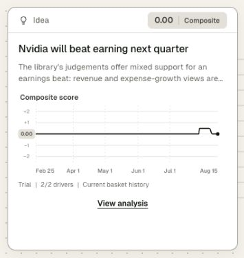

# D185 composite score trial

The current NVIDIA Idea now shows a thesis-style fractional score history. Two explicitly reviewed connected representatives have equal weights: total revenue v2 and current-year top-five capex v1, both with direction +1. At August 15 the raw states are -1 and +1; contributions are -0.50 and +0.50, giving **0.00**. The current basket's history is **0 through July 28 → +0.50 on July 29 → 0 on August 10**. [Calculation records](calculation.json).

Replay and the Full / Last 30 days controls update the score and chart together. The card shows Trial and 2/2 driver coverage. View analysis lists each representative, signed score, contribution and manual selection rationale. The card content stays inside its existing bounds. [Full page](page.png) · [Calculation panel](calculation.png).

This is an explicit UI trial, not a default automatic scorer or a probability of beating earnings. It uses a current basket retrospectively, not a historical record of the Idea's past composition. The underlying API supplies neither contribution directions nor independent representative selection; the dated trial input supplies those assumptions. Eight other connected theses remain visible without additional scoring weight. The lack of a next-quarter consensus benchmark is stated in the calculation panel.

Enable the reviewed example with `python3 scripts/mock_build.py --composite-trials poc/config/idea-composite-trial-2026-10-26.json`. Omitting the option builds the ordinary page with no trial basket. Only the exact input text, as-of date and matching immutable thesis questions enable this trial. Generic source code contains no company-specific IDs or direction guesses.

Verification: **33 UI tests**, **10 caught mutants**, and **151 Python tests** (14.66 s) pass. New checks use real stored data for historical cutoff, sign inversion, duplicate IDs, wrong identities, unrelated queries, missing/partial coverage, fractional plotting and latest-dot margins. Replacing the average with a sum fails the positive control. Both ordinary and trial build entry points were exercised. Lint and formatting pass. The final production JS is **150,571 bytes**, below the 200 KiB budget; current-library validation took **26.7 ms** in one local sample.

All three protected source database hashes are unchanged. The cached Idea response was reused; the model archive stayed at two rows. No model/prompt, extraction, grouping, matching or ledger schema changed. Automatic general scoring and persistent Idea composition history are outside this trial. [Check data](checks.json) · [UI tests](ui-tests.txt) · [Mutation checks](mutations.txt) · [Python suite](python-tests.txt) · [Documentation check](docs-check.txt).
