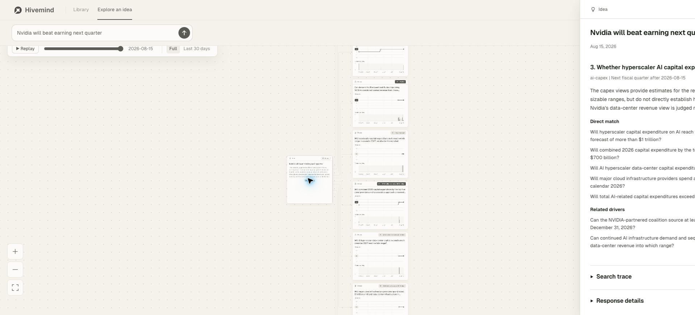

# D184 Idea analysis detail

The clipped text on an Idea card is the second model call's `reading.summary`. View analysis now opens a sliding detail panel with the entire summary, all per-part explanations and direct/driver/context choices, search queries and candidate titles, excluded choices when present, and the structured service response. It uses only the existing response, not a new model-generated explanation. No internal model reasoning stream is returned by this API.

The current user's cached response contains three parts, ten selected theses, and four search entries including the initial search. All are displayed; loaded titles also resolve context and searched-but-unselected records. Missing records are explicitly labelled unavailable. The summary has no line clamp. Expanding Search trace and Response details, closing with Escape, and reopening were verified in the actual page. The structured response view contains 9,800 characters for this case. [Search view](search-trace.png), [response](response.json), [checks](checks.json).

29 UI tests pass, including complete stored summaries, every part reason and search query, null/empty responses, missing-title fallback and escaped source text. Nine mutation checks pass; deliberately truncating the full summary fails the new check. The full Python suite passes 151 tests in 15.38 seconds. Lint and formatting pass. Production JS is 144,784 bytes, below the existing 200 KiB budget.

The two already-archived model calls were reused, with two rows before and after the browser checks. All three protected database hashes are unchanged. No prompt, model, matching, extraction, graph selection or backend response contract changed. [UI tests](ui-tests.txt), [mutations](mutations.txt), [Python tests](python-tests.txt), [documentation check](docs-check.txt).
