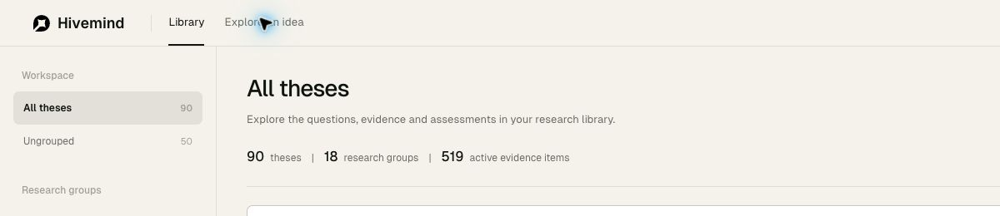

# D183 Idea send input and library statistics

The input now contains a round arrow button. Empty or whitespace input disables it and shows grey; text enables it and shows black. Click and Enter use the same form submission. The pending request disables submission; completion, failure or cancellation restores the state from the retained text. The composer is capped at 500px (half the previous 1000px); it fits narrower screens. The library statistics use two shared `|` separators.

Real-browser verification checked empty and whitespace input, no submission on whitespace Enter, a black enabled button with text, the button fully inside the input, disabled pending state, and Enter completion with ten chosen theses. The exact previously submitted user query was reused; model archive rows remained 2 before and after, so no new chat-model call was needed. The input measured 500px and the round button 32px. Statistics contained exactly two bar separators. [Check record](checks.json).

The same check exposed an initial-load race: the API read called `showLibrary()` after the user had entered the Idea view, hiding the form. The read now updates library data without navigating. The final browser checks entered Idea immediately after reload and the form stayed visible through completion of the background read.

27 UI tests pass, lint and formatting pass, and the full Python suite passes 151 tests in 15.59 seconds. No backend, model, prompt, data contract or collected database change. All three protected database hashes remain unchanged. The user-facing page is refreshed; both local services remain running. [Documentation check](docs-check.txt).
