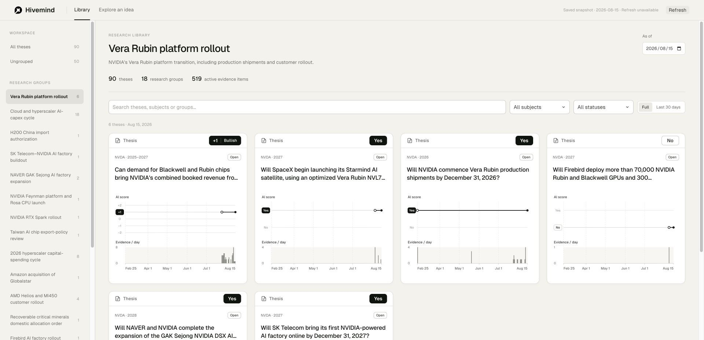

# Current-library frontend — measured result

The frontend now opens the collected English library directly: **90 theses and 18 stored research groups**, including **50 ungrouped theses**. The old default was a 42-thesis translated export accessible mainly through an Idea flow. No collected database was changed and no model or embedding call was made.

For example, selecting **Vera Rubin platform rollout** shows its six stored member theses at August 15, 2026. Selecting February 25 shows its one then-existing member. These are peers in a research group; the page invents no parent, group score or dependency.

[Open the generated page](../../mock/index.html) · [Implementation contract](../../../docs/research/2026-10-26-library-ui/plan.md) · [Reasoning refresh](../../../docs/research/2026-10-26-library-ui/refresh.md) · [Measurements](measurements.json)

## What changed and why

- The new library view offers group, subject, status, text and date filters. Cards, charts and the animated detail drawer remain shared with the explicit Idea flow.
- HTTP `GET /library`, MCP `thesis_library` and the standalone build share one read-only projection. Its default ledger is `english-v23-jev-2026-10-25/views.sqlite`, paired with `items-window-tags2-2026-10-24.sqlite`. API/MCP and Docker paths agree; Docker data mounts remain read-only.
- `thesis-ui/2` exposes identity, all source records, dated group membership, replacements, dependency resolution and other-period links. A single adapter preserves older exports. `createLibrary` is exposed through the public package entry and the standalone build.
- A replacement becomes visible when recorded, not on the date of the quoted statement. Historical citations use their judgement's date. Evidence IDs in reasons become links to the evidence, and source provenance preserves speaker, publisher, original date and event period.
- Snapshot replacement validates first, replaces scoped IDs as a whole and clamps the selected date. A failed refresh retains the current data and filters with an explicit saved-snapshot label.

## Population and coverage

| Stored population | Count / verification |
|---|---|
| Theses / identity records | 90 / 90 retained |
| Judgements | 227 |
| Distinct evidence / active at August 15 | 534 / 519 |
| Evidence links / source records | 716 / 784; each linked source list checked |
| Evidence with more than one source | 99; all sources now projected |
| Groups / memberships | 18 / 51 retained; 40 distinct grouped theses |
| Replacement records | 15; 25 earlier citations across 13 later-replaced evidence records checked |
| Dependencies / resolutions / succession | 0 / 0 / 0 in current ledger; temporary real storage covers dated cases, legacy corpus covers existing dependencies |
| Non-day original dates | 4 current, 31 legacy; preserve their free text rather than refusing months/ranges |

## Verification

| Check | Measured result |
|---|---|
| Full Python suite | **151 passed in 14.92 s**; [raw output](python-tests.txt) |
| UI suite | **27 passed**; current corpus plus 42 English, 42 original-language and 94 legacy live theses; [raw output](ui-tests.txt) |
| Mutation checks | **8 rejected**, including future membership, premature replacement, future sources and incorrect Idea parent assignment; [raw output](mutations.txt) |
| Browser style regression | A scratch build omitting the library host style scope fails its independent-host check; [browser results](browser-checks.txt) |
| ESLint / Prettier / public package import | Passed |
| Browser lifecycle on final build | **8 passed**: standalone host styling, invalid update preservation, date clamping, narrow canvas snapshot, teardown, empty data, restore and unique IDs |
| Browser product path | Group/date navigation, metadata, current evidence links, historical selection and score definitions verified; Idea navigation preserves the selected group; API failure retains all six selected cards |
| Docker configuration | Both services resolve to English ledger/items with read-only mounts and a separate service directory; configuration inspected, containers not launched |
| Source integrity | All **3 protected database SHA-256 hashes unchanged**; [baseline](../../../docs/research/2026-10-26-library-ui/baseline.json) |

Browser developer logs showed an unrelated wallet-extension injection error, not an application exception. Stopping the test API deliberately produced a network failure and the expected saved-snapshot state. The temporary local API and page server were stopped after verification.

## Size and timing

Production JavaScript is **141,125 bytes**, below the existing 200 KiB budget. The complete standalone HTML is **1,684,246 bytes**. The final full-corpus validation sample is **25.3 ms**, below 200 ms. Browser initial render samples were **26.7 ms, 23.1 ms and 22.9 ms**; the last used the final build. One local full-library HTTP read took **0.240 s** for **1,919,101 bytes**. These are local measurements, not a production load test.

## Limits

The current ledger itself has overlapping capex groups and no dependency/succession records. This slice faithfully displays those facts and does not repair extraction or infer missing relations. Existing Idea model configuration remains `poc-v9`; semantic index construction and fresh paid Idea validation on the English ledger were not run. No production deployment, commit or push is included. The concurrent acceleration work remains intact.

The final documentation check is recorded in [docs-check.txt](docs-check.txt), after the reasoning refresh. Initial Python collection without the repository import paths failed before running tests; the corrected invocation uses `PYTHONPATH=src:poc` and the configured Python environment. That failed collection is preserved separately and is not counted as a product failure or a passing test.
