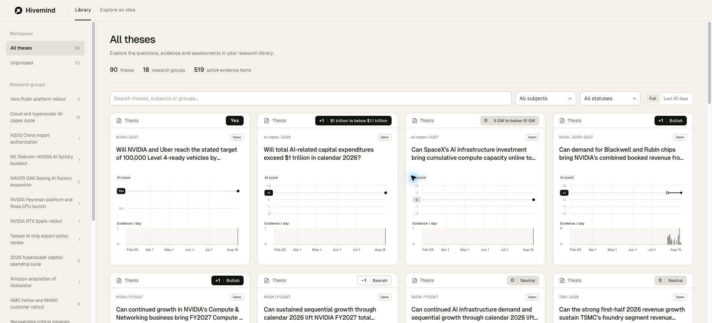

# D182 frontend presentation cleanup

The four requested interface elements are removed: connection/Refresh area, Research library eyebrow, As of date picker and duplicate count/date row. Workspace and Research groups use sentence case. Card subject/year and dependency metadata use the shared `|` separator. Both library and evidence pagination say “Show more”. Removed controls, event handlers and unused CSS were removed together.

The rule is owned by [the UI specification](../../../docs/poc/thesis-ui.md#presentation-rules), with a pointer in AGENTS. [Scope and census](../../../docs/research/2026-10-26-library-ui/presentation-cleanup.md) and [reasoning refresh](../../../docs/research/2026-10-26-library-ui/refresh.md) explain the change. The default page still loads the available dated snapshot and makes its existing optional API read. No source data or quotation was reformatted.

Verification: 27 UI tests, eight existing mutation checks, lint and formatting pass. The full Python suite passes 151 tests in 14.56 seconds. Nine real-browser lifecycle checks pass. The open product page has zero removed controls, sidebar text is Workspace / Research groups, and card metadata reads NVDA | 2027. “Show more” increases rendered cards from 24 to 48. The API was unavailable during browser verification; the saved library remained usable without the removed status area. All three protected database hashes are unchanged. No model calls were made.

The production JavaScript is 139,995 bytes. Full-corpus validation took 25.2 ms in one local sample; the lifecycle page's initial render took 25.1 ms in one sample. [Machine-readable results](checks.json), [UI output](ui-tests.txt), [mutation output](mutations.txt), [Python output](python-tests.txt) and [documentation check](docs-check.txt) are retained.
